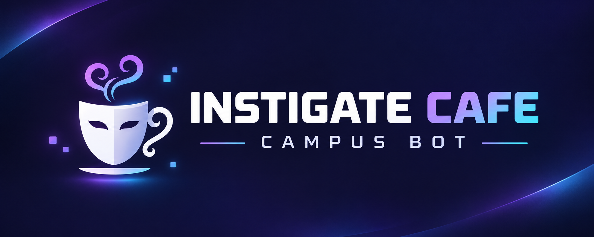

<p align="left">
  
</p>

# Instigate Cafe Bot

A modular, self-hostable Discord slash-command bot (`/ic`) for student communities—combining academic schedules and course resources, early-career job feeds, optional consent-based AI resume review, regional transit/market feeds, and a virtual campus economy backed by SQLite (WAL mode).

[](pyproject.toml)
[](https://www.python.org/)
[](LICENSE)
[](https://github.com/sukesan7/instigate-cafe-bot/actions/workflows/ci.yml)

---

## Overview

Instigate Cafe Bot runs strictly on Discord application commands under `/ic` (53 commands across 17 feature modules) and optional background pollers managed by a single-instance `TaskSupervisor`.

All optional integrations default to disabled so a fresh checkout can be tested completely offline without tokens, secrets, or live Discord connections. Core features require only a `DISCORD_TOKEN`; third-party API keys (`GEMINI_API_KEY`, `GO_API_KEY`, `ODDS_API_KEY`) are optional and degrade cleanly when omitted.

---

## Features

| Area | What It Does | Optional / Scope Notes |
| :--- | :--- | :--- |
| **Academics** | Shared server exam calendar with `.ics`/CSV export, RateMyProfessors ratings, course study-guide links, and grade distributions. | `/ic exam` works for any school. Default `/ic notes`, `/ic grades`, and default `RMP_UNIVERSITY` target **TMU** (see [Limitations](#campus-and-operational-limitations)). |
| **Careers** | Searches cached Greenhouse, Lever, and Workday intern/new-grad postings, saves personal filter preferences, and posts guild job alerts. | No API key required; feeds are polled only when board lists and `JOBS_POLL_SECONDS` are configured. |
| **AI Resume Assistance** | Ephemeral PDF/image resume critique with a mandatory pre-transmission consent barrier (`ResumeConfirmView`) and an instant offline No-AI checklist. | **Optional & consent-based.** Requires `LLM_ENABLED=true` and `GEMINI_API_KEY`. Processed in RAM only (zero local disk/SQLite persistence); Discord CDN and Gemini API terms apply. |
| **Community & Economy** | Guild-scoped virtual tokens, daily allowance, net-worth leaderboard, ICSE virtual stock exchange, and unit-tested PRNG game engines (Blackjack, Roulette, Slots). | Runs offline on an atomic SQLite WAL ledger. Purely virtual currency with no real-money transactions. |
| **Transit & Market Feeds** | Background alerts for GO Transit and TTC delays, Yahoo Finance market snapshots/volatility alerts, optional Bitcoin address watcher, and sports schedules/headlines. | **Optional & location/source-dependent.** GO (`GO_API_KEY`) and TTC Mastodon target Toronto/GTA; sports odds use optional `ODDS_API_KEY`. |
| **Administration** | Interactive `/ic admin setup` wizard, per-guild feature profiles/toggles, role delegation, config audit log, redacted `/ic status` reports, and `/ic admin llm_stop`. | Requires Discord `Manage Server` / `Administrator` or configured `ALLOWED_ROLE_IDS`. |

---

## Representative Commands

All commands live under `/ic`. A few common starting points:

| Command | Purpose |
| :--- | :--- |
| `/ic getting-started` | Interactive 4-step walkthrough for new members. |
| `/ic help` | Dynamic command directory filtered to modules enabled in your server. |
| `/ic exam list` | Upcoming shared guild exams (private exams automatically reply ephemerally). |
| `/ic notes` | Course study-guide lookup with alias normalization and SSRF-validated links. |
| `/ic jobs` | Search cached early-career ATS job postings with HTTPS-only apply links. |
| `/ic resume` | Ephemeral AI resume review (with explicit consent) or offline self-review checklist. |
| `/ic icse market` | View active listings and weekly changes on the virtual campus stock exchange. |
| `/ic admin setup` | Guided server setup for channels, campus preset, and enabled feature modules. |
| `/ic status` | Inspect module readiness, SQLite Schema v7 WAL health, and redacted issue reports. |

See [Features & Command Guide](docs/features.md) for all 53 verified slash commands and options.

---

## Self-Hosted vs. Hosted Public Bot

- **Self-Hosted Open-Source Release (Recommended):** Clone this repository, create your own Discord Application, supply your own optional API keys, and keep the SQLite database (`DB_PATH`) on your own host. No Discord `>100`-server verification is needed, and you remain the sole Data Controller for your community.
- **Publicly Inviteable Hosted Bot (Not Operated Here):** Running a single shared instance across `>100` servers requires Discord Bot Verification, restricted Message Content Intent (slash commands only), multi-tenant operational governance, and maintainer-funded API quotas.

See [Deployment, Hosting & Disaster Recovery](docs/deployment.md) for Docker Compose, `systemd`, and Railway setup.

---

## Campus and Operational Limitations

- **TMU & Toronto defaults:** Out-of-the-box study guides (`/ic notes`), grade distributions (`/ic grades` via `tmu.grades.zone`), default `RMP_UNIVERSITY` (`Toronto Metropolitan University`), and transit pollers (Metrolinx GO, TTC Mastodon) target Toronto Metropolitan University and the Greater Toronto Area. Other institutions can override `RMP_UNIVERSITY`, `CAMPUS_ID`, `EXAMS_TZ`, and `NOTES_SITES` or add an adapter (see [Provider Guide](docs/providers.md)).
- **Privacy & storage boundaries:** The bot stores persistent state in local plaintext SQLite (`DB_PATH`); host-level disk encryption is the operator's responsibility. No channel messages are written to local disk or SQLite, and **no automatic channel-history collection occurs by default** (`LLM_CHANNEL_HISTORY_ENABLED=false`). Resumes are never written to local disk or SQLite, though attachments and AI requests transit Discord CDN and Google Gemini under their respective policies.
- **Single active replica:** SQLite WAL and scheduled pollers require `replicas: 1` per database.
- **Virtual economy & games:** Casino games use standard Python PRNG (`unit-tested PRNG game engines`), not a cryptographic commit-reveal protocol. Market tools are educational simulations, not financial advice.

For claim-by-claim test traceability and unverified live-staging items, see [Release Claims & Verification Evidence](docs/release-evidence.md).

---

## Quick Start

Requires **Python 3.12** (recommended managed environment; 3.11 and 3.13 are also tested in CI; Python 3.14+ is not yet supported) and [`uv`](https://docs.astral.sh/uv/).

### 1. Canonical Setup & Offline Verification (No Tokens Required)

```bash
git clone https://github.com/sukesan7/instigate-cafe-bot.git
cd instigate-cafe-bot

# Provision managed Python 3.12 (avoids conflicts on Arch/Garuda hosts with system Python 3.14)
uv venv --python 3.12
uv sync --frozen --dev

# Run the full no-network, no-token contributor verification suite
uv run python tools/verify_offline.py
```

*(Fallback without `uv`: create a Python 3.12 virtual environment and install the generated runtime lock with `python3.12 -m venv .venv && .venv/bin/pip install -r requirements.txt` — or `--require-hashes -r requirements.lock` — then run `.venv/bin/python tools/smoke_offline.py` and `uv run pytest` / `.venv/bin/pytest`.)*

### 2. Configure and Run Locally

All optional modules (`LLM_ENABLED`, `MARKET_WATCH_ENABLED`, `BTC_WATCH_ENABLED`, `WORKDAY_POLL_SECONDS=0`) default to off in [`.env.example`](.env.example). Live Discord connections are blocked by default until `--allow-gateway` (or `ICBOT_ALLOW_GATEWAY=true`) is explicitly passed.

```bash
cp .env.example .env
chmod 600 .env
# Set DISCORD_TOKEN and GUILD_ID in .env (plus any optional provider keys)

uv run python main.py --allow-gateway
```

---

## Screenshots / Gallery

*Reserved for verified, redacted screenshots captured on an owner-run staging server after development completes. No placeholder or AI-generated UI mockups are included here.*

Maintainers preparing gallery captures should follow [Screenshots Capture & Redaction Guide](docs/screenshots-guide.md) to ensure user IDs, tokens, private channels, and personal records are cropped or redacted before committing images.

---

## Documentation & Community

- [Documentation Index](docs/README.md) — Full map of user, operator, and contributor guides
- [Features & 53-Command Guide](docs/features.md) — Complete slash-command reference
- [Configuration Reference](docs/configuration.md) — All environment variables and per-guild overrides
- [Deployment & Recovery](docs/deployment.md) — Docker Compose, `systemd`, Railway, and SQLite WAL backups
- [Privacy & Data Model](docs/privacy.md) — Data flows, ephemeral resume handling, and user data export/erasure
- [Security Policy](SECURITY.md) — Vulnerability disclosure and secret incident response
- [External Providers & Campus Extensions](docs/providers.md) — Provider limits, SSRF rules, and adding a university adapter
- [Troubleshooting](docs/troubleshooting.md) — `/ic status` diagnostics, failure taxonomy, and recovery steps
- [Contributing](CONTRIBUTING.md) & [Development Guide](docs/development.md) — Local workflow, safety tiers, and PR gates
- [Issues & Feature Requests](https://github.com/sukesan7/instigate-cafe-bot/issues) — Bug reports and proposals

---

## License & Attribution

- Source code is licensed under the [MIT License](LICENSE) (Copyright &copy; 2026 sukesan).
- "Instigate Cafe" branding and `assets/ic_logo.png` are reserved by the Instigate Cafe community.
- External course notes remain the copyright of their student authors (**Jasper Cruz** and **Krish Patel**); transit data follows the [Metrolinx Open Data Licence](https://www.metrolinx.com/en/about-us/open-data) and public TTC Mastodon feeds.
