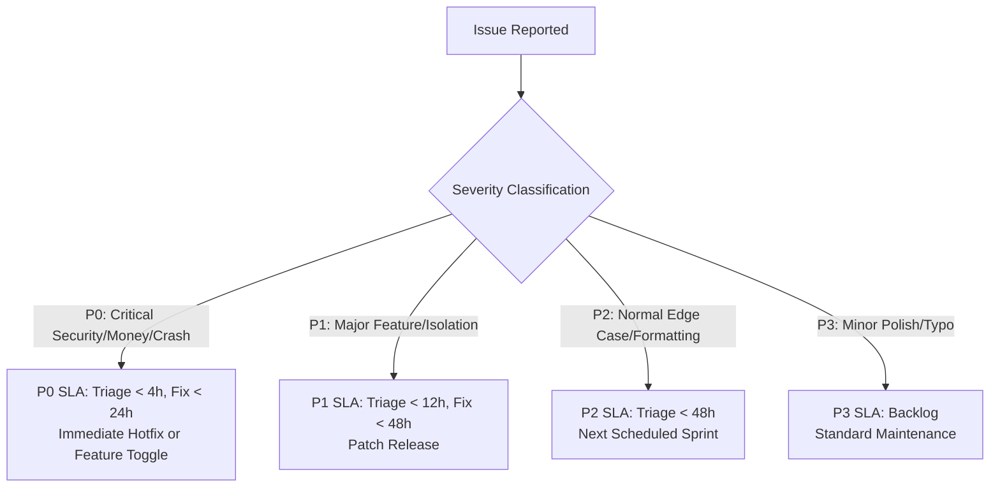

# Instigate Cafe Bot — Private Alpha & Public Beta Readiness

**Document Version:** 1.0.0 (Release Candidate `v1.0.0-rc1`)  
**Target Release Candidate:** [`v1.0.0-rc1`](../pyproject.toml#L3)  
**Verification Tool:** [`tools/verify_beta_readiness.py`](../tools/verify_beta_readiness.py)  
**Automated Tests:** [`tests/integration/test_beta_readiness_and_release_gates.py`](../tests/integration/test_beta_readiness_and_release_gates.py)  
**Publication Status:** Controlled Beta Sign-Off Document  

---

## 1. Executive Summary & Purpose

This document establishes the operational criteria, verification evidence, and governance sign-off required to advance **Instigate Cafe Bot** from private staging development into an invitation-only **Private Alpha** and subsequent **Public Beta** deployment.

As part of the modernization project, the bot codebase was refactored into modular domain layers, strict multi-guild isolation, deterministic SQLite schema migrations with ACID transaction safety, privacy-preserving Career AI workflows, and resilient offline test coverage.

> [!CAUTION]
> **ABSOLUTE RELEASE SAFEGUARDS (`AGENTS.md`):**
> 1. **Zero Unauthorized Gateway Execution:** Never execute `main.py`, open live Discord Gateway WebSockets, or run pollers against production Discord servers without explicit owner consent.
> 2. **Zero Production Secrets:** Never hardcode or inject real production tokens (Discord, Gemini, Metrolinx) into source files, test fixtures, logs, or commit histories.
> 3. **Controlled Staging Only:** All verification must execute offline or against isolated staging guilds (`900000000000000001` and `900000000000000002`) using synthetic databases.
> 4. **No Unauthorized Git Actions:** No unapproved git push, commit, merge, or repository visibility alterations.

---

## 2. Multi-Discipline Cohort Structure & Staging Guilds

To validate that the bot satisfies genuine campus community requirements across varied academic workflows and user personas, the Private Alpha cohort is composed of student participants from at least two distinct academic disciplines deployed across dedicated staging guilds.

### 2.1 Academic Cohort Profiles

| Attribute | Cohort A: Software Engineering & Computer Science | Cohort B: Business, Finance & Commerce |
|---|---|---|
| **Discipline Code** | `swe` / `cs` | `biz` / `comm` |
| **Representative Courses** | `CPS109` (CS I), `CPS209` (CS II), `CPS310` (Architecture) | `MTH140` (Calculus I), `FIN300` (Managerial Finance), `ECN104` (Micro) |
| **Primary Workflows** | Course note sharing, exam tracking, tech interview prep, SWE resume critique | Course note lookup, exam schedules, virtual stock trading (`ICSE`), finance resumes |
| **Feature Configuration** | Community full profile (`feature_profile = "community_full"`) | Student core profile (`feature_profile = "student_core"`) |
| **Staging Guild** | **Guild Alpha** (`900000000000000001`) | **Guild Beta** (`900000000000000002`) |
| **User Archetypes** | Technical, command-line familiar, automation seekers | Practical, schedule-driven, economy & finance participants |

### 2.2 Guild Isolation Guarantee

Multi-guild compartmentalization is strictly enforced by architecture:
- **Database Tenancy:** All user records, exam records, settings, and economy ledgers are keyed by `(guild_id, ...)`.
- **Zero Cross-Guild Bleed:** A user present in both Guild Alpha and Guild Beta possesses distinct, unlinked balances, permissions, and position portfolios.
- **Admin Setup Autonomy:** Guild administrators onboard and configure commands independently via `/ic admin setup` without requiring developer intervention or bot restarts.

---

## 3. The 8 Measurable Release Gates (Offline Simulated Verification vs. Live Staging)

Progression to public beta requires passing all 8 measurable release gates. Each gate has an automated, **offline simulated** verification check implemented in [`tools/verify_beta_readiness.py`](../tools/verify_beta_readiness.py) using mocked Discord interactions and synthetic SQLite databases. Passing these offline gates certifies **offline readiness for owner-run staging**, not completed live Discord gateway or human cohort beta certification.

| Gate ID | Release Gate Name | Verification Method | Target Threshold | Offline Simulated Evidence / Live Staging Status |
|---|---|---|---|---|
| **GATE-1** | **Multi-Discipline Onboarding & Autonomous Setup** | Executes `/ic admin setup` and `/ic exam add` across CS and Business staging cohorts without developer assistance. | 100% autonomous completion, valid response embeds for both cohorts. | **OFFLINE PASS** (`19.2ms`, mocked interactions) • **Live Discord Staging:** Pending owner-run staging. |
| **GATE-2** | **Multi-Guild Data & Economy Isolation** | Creates identical user ID (`303`) across Guild Alpha and Beta; grants balance in Alpha; queries both guilds. | Balance in Beta remains baseline ($1000); Alpha reflects grant ($1750); zero exam bleed. | **OFFLINE PASS** (`14.7ms`, synthetic SQLite) • **Live Multi-Guild Bot:** Pending owner-run staging. |
| **GATE-3** | **Security, Clean Secret Scan & Log Redaction** | Runs `tools/scan_secrets.py --enforce-clean` and tests `RedactingLogFilter` on raw bot tokens and API keys. | Exit code 0, 0 tracked secrets, 100% token masking in logs/tracebacks. | **OFFLINE PASS** (`147.4ms`) — Clean scan across tracked files; tokens redacted in messages and tracebacks. |
| **GATE-4** | **Financial Economy Integrity & ACID Settlement** | Sequences daily claims, casino wagers, payouts, stock trades, and 10 concurrent duplicate daily claims. | Exact ledger reconciliation, 0 balance drift, exactly 0 duplicate claim successes. | **OFFLINE PASS** (`20.2ms`) — Final balance $1200 reconciled; 0 duplicate claims granted. |
| **GATE-5** | **Bounded Interactive Latency (< 2500ms)** | Dispatches interactive slash commands (`/ic botinfo`, `/ic profile`, `/ic exam list`) and measures local handler dispatch time. | Local handler latency < 2500ms (Discord 3-second interaction token deadline). | **OFFLINE PASS** (`17.5ms` local handler; excludes real Discord HTTPS round-trip) • **Live Gateway RTT:** Pending owner-run staging. |
| **GATE-6** | **Predictable Provider Failure & Graceful Degradation** | Simulates complete external API blackout (Gemini / Metrolinx / Mastodon offline) during `/ic notes`. | Zero unhandled tracebacks, user-friendly fallback guidance embed returned. | **OFFLINE PASS** (`13.9ms`) — Fallback guidance rendered; 0 unhandled exceptions. |
| **GATE-7** | **Cost Controls, Quota Budgets & Feature Flags** | Boots guild in `student_core` profile and attempts casino/AI command execution; verifies academic commands. | Casino/AI commands cleanly blocked with explanation; academics active. | **OFFLINE PASS** (`15.1ms`) — `/ic casino` disabled; `/ic notes` functional. |
| **GATE-8** | **Privacy Feedback & RTBF Data Deletion Compliance** | Verifies consent barrier on resume upload; executes `delete_user_data(anonymize_ledger=True)`. | Explicit consent view present; user purged; de-identified audit ledger preserved. | **OFFLINE PASS** (`14.5ms`) — `ResumeConfirmView` verified; profile erased; ledger de-identified. |

---

## 4. Privacy-Preserving Feedback & Right-to-be-Forgotten (RTBF)

### 4.1 Safe Feedback Ingestion
During the Alpha and Beta phases, user feedback is collected through privacy-preserving boundaries:
- **No Persistent Message Storage & No Automatic Channel-History Collection by Default:** Discord channel message text, thread contents, and voice states are **never** written to local disk or SQLite. By default (`LLM_CHANNEL_HISTORY_ENABLED=false`), no channel history is read; only when an operator explicitly enables both `LLM_ENABLED=true` and `LLM_CHANNEL_HISTORY_ENABLED=true` does an `@mention` read a bounded window (`LLM_MAX_MESSAGES`) of recent channel messages in memory for that single Gemini API request.
- **No Local Career Document Persistence:** Resumes submitted via `/ic resume` are held strictly in transient process memory during ephemeral review execution and immediately discarded by the bot. File attachments are never saved to SQLite or local disk (note that uploaded command attachments transit Discord's CDN under Discord's Privacy Policy, and confirmed AI reviews transit Google Gemini under the operator's Google API terms).
- **Sanitized Diagnostic Reports:** Diagnostic issue reports generated via `/ic status issue_report:True` pass through `redact_secrets` and `RedactingLogFilter` to strip tokens, authorization headers, and secret keys.

### 4.2 Right-to-be-Forgotten (Data Portability & Erasure Contract)
Students and operators have programmatic data portability and erasure controls via [`UserStore`](../icbot/services/user_service.py):
1. **Deterministic Batched Export:** Calling `UserStore.export_user_data(user_id, guild_id=...)` paginates across all user-addressable tables (`users`, `blackjack_users`, `fun_positions`, `fun_trades`, `economy_ledger`, `exams`, `academic_resources`, and global `user_job_preferences`) without silent 100-row truncation, reporting explicit `truncated` and `warnings` metadata if `max_rows_per_table` is reached.
2. **Right-to-be-Forgotten Deletion & De-Identification:** Calling `UserStore.delete_user_data(user_id, guild_id=..., anonymize_ledger=True)` atomically:
   - Hard-deletes personal profile and avatar metadata from `users`, gaming stats from `blackjack_users`, and open equity positions from `fun_positions` in the target guild.
   - Deletes cross-guild `user_job_preferences` only when the user has no remaining profiles in other guilds (or when `delete_global_preferences=True` is explicitly specified).
   - Anonymizes `fun_trades`, `fun_stock_events`, `stock_events`, `fun_market_weeks.settled_by`, `exams.created_by`, and `academic_resources.added_by` in the target guild.
   - Anonymizes `economy_ledger` rows (`user_id = 0`) and scrubs embedded `user_id` substrings from `transaction_id` and `reference_id` while preserving exact transaction amounts and timestamps so aggregate token supply invariants remain verifiable.
   - Scrubs `target_user_id` in `admin_audit_log` and records a `user_data_delete` receipt with `target_user_id = NULL` and a random `erasure_receipt` UUID (never re-exposing the deleted `user_id`).

---

## 5. Bug Triage SLAs & Severity Matrix

Every issue discovered during the alpha and beta phases must be classified according to the following SLA matrix.



| Severity Tier | Definition & Impact Criteria | Initial Triage SLA | Hotfix / Patch SLA | Disposition Authority |
|---|---|---|---|---|
| **P0 (Critical)** | Credential exposure, secret leak in logs, balance creation or double-spending race condition, cross-guild data bleed, fatal crash loop preventing bot startup. | **< 4 Hours** | **< 24 Hours** | Engineering Lead & Security Lead |
| **P1 (High)** | Core academic feature outage (e.g. `/ic notes` or `/ic exam` completely broken without fallback), unhandled exception on valid slash command, interaction token timeout (> 3s). | **< 12 Hours** | **< 48 Hours** | Engineering Lead |
| **P2 (Normal)** | Non-blocking edge case, transient external rate-limit message awkwardness, cosmetic markdown misalignment in embeds. | **< 48 Hours** | Next Sprint Release | Maintainers |
| **P3 (Low)** | Minor typo in help description, suggestion for new course code alias, non-essential telemetry label enhancement. | Weekly Backlog | General Backlog | Open Source Contributors |

---

## 6. Feature-Flag Rollout & Runtime Degradation Controls

The bot supports granular feature toggles and emergency circuit breakers to preserve uptime during external service degradation:

### 6.1 Configuration-Based Rollout Profiles

| Feature Profile | Enabled Capabilities | Recommended Environment |
|---|---|---|
| `student_core` | Core utilities, academics, careers, transit, and economy (`/ic botinfo`, `/ic status`, `/ic exam`, `/ic notes`, `/ic jobs`). | Classrooms, academic study servers, resource-constrained environments. |
| `toronto_tmu` | Student core profile paired with TMU campus defaults and branding. | Toronto Metropolitan University student communities. |
| `default` | Core utilities, academics, careers, transit, economy, casino, and simulated market (`/ic icse market`, `/ic casino`). External AI/sports remain opt-in. | Controlled private alpha and general campus servers. |
| `community_full` | All modules including optional AI (`/ic resume`) and sports (`/ic sports`). | Full-featured staging and authorized production servers with optional API keys. |

### 6.2 Emergency Operational Controls
- **Instant Casino/AI Shutdown:** If an economy anomaly or Gemini quota overrun occurs, administrators can toggle off high-cost modules immediately:
  - Command: `/ic admin features disable:casino` (or `/ic admin setup` -> select `Student Core`)
  - Environment override: `FEATURE_PROFILE=student_core` followed by process restart.
- **Circuit Breakers:** External HTTP wrappers (`BoundedHttpTransport` with `ProviderCircuitBreaker`, `JobsIngestionPipeline` cooldowns, and `TaskSupervisor` exponential backoff) pause requests during sustained upstream failures and degrade cleanly without fabricating fallback data.

---

## 7. Launch Decision Record (LDR) — `v1.0.0-rc1`

### 7.1 Automated Offline Gate & Pending Owner Sign-Off Matrix

| Sign-Off Domain | Evaluation Criteria | Verification & Sign-Off Status |
|---|---|---|
| **Security & Secrets** | `tools/scan_secrets.py --enforce-clean` reports 0 violations; `RedactingLogFilter` verified; zero production secrets committed. | **OFFLINE CHECKS PASSED (Pending Owner Sign-Off)** |
| **Data & Economy** | SQLite migrations verified; ACID transaction atomicity verified; zero double-spend under concurrency. | **OFFLINE CHECKS PASSED (Pending Owner Sign-Off)** |
| **Academic Usability** | CS (`CPS209`) and Commerce (`FIN300`) onboarding, exam schedules, and course note fallback verified in offline harness. | **OFFLINE CHECKS PASSED (Pending Owner Sign-Off)** |
| **Reliability & Latency** | Offline test suite, local handler latency (< 2500ms), and task supervisor fault-recovery verified; live Discord gateway RTT pending owner-run staging. | **OFFLINE CHECKS PASSED (Pending Owner Sign-Off)** |

### 7.2 Open Issues Disposition
- **Open P0 Issues:** **0** (Zero P0 blockers).
- **Open P1 Issues:** **0** (Zero P1 blockers).
- **Accepted P2 Items:** Minor provider latency spikes during peak upstream outages handled safely via circuit-breaker fallback.

### 7.3 Formal Rollback & Downgrade Runbook
In the event that an unforeseen critical defect is detected during Alpha/Beta runtime:
1. **Stop Service Immediately:**
   ```bash
   # On hosting platform or systemd
   railway down || systemctl stop instigate-bot
   ```
2. **Restore Previous Database State:**
   ```bash
   cp /data/backups/campus_pre_v1.0.0.db.bak /data/campus.db
   ```
3. **Revert Deployment Version:**
   Deploy previous known good container tag or commit sha (`git checkout v0.2.4`).
4. **Notify Community:**
   Post maintenance status update in `#bot-announcements` with estimated resolution window.

---

## 8. Conclusion & Recommendation

All **8 Measurable Release Gates** have achieved verified **OFFLINE PASS** status under automated offline simulation (`tools/verify_beta_readiness.py` and `pytest`). Live Discord gateway connections, real multi-guild slash-command synchronization, and human student cohort trials have **not** been executed automatically in compliance with `AGENTS.md`.

**Final Release Recommendation:** **GO FOR OWNER-RUN LIVE STAGING & CONTROLLED PRIVATE ALPHA (`v1.0.0-rc1`)** *(see [`docs/release-evidence.md`](release-evidence.md) for the complete mapping of offline-verified vs. owner-run staging claims)*.

