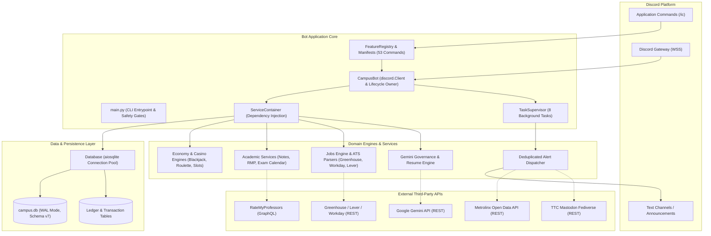
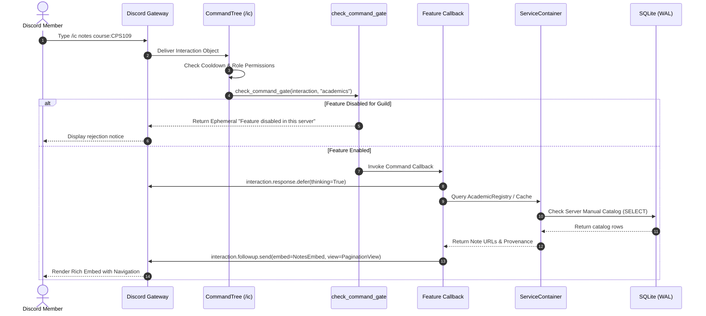
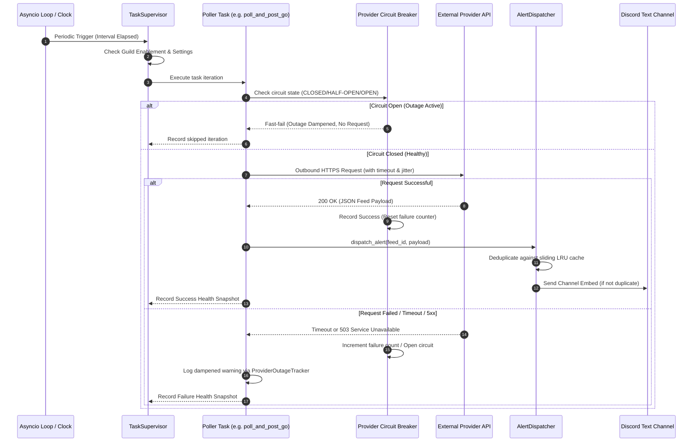
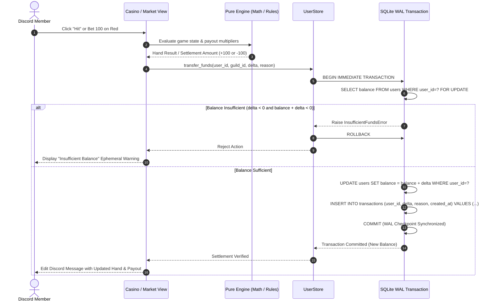

# Instigate Cafe Bot — System Architecture & Execution Flows

**Version:** 2.0.0 (Modernized Service Architecture)  
**Storage Engine:** SQLite 3 in Write-Ahead Logging (WAL) mode  
**Framework:** Python 3.11+ / Discord.py 2.3+ (`app_commands`)  
**Design Principles:** Modular service container, strict dependency injection, single-instance scheduler ownership, and zero-token offline testability.

---

## 1. System Component Architecture

The modernized Instigate Cafe Bot is structured around a centralized **Service Container** and **Feature Registry** that decouple presentation (Discord UI interactions) from business logic, data persistence, and external HTTP providers.

---

## 2. Sequence Diagram 1: Slash Command Execution Flow

This diagram illustrates how an incoming slash command (e.g. `/ic notes`, `/ic profile`, `/ic exam list`) is routed, authenticated, guarded by module enablement rules, and resolved:

---

## 3. Sequence Diagram 2: Periodic Background Poller Flow

This diagram illustrates how the `TaskSupervisor` schedules and executes background loops (e.g. transit alerts, job ingestion) with circuit breakers, exponential backoff, and deduplicated channel announcements:

---

## 4. Sequence Diagram 3: Atomic Economy & Market Transaction Flow

This diagram illustrates how casino games (Blackjack, Roulette, Slots) and virtual stock trades (`/ic icse buy/sell`) execute with double-entry balance verification, ACID invariants, and immediate WAL synchronization:

---

## 5. Lifecycle Management and Clean Shutdown

The application guarantees clean process lifecycle handling through [`CampusBot._cleanup_runtime()`](file:///home/sukesan/dev/discord/campus-bot/icbot/bot.py):
1. **Signal Interception:** `SIGTERM` or `SIGINT` triggers `CampusBot.close()`.
2. **Supervisor Cancellation:** All active background asyncio tasks are cancelled with `supervisor.stop_all()`.
3. **HTTP Session Teardown:** Open `aiohttp.ClientSession` pools are drained and closed.
4. **Database Checkpointing:** SQLite WAL log is flushed and the connection is closed cleanly, preventing database corruption or stranded lock files.

