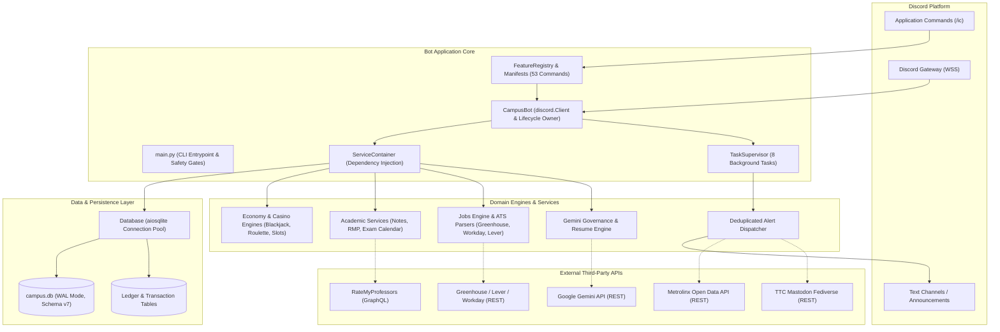
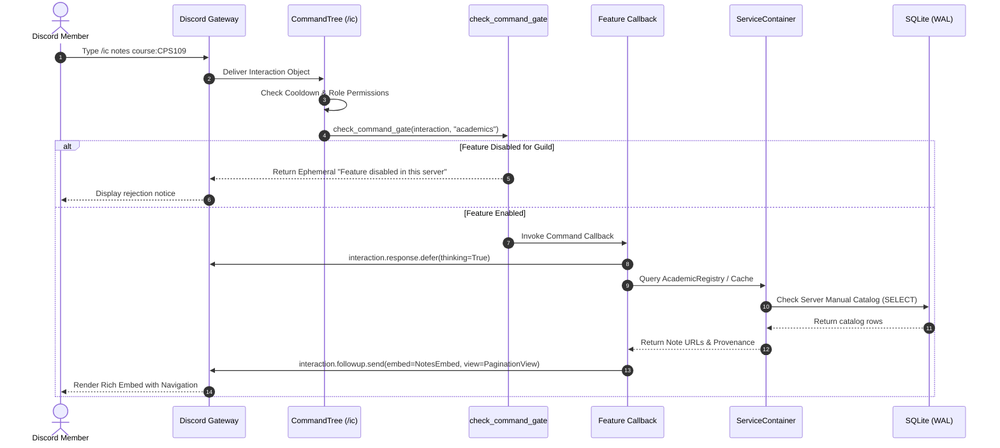
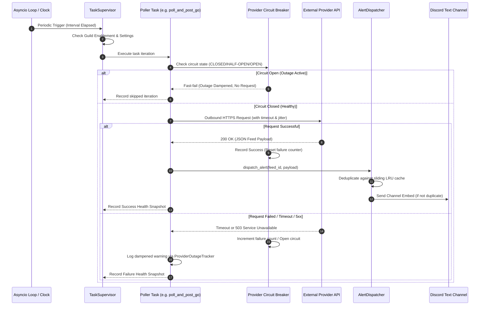
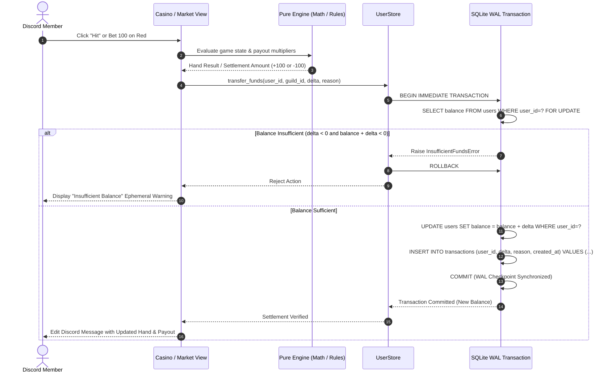

# Instigate Cafe Bot — System Architecture & Developer Reference

**Release:** `v1.0.0-rc1` (Modular Service Architecture)  
**Storage Engine:** SQLite 3 in Write-Ahead Logging (WAL) mode (Schema v7)  
**Framework:** Python 3.11–3.13 / `discord.py` 2.3+ (`app_commands`)  
**Design Principles:** Zero import-time side effects, centralized `ServiceContainer` dependency injection, single-instance `TaskSupervisor`, and zero-token offline testability.

---

## 1. System Component Architecture

The modernized Instigate Cafe Bot is structured around a centralized **Service Container** and **Feature Registry** that decouple presentation (Discord UI interactions) from business logic, data persistence, and external HTTP providers.

---

## 2. Sequence Diagram 1: Slash Command Execution Flow

This diagram illustrates how an incoming slash command (e.g. `/ic notes`, `/ic profile`, `/ic exam list`) is routed, authenticated, guarded by module enablement rules, and resolved:

---

## 3. Sequence Diagram 2: Periodic Background Poller Flow

This diagram illustrates how the `TaskSupervisor` schedules and executes background loops (e.g. transit alerts, job ingestion) with circuit breakers, exponential backoff, and deduplicated channel announcements:

---

## 4. Sequence Diagram 3: Atomic Economy & Market Transaction Flow

This diagram illustrates how casino games (Blackjack, Roulette, Slots) and virtual stock trades (`/ic icse buy/sell`) execute with double-entry balance verification, ACID invariants, and immediate WAL synchronization:

---

## 5. Lifecycle Management, Command Registry & Clean Shutdown

### 5.1 Zero Import-Time Side Effects & Gateway Guard
- Importing [`icbot/`](../icbot/__init__.py) or [`main.py`](../main.py) performs **zero** outbound network requests, **zero** SQLite writes, and **zero** `.env` credential exposure.
- [`icbot/registry.py`](../icbot/registry.py) explicitly registers all **17 feature modules** and **53 leaf slash commands** onto the root `/ic` command group (`icbot/app.py`).
- Live Discord gateway connections require explicit opt-in via `--allow-gateway` or `ICBOT_ALLOW_GATEWAY=true` (`validate_gateway_launch()`).

### 5.2 Clean Shutdown Sequence
[`CampusBot._cleanup_runtime()`](../icbot/bot.py) handles `SIGTERM` / `SIGINT` deterministically:
1. **Signal Interception:** `SIGTERM` or `SIGINT` triggers `CampusBot.close()`.
2. **Supervisor Cancellation:** All active background asyncio tasks are cancelled with `supervisor.stop_all()`.
3. **HTTP Session Teardown:** Open `aiohttp.ClientSession` pools are drained and closed.
4. **Database Checkpointing:** SQLite WAL frames are flushed and the managed connection is closed cleanly.

---

## 6. Unified Task Supervision (`TaskSupervisor`)

[`build_default_task_specs()`](../icbot/scheduler.py) manages all **8 background and event-driven tasks** under one coordinator with startup jitter (`TASK_STARTUP_JITTER_SECONDS`), exponential backoff (`TASK_MAX_BACKOFF_SECONDS`), and live capability reconciliation:

| Task Name | Kind | Capability Gate | Schedule / Trigger | Persisted Checkpoint |
| :--- | :--- | :--- | :--- | :--- |
| `ttc` | `periodic` | `TTC_ALERTS_CHANNEL_ID`, `TTC_MASTODON_BASE`, `TTC_MASTODON_ACCT`, `TTC_POLL_SECONDS > 0` | `[30, 86400]s` (default `120`) | `meta.ttc_account_id`, `meta.ttc_last_status_id` |
| `go` | `periodic` | `GO_ALERTS_CHANNEL_ID` (or `TTC_ALERTS_CHANNEL_ID`), `GO_API_KEY`, `GO_POLL_SECONDS > 0` | `[60, 86400]s` (default `180`) | `meta.go_last_servicealert_code` |
| `jobs` | `periodic` | `JOB_ALERTS_CHANNEL_ID`, `JOBS_POLL_SECONDS > 0`, `GREENHOUSE_BOARDS` or `LEVER_SITES` | `0` or `[60, 86400]s` | `job_seen`, `alert_delivery_dedupes` |
| `workday` | `periodic` | `JOB_ALERTS_CHANNEL_ID`, `WORKDAY_SITES`, effective interval `> 0` | `WORKDAY_POLL_SECONDS` or `JOBS_POLL_SECONDS` | `job_seen`, `workday_cxs_cache` (7d TTL) |
| `market_watch` | `periodic` | `MARKET_WATCH_ENABLED=true`, watch/stock channel, `MARKET_WATCH_POLL_SECONDS > 0` | `[10, 86400]s` (default `60`) | `meta.mw_state:*`, `meta.mw_last_alert:*` |
| `btc_watch` | `periodic` | `BTC_WATCH_ENABLED=true`, channel, `BTC_WATCH_ADDRESSES`, `BTC_WATCH_POLL_SECONDS > 0` | `[30, 86400]s` (default `300`) | `meta.btc_last_tx:*`, `meta.btc_last_alert_any` |
| `daily_market_report` | `daily_clock` | `MARKET_DAILY_REPORT_ENABLED=true`, channel | Wall clock `MARKET_DAILY_REPORT_TIME` in `MARKET_DAILY_REPORT_TZ` (DST-safe) | `meta.daily_report_last_date`, `meta.fun_auto_move_last_date` |
| `llm_assistant` | `event_driven` | `LLM_ENABLED=true`, `GEMINI_API_KEY`, `not llm_killed` | `@bot` mentions in `CampusBot.on_message` | `meta.llm_killed` + in-memory per-user cooldown |

---

## 7. SQLite WAL Persistence & Schema Migrations (v1–v7)

[`icbot/db.py`](../icbot/db.py) maintains a managed `aiosqlite` connection protected by `asyncio.Lock` with `PRAGMA journal_mode=WAL`, `PRAGMA busy_timeout=5000`, `PRAGMA foreign_keys=ON`, and `PRAGMA synchronous=NORMAL`. Multi-statement mutations execute inside `async with db.write_transaction()` (`BEGIN IMMEDIATE`) with automatic rollback on exception or `asyncio.CancelledError`.

### Forward Migration Ledger (`PRAGMA user_version` + `schema_migrations`)
Migrations run atomically and idempotently during `Database.init()` (inspectable beforehand via `db.plan_migrations()`):

| Version | Migration Name | Summary |
| :---: | :--- | :--- |
| `1` | `0001_baseline_schema` | Core tables (`meta`, `users`, `stock_events`, `blackjack_users`, `job_seen`, `workday_cxs_cache`, `exams`, `fun_stocks`, `fun_stock_events`, `fun_positions`, `fun_trades`, `fun_market_weeks`, `guild_settings`, `schema_migrations`). |
| `2` | `0002_grades_cache` | Adds namespaced `grades_course_cache` table. |
| `3` | `0003_indexes_and_integrity` | Adds performance indexes across trades, stock events, and exams. |
| `4` | `0004_guild_scoped_economy_and_ledger` | Multi-guild tenancy (`guild_id` partitioning) across users, Blackjack, positions, trades, stocks, plus immutable `economy_ledger`, `admin_audit_log`, and `guild_stock_catalog`. |
| `5` | `0005_guild_settings_audit` | Adds `guild_settings_audit` for configuration mutation accountability. |
| `6` | `0006_academic_catalog_and_exam_fields` | Adds `academic_courses`, `academic_resources`, and multi-campus exam metadata columns. |
| `7` | `0007_exam_scheduling_and_reminders` | Adds exam visibility (`public`/`private`), reminder checkpoints, `user_job_preferences`, `guild_job_subscriptions`, `job_alert_outbox`, and `alert_delivery_dedupes`. |

---

## 8. Subsystem Architecture Highlights

- **Dependency Injection (`ServiceContainer` — [`icbot/container.py`](../icbot/container.py)):** Owns the shared `Database`, `aiohttp.ClientSession`, `GuildConfigStore`, `AcademicRegistry`, `ProviderCircuitBreaker` instances, and `UserStore`/`FunMarketStore` factories. Eliminates global mutable singletons across tests and runtime.
- **Jobs Ingestion Pipeline ([`icbot/services/jobs/pipeline.py`](../icbot/services/jobs/pipeline.py)):** Consolidates Greenhouse, Lever, and Workday fetching behind a shared concurrency semaphore, normalized `JobPosting` models, per-source `SourceHealth` (`Retry-After` cooldowns + permanent 404/410 quarantine), explainable filter classification, and two-layer deduplication (`job_seen` + `alert_delivery_dedupes`).
- **Academic Registry & URL Safety ([`icbot/academics/`](../icbot/academics/providers.py)):** Normalizes cross-listed course aliases and enforces SSRF host/scheme validation (`validate_fetch_url`) before querying or rendering external study links.
- **Discord UI & Failure Normalization ([`icbot/ui.py`](../icbot/ui.py), [`icbot/errors.py`](../icbot/errors.py)):** Shared `BasePaginationView` and `BaseConfirmView` enforce actor ownership, guild checks, and 180s/60s timeouts; `respond_with_failure` maps all 12 failure families into safe, redacted embeds. See [UI Style Contract](ui-style.md) and [Troubleshooting](troubleshooting.md).

