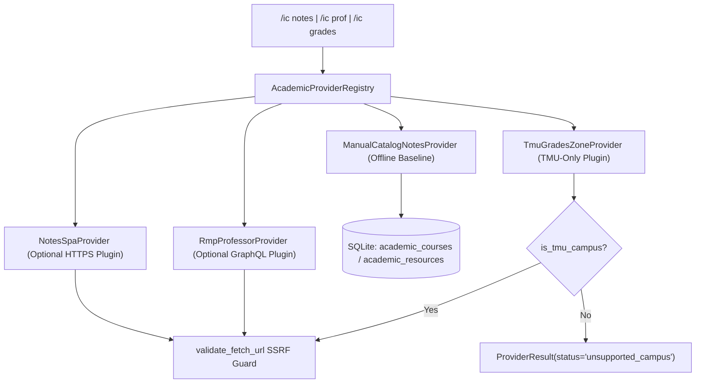

# Multi-Campus Academics & Provider Architecture

## 1. Design Principles

The academic subsystem is built around a **campus-agnostic data contract** and an **extensible provider registry** (`icbot/academics/`), rather than hardcoded Toronto Metropolitan University (TMU) scrapers.

1. **Universal Offline Baseline First**: Every server gets a SQLite-backed manual course/resource catalog (`ManualResourceCatalogStore`) and guild-scoped exam planner (`exams`) that function 100% offline with zero external scrapers or APIs.
2. **Optional Campus Plugins**: External data sources (`NotesSpaProvider`, `RmpProfessorProvider`, `TmuGradesZoneProvider`) are registered behind typed provider interfaces returning immutable provenance, fetch timestamps, status codes, and error metadata (`ProviderResult[T]`).
3. **Strict Failure Isolation**: A failure, timeout, or unsupported campus error in any remote academic plugin never breaks the manual resource catalog or the core exam schedule.
4. **No Universal Grade Coverage Claims**: Campus-specific plugins (such as `TmuGradesZoneProvider`) explicitly declare campus compatibility via `supports_campus(campus)`. Non-TMU campuses return `status="unsupported_campus"` with zero outbound HTTP calls.
5. **External Licensed Resources Only**: Course notes, syllabi, and study guides are treated as externally licensed resources — the bot stores validated URLs and attribution/license metadata only, never scraping or hosting copyrighted document blobs.

---

## 2. Typed Domain Model (`icbot/academics/models.py`)

| Concept | Purpose | Key Attributes |
| :--- | :--- | :--- |
| `Campus` | Institution identity & timezone context | `campus_id`, `name`, `canonical_url`, `domain`, `timezone`, `source_ids` |
| `Department` | Academic unit within a campus | `department_id`, `campus_id`, `code`, `name` |
| `Program` | Degree program / major | `program_id`, `campus_id`, `department_id`, `name`, `degree_level`, `course_prefixes` |
| `Course` | Normalized multi-campus course identity | `display_code`, `normalized_key`, `title`, `campus_id`, `department_code`, `aliases`, `term` |
| `ResourceLink` | External licensed study resource link | `resource_id`, `guild_id`, `course_key`, `display_code`, `title`, `url`, `resource_type`, `source_attribution`, `license_note` |
| `Exam` | Guild-scoped exam schedule entry | `id`, `guild_id`, `course_code`, `course_key`, `course_name`, `start_ts`, `end_ts`, `organizer`, `location`, `notes`, `visibility` |

### Multi-Campus Course Normalization & Alias Mapping
Universities use heterogeneous course code formats (`ELE888`, `CS 135`, `COMP-2404`, `BIO120H1`, `HIST 2010A`).
- `normalize_course_key(raw)` strips whitespace/punctuation and normalizes to uppercase alphanumeric keys (`"COMP-2404"` $\rightarrow$ `"COMP2404"`).
- `ACADEMIC_COURSE_ALIASES` (process or per-guild override) supports both exact aliases (`ECE888=ELE888`) and prefix aliases (`CSCI*->CS*`).

---

## 3. Provider Registry & Interfaces (`icbot/academics/providers.py`)

### Provider Protocols
- `NotesProvider.search(course, *, campus, guild_id, settings, session, clock) -> ProviderResult[list[ResourceLink]]`
- `ProfessorProvider.search(name, institution, *, campus, settings, session, clock) -> ProviderResult[list[ProfessorRecord]]`
- `GradeDistributionProvider.get(course, campus, *, settings, session, clock) -> ProviderResult[GradeDistribution | None]`

Every call returns a `ProviderResult[T]` carrying:
- `status`: `"ok" | "not_found" | "unsupported_campus" | "disabled" | "error" | "unsafe_url"`
- `provenance`: `ProviderProvenance(provider_id, provider_name, fetched_at, source_url, attribution, cached)`
- `error_code` & `error_message`

---

## 4. URL Safety & SSRF Defense (`icbot/academics/url_safety.py`)

Untrusted user links must never become server-side fetch targets:
- **`validate_resource_url(url)`** (used by `ManualResourceCatalogStore`): rejects `javascript:`, `file:`, `data:`, non-HTTP(S) schemes, embedded credentials, whitespace, single-label internal hosts, and loopback/private/link-local/cloud-metadata IP addresses (`127.0.0.1`, `169.254.169.254`, `10.0.0.0/8`, `192.168.0.0/16`, `::1`, `*.local`, `*.internal`).
- **`validate_fetch_url(url, allowed_hosts=...)`** (used before every server-side HTTP fetch): strictly requires `https://`, rejects direct IP addresses, blocks internal hostnames, and enforces `ACADEMIC_ALLOWED_HOSTS` when configured.

---

## 5. SQLite Schema Migration (`0006_academic_catalog_and_exam_fields`)

Additive, reversible migration in [`icbot/db.py`](file:///home/sukesan/dev/discord/campus-bot/icbot/db.py):
- `academic_courses`: `(guild_id, normalized_key)` primary key storing display code, title, campus ID, department code, aliases JSON, and term.
- `academic_resources`: guild-scoped external resource links with `idx_academic_resources_guild_course`.
- `exams`: additive columns `course_key`, `organizer`, and `visibility` (default `'guild'`).

---

## 6. Configuration Keys (Process & Per-Guild Overridable)

| Key | Env Variable | Example | Description |
| :--- | :--- | :--- | :--- |
| `campus_id` | `CAMPUS_ID` | `waterloo` | Canonical campus slug (`tmu` enables TMU Grades Zone plugin) |
| `campus_url` | `CAMPUS_URL` | `https://uwaterloo.ca` | Institution canonical website URL |
| `rmp_university` | `RMP_UNIVERSITY` | `University of Waterloo` | Display & RateMyProfessors search institution name |
| `exams_tz` | `EXAMS_TZ` | `America/Toronto` | IANA timezone for exam schedules |
| `academic_course_aliases` | `ACADEMIC_COURSE_ALIASES` | `CSCI*->CS*,ECE888=ELE888` | Exact and prefix course code aliases |
| `academic_allowed_hosts` | `ACADEMIC_ALLOWED_HOSTS` | `notes.example.org,tmu.grades.zone` | Optional domain allowlist for server-side academic fetches |
| `academic_enabled_providers` | `ACADEMIC_ENABLED_PROVIDERS` | `manual_catalog,rmp_graphql` | Optional explicit subset of enabled academic provider IDs |

