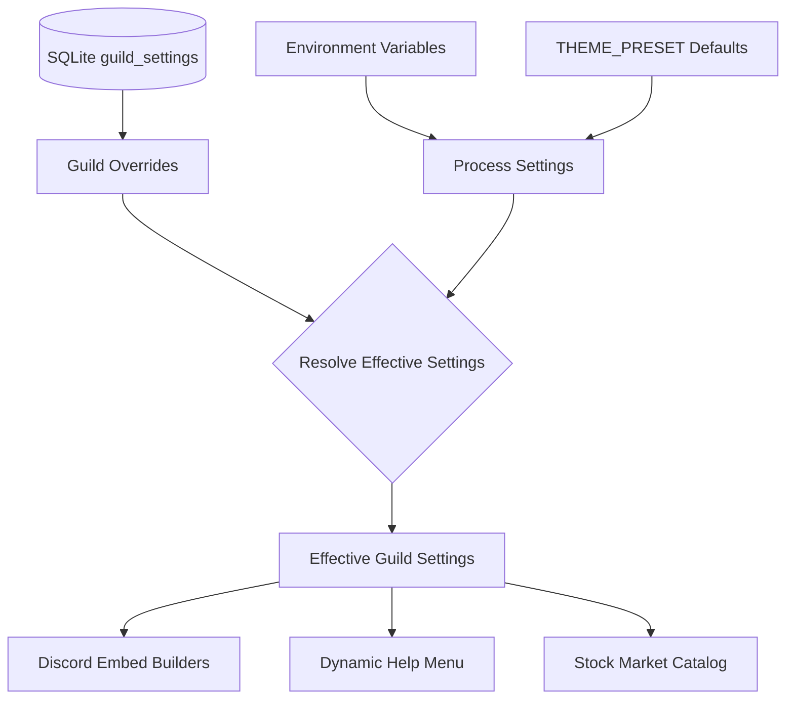

# Branding, Theming, and Localization Architecture

## 1. Overview and Design Principles

The Instigate Cafe Bot was originally engineered for a specific university community ("Instigate Cafe", Toronto Metropolitan University). As part of modernization, the bot's presentation layer is completely decoupled from business and simulation logic.

### Core Architecture Principles
1. **Zero Server-Specific Assumptions in Logic**: Bot business logic, database models, game engines, and task pollers do not assume hardcoded community names, stock symbols, or campus labels.
2. **Preserve Instigate Cafe as Default**: The default configuration skin remains `instigate_cafe` with signature purple accent (`0xA64DFF`) and community branding, ensuring existing server setups and integrations continue without regression.
3. **Configuration-Driven Presentation**: Display names, embed colors, currency names, stock exchange titles, and footers are driven by process configuration (`Settings`) and dynamically adapted per guild via SQLite (`guild_settings`).
4. **Visual Accessibility & WCAG Compliance**: Theme presets enforce relative luminance bounds to guarantee legibility across both Discord Dark (`#2B2D31`) and Light (`#FFFFFF`) themes.
5. **Defensive Embed Boundaries**: Embed builders strictly enforce Discord's payload limits (title, description, fields, total length) and sanitize untrusted text against mass pings (`@everyone`, `@here`) and mention injections.

---

## 2. Built-in Theme Presets

The bot ships with five built-in presets defined in `icbot/theme.py`:

| Preset Identifier | Display Name | Accent Color | Hex | Default Footer | Primary Stock | Currency | Description |
| :--- | :--- | :--- | :--- | :--- | :--- | :--- | :--- |
| `instigate_cafe` (Default) | InstigateAI | `0xA64DFF` | `#A64DFF` | Instigate Cafe | `IC` ($IC) | IC Cash ($) | Original Instigate Cafe community branding with signature purple accent. |
| `campus_generic` | Campus Assistant | `0x2563EB` | `#2563EB` | Campus Utility | `CAMP` ($CAMP) | Campus Coins ($) | Neutral university theme with high-contrast royal blue accent. |
| `student_clean` | Student Bot | `0x0284C7` | `#0284C7` | Student Portal | `STUD` ($STUD) | Credits ($) | Clean, modern student union theme with sky blue styling. |
| `toronto_tmu` | TMU Campus Bot | `0x004C97` | `#004C97` | TMU Student Hub | `TMU` ($TMU) | TMU Bucks ($) | Toronto Metropolitan University student hub preset. |
| `emerald_academic` | Academic Bot | `0x059669` | `#059669` | Academic Commons | `ACAD` ($ACAD) | Credits (¢) | Scholarly theme with rich academic emerald green accents. |

---

## 3. Configuration & Guild Override Flow

Branding values can be configured globally at process startup (via environment variables) or overridden per-guild by server administrators using `/ic admin config theme:<preset>`.

### Configuration Resolution Sequence



### Supported Branding Keys

| Key | Type | Default (`instigate_cafe`) | Environment Variable | Guild Overridable? |
| :--- | :--- | :--- | :--- | :--- |
| `theme_preset` | string | `"instigate_cafe"` | `THEME_PRESET` | Yes |
| `bot_display_name` | string | `"InstigateAI"` | `BOT_DISPLAY_NAME` | Yes |
| `embed_accent_color` | int (24-bit RGB) | `0xA64DFF` | `EMBED_ACCENT_COLOR` | Yes |
| `embed_footer_text` | string | `"Instigate Cafe"` | `EMBED_FOOTER_TEXT` | Yes |
| `embed_logo_url` | string (URL) | `""` | `EMBED_LOGO_URL` | Yes |
| `stock_exchange_name` | string | `"Instigate Cafe Stock Exchange"` | `STOCK_EXCHANGE_NAME` | Yes |
| `currency_name` | string | `"IC Cash"` | `CURRENCY_NAME` | Yes |
| `currency_symbol` | string | `"$"` | `CURRENCY_SYMBOL` | Yes |
| `primary_stock_symbol` | string | `"IC"` | `PRIMARY_STOCK_SYMBOL` | Yes |
| `primary_stock_name` | string | `"Instigate Cafe"` | `PRIMARY_STOCK_NAME` | Yes |
| `source_attribution` | string | `"Internal Instigate Cafe Repository"` | `SOURCE_ATTRIBUTION` | Yes |

---

## 4. Visual Accessibility & Contrast Math

Discord clients run in either Dark theme (background approximately `#2B2D31`, relative luminance $L \approx 0.03$) or Light theme (background `#FFFFFF`, relative luminance $L = 1.0$).

### WCAG 2.1 Relative Luminance

Relative luminance is computed per the W3C WCAG 2.1 specification:

$$L = 0.2126 \times R_{\text{lin}} + 0.7152 \times G_{\text{lin}} + 0.0722 \times B_{\text{lin}}$$

where each sRGB component $C \in \{R, G, B\} / 255$ is linearized:

$$C_{\text{lin}} = \begin{cases} \frac{C}{12.92} & \text{if } C \le 0.04045 \\ \left(\frac{C + 0.055}{1.055}\right)^{2.4} & \text{otherwise} \end{cases}$$

### Contrast Validation Rule
An accent color is validated by `is_accessible_accent(color_int)`:
- Extreme black ($L < 0.03$) is invisible against dark theme cards.
- Pure white ($L > 0.95$) washes out against light theme backgrounds.
- Configured colors with relative luminance outside $[0.03, 0.95]$ generate non-fatal configuration warnings during validation.

---

## 5. Embed Defense and Text Sanitization

All user-visible embeds constructed via `icbot/embeds.py` enforce strict Discord constraints and security sanitization:

### Discord Constraints Budget
- **Title**: Maximum 256 characters (truncated with `…`).
- **Description / Summary**: Maximum 4,096 characters.
- **Field Name**: Maximum 256 characters.
- **Field Value**: Maximum 1,024 characters.
- **Field Count**: Maximum 25 fields per embed.
- **Total Payload Size**: Maximum 6,000 characters across title, description, fields, footer, and author.

### Security Sanitization
- **Mass Mention Neutralization**: `sanitize_text(s)` replaces `@everyone` with `@\u200beveryone` and `@here` with `@\u200bhere` using zero-width spaces (`\u200b`) to prevent unauthorized mass pings.
- **User/Role Ping Neutralization**: Raw mention patterns `<@123456>` and `<@&123456>` are sanitized to prevent ping exploits in untrusted output.
- **Safe Allowed Mentions**: Provider responses and background task alerts use `safe_allowed_mentions()` returning `discord.AllowedMentions.none()` to ensure the bot client never triggers unintentional pings.

---

## 6. Dynamic Help Generation

Rather than a static, hardcoded help menu, `icbot/features/help.py` dynamically queries the `FeatureRegistry` and effective guild permissions:
1. **Module Filtering**: If a feature module (e.g., `academics` or `casino`) is disabled in a guild, its corresponding category and commands are completely omitted from the help menu.
2. **Permission Gating**: The `⚙️ Server Administration` category is rendered only for members with guild management permissions (`can_manage_guild`).
3. **Dynamic Theme Copy**: Help categories reflect the guild's configured `stock_exchange_name`, `currency_name`, `currency_symbol`, and `bot_display_name`.
4. **Backwards Compatibility**: The module-level `HELP_CATEGORIES` remains exported with baseline titles for backwards compatibility with existing test suites.

---

## 7. Forking & Community Customization Guide

Forks or institutions looking to deploy this bot can configure their brand identity entirely via environment variables without altering a single line of Python source:

```bash
# Minimal University Deployment Example (.env)
THEME_PRESET=campus_generic
BOT_DISPLAY_NAME="Waterloo Bot"
EMBED_FOOTER_TEXT="University of Waterloo Student Hub"
RMP_UNIVERSITY="University of Waterloo"
EXAMS_TZ="America/Toronto"
PRIMARY_STOCK_SYMBOL="UW"
PRIMARY_STOCK_NAME="Waterloo Flagship"
CURRENCY_NAME="Goose Bucks"
CURRENCY_SYMBOL="$"
SOURCE_ATTRIBUTION="UW Student Community Bot"
```

