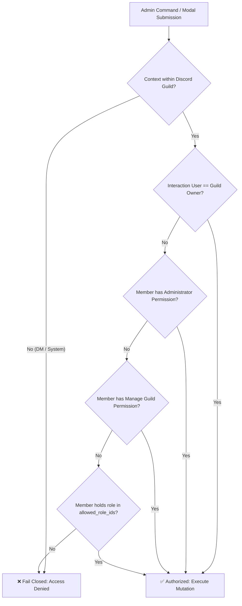

# Instigate Cafe Bot — Guild Setup, Configuration Separation & Permission UX

This document specifies the Phase 5B guild administrative architecture, server-side authorization model, interactive setup UX, operational status diagnostics, and audit ledger schema implemented across [`icbot/permissions.py`](../../icbot/permissions.py), [`icbot/guild_config.py`](../../icbot/guild_config.py), [`icbot/features/admin.py`](../../icbot/features/admin.py), [`icbot/features/info.py`](../../icbot/features/info.py), [`icbot/db.py`](../../icbot/db.py), and [`icbot/registry.py`](../../icbot/registry.py).

---

## 1. Dual Deployment Architecture

Instigate Cafe Bot operates seamlessly across two distinct deployment topologies without code changes:

| Attribute | Multi-Guild Hosted Mode | Single-Guild Self-Hosted Mode |
| :--- | :--- | :--- |
| **Trigger** | `settings.guild_id == 0` (or omitted) | `settings.guild_id > 0` (pinned to server snowflake) |
| **Settings Resolution** | Base process defaults merged with per-guild overrides stored in SQLite `guild_settings` | Effective settings fall back to process environment variables; admin commands persist overrides for the pinned server |
| **Storage Model** | Guild rows keyed by Discord snowflake `guild_id` in SQLite | Process defaults + optional SQLite rows for the pinned `guild_id` |
| **Tenant Isolation** | Strict isolation: zero cross-guild state leakage; mutations require admin authority in the target guild | Single tenant context |
| **Status Badge** | `🌐 Multi-Guild Hosted (Per-Guild Isolated Settings)` | `🏠 Single-Guild Self-Hosted (Pinned Guild <id>)` |

### Setting Scope Partitioning

Security-critical and process-wide parameters remain strictly un-overridable by guild admins:
- **Process Secrets & Core Topology (Environment Only):** `token`, `gemini_api_key`, `go_api_key`, `odds_api_key`, `db_path`, `grades_db_path`, `lore_path`, `allow_gateway_connections`.
- **Per-Guild Overridable Settings (SQLite `guild_settings`):** `rmp_university`, `exams_tz`, `feature_profile`, `enabled_features`, `disabled_features`, `user_command_channel_id`, `job_alerts_channel_id`, `ttc_alerts_channel_id`, `allowed_role_ids`, `embed_color`, `embed_logo_url`.

---

## 2. Server-Side Permission Authorization Matrix

Discord client-side command hiding via `app_commands.default_permissions(manage_guild=True)` is necessary but insufficient for public bot security. [`can_manage_guild()`](../../icbot/permissions.py) performs strict, server-side authorization on every administrative interaction and modal submission.



### Authorization Rules:
1. **Guild Owner:** The server owner (`guild.owner_id == member.id`) always has full administrative rights.
2. **Administrator:** Discord members with the `administrator` permission flag are authorized.
3. **Manage Guild:** Discord members holding `manage_guild` permission are authorized.
4. **Role Allowlist:** Members holding any Discord snowflake role listed in the effective `allowed_role_ids` are authorized.
5. **Fail-Closed Guarantee:** Any invocation outside a server (DMs, group chats, webhook invocations) or by users failing the hierarchy fails closed immediately with an ephemeral warning.

---

## 3. Interactive Administrative & Setup UX

### Slash Commands (`/ic admin ...`)

Administrative commands are registered under the `/ic admin` group (respecting Discord's maximum 2-level command hierarchy):

- `/ic admin setup`: Launches the interactive visual configuration dashboard (`GuildSetupView`).
- `/ic admin config [action] [campus] [timezone] [command_channel] [job_alerts_channel] [transit_alerts_channel]`: Direct parameter viewing, updating, or resetting back to process defaults.
- `/ic admin features [profile] [enable] [disable]`: Activates feature profiles (`student_core`, `community_full`, `toronto_tmu`, `default`) or toggles individual modules.
- `/ic admin roles <action> [role]`: Manages administrative role IDs (`add`, `remove`, `list`, `clear`).
- `/ic admin audit`: Displays the 10 most recent administrative mutation records for the current guild.
- `/ic admin llm_start` / `llm_stop`: Administrative circuit breakers for Gemini LLM integration.

### Interactive Components

1. **`GuildSetupView` (`discord.ui.View`):**
   - **Preset Profile Dropdown (`ProfileSelect`):** Selects from `student_core` (academics, careers, transit, info), `community_full` (all features enabled), `toronto_tmu` (TMU campus branding & transit), and `default`.
   - **Campus & Timezone Button:** Launches `CampusTimezoneModal`.
   - **Channels Button:** Launches `ChannelsConfigModal`.
   - **Reset Overrides Button:** Resets all server-specific settings to defaults with confirmation.
   - **Live Preview Embed:** Displays current deployment mode, campus branding, active timezone, channel gates, and module status in real time.
2. **`CampusTimezoneModal` (`discord.ui.Modal`):**
   - Inputs: University/Campus name and IANA Timezone.
   - **Validation:** Validates timezone string using Python's standard `zoneinfo.ZoneInfo(name)`. Rejects invalid timezones prior to persisting.
3. **`ChannelsConfigModal` (`discord.ui.Modal`):**
   - Inputs: Command channel ID, job alerts channel ID, transit alerts channel ID.
   - **Validation:** Validates Discord snowflake bounds (`0..MAX_SNOWFLAKE`) and strips non-numeric formatting.

---

## 4. Operational Status & Health Diagnostics (`/ic status`)

The `/ic status` slash command provides server administrators with actionable diagnostic telemetry regarding the bot's health, feature readiness, and runtime dependencies:

1. **Deployment Track:** Displays whether the bot is running in Multi-Guild Hosted mode or Single-Guild Self-Hosted mode.
2. **Storage Health:** Checks SQLite WAL journal mode, database integrity check (`PRAGMA integrity_check`), and current schema version (Schema v5).
3. **Module Diagnostics:** Queries [`FeatureRegistry`](../../icbot/registry.py) to assess health across all 9 modules (`core`, `academics`, `careers`, `transit`, `finance`, `sports`, `casino`, `gaming`, `assistant`):
   - 🟢 **Working:** Feature is enabled, all configurations are present, and background tasks are running.
   - 🟡 **Degraded:** Feature is active but optional dependencies (e.g. Odds API key) are missing; fallback behavior is engaged.
   - ⚪ **Disabled:** Module is explicitly disabled via guild profile or settings overrides.
   - 🔴 **Missing Config:** Module is enabled but mandatory configuration (e.g. transit alerts channel) is missing.
   - ⚠️ **Missing Dependency:** Module requires an external capability or token that is not configured.
4. **Actionable Fixes:** Provides explicit remediation instructions (e.g., command syntax, env variable names) for any detected configuration gaps.

---

## 5. Audit Ledger & Schema Migration 5

To ensure accountability in multi-admin environments, all configuration changes and resets are committed to a durable audit table.

### Schema Migration 5 (`guild_settings_audit`)

```sql
CREATE TABLE IF NOT EXISTS guild_settings_audit (
    audit_id      INTEGER PRIMARY KEY AUTOINCREMENT,
    guild_id      INTEGER NOT NULL,
    actor_id      INTEGER NOT NULL,
    action        TEXT NOT NULL,
    changed_keys  TEXT NOT NULL,
    previous_json TEXT,
    new_json      TEXT,
    created_at    INTEGER NOT NULL
);

CREATE INDEX IF NOT EXISTS idx_guild_settings_audit_guild 
    ON guild_settings_audit(guild_id, created_at DESC);
```

### Audit Invariants:
- **Atomic Mutation Logging:** Every `set_overrides()`, `update_overrides()`, and `reset_overrides()` records an audit entry within the same SQLite operation.
- **Actor Tracking:** The Discord user ID of the administrator making the change (`actor_id`) is stored along with the list of modified keys, previous JSON payload, and new JSON payload.
- **Auditable Query Interface:** `get_audit_history(guild_id, limit=10)` returns typed `GuildSettingsAuditEntry` records ordered by recency.

---

## 6. Offline Verification & Security Guarantees

All components undergo rigorous offline verification in [`tests/integration/test_guild_setup_and_permissions.py`](../../tests/integration/test_guild_setup_and_permissions.py):

- **Two Distinct Guilds Isolation:** Verifies Guild A and Guild B maintain distinct settings, role allowlists, and administrators. Admin A cannot modify Guild B, and members holding roles in Guild A have zero elevated privileges in Guild B.
- **DM & Context Rejection:** Verifies DM interactions fail closed and return ephemeral error notices without reading storage.
- **Timezone Validation:** Confirms invalid timezone strings (`Mars/Olympus`, `Invalid/Zone`) are rejected ephemerally and never written to SQLite.
- **Audit Persistence:** Verifies update and reset actions produce complete audit entries inspectable via `/ic admin audit`.
- **Status Accuracy:** Verifies `/ic status` accurately reports Multi-Guild vs Single-Guild configurations and correctly badges enabled, degraded, and disabled modules.

