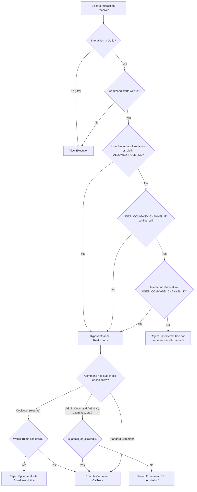
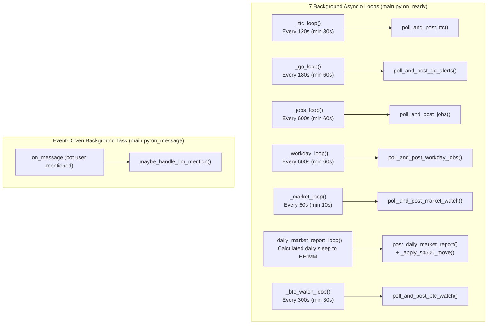
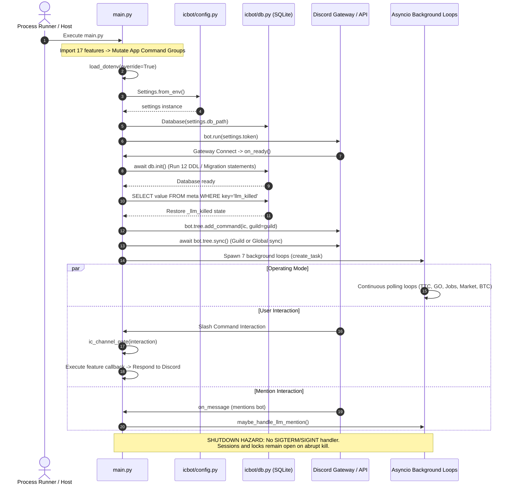

# Instigate Cafe Bot — Evidence-First Architecture Inventory & Baseline Audit
**Phase 0: Repository Audit and Zero-Change Baseline**  
**Audit Date:** November 3, 2026  
**Auditor:** Senior Engineering Infrastructure Modernization Agent  
**Operating Mode:** Read-Only Analysis & Documentation Baseline

---

## 1. Executive Summary & Audit Context

### 1.1 Repository Metadata
| Parameter | Value | Verification Command / Source Evidence |
| :--- | :--- | :--- |
| **HEAD Commit** | `c6c854d530c7961779db7701c13adadffef66fe4` | `git rev-parse HEAD` |
| **Working Branch** | `main` | `git branch --show-current` |
| **Host Python Version**| `Python 3.14.9` | `python3 --version` |
| **Repository State** | Clean (working tree clean) | `git status` (untracked/ignored: `.env`) |
| **Tracked Artifacts** | 71 files tracked in Git | `git ls-files` |
| **Tracked DB Warning** | `ic_stock.db` (1.36MB), `tmu_grades.db` (24KB) | Committed directly in Git tree |

### 1.2 Zero-Impact / Safety Safeguard Attestation
- **Discord Gateway:** Strictly **0** live gateway connections executed; `main.py`, `bot.run()`, and `client.start()` were never invoked.
- **Railway & Remote Infrastructure:** Strictly **0** Railway CLI commands, API calls, build triggers, or environment variable mutations performed.
- **Network Boundaries:** Strictly **0** outbound internet requests dispatched. No third-party APIs (Gemini, RateMyProfessors, Metrolinx, Mastodon, Yahoo Finance, Blockstream, Odds API, Greenhouse, Lever, Workday) were contacted.
- **Production Data Protection:** No live secrets from `.env` or production database rows from `ic_stock.db` / `tmu_grades.db` have been read, logged, or recorded in any artifact or report.
- **Files Modified:** Strictly isolated to `docs/audit/architecture_inventory.md`. Zero production code modified.

---

## 2. Command Traceability Matrix (`app_commands`)

All slash commands register onto the root group `/ic` defined in [`icbot/app.py:4`](file:///home/sukesan/dev/discord/campus-bot/icbot/app.py#L4). The bot defines 5 nested subgroups (`casino`, `icse`, `admin`, `exam`, `sports`) and 42 distinct executable command paths.

| # | Slash Command Path | Group / Subgroup | Callback Symbol | Location (`file:line`) | Permission / Guard | Discord Views Attached | SQLite Tables Accessed | External Network / Services |
| :- | :--- | :--- | :--- | :--- | :--- | :--- | :--- | :--- |
| 1 | `/ic admin llm_stop` | `admin` | `llm_stop_cmd` | [`icbot/features/admin.py:8`](file:///home/sukesan/dev/discord/campus-bot/icbot/features/admin.py#L8) | `is_admin_or_allowed` | None | `meta` | None |
| 2 | `/ic admin llm_start` | `admin` | `llm_start_cmd` | [`icbot/features/admin.py:25`](file:///home/sukesan/dev/discord/campus-bot/icbot/features/admin.py#L25) | `is_admin_or_allowed` | None | `meta` | None |
| 3 | `/ic admin move` | `admin` | `move` | [`icbot/features/invest.py:329`](file:///home/sukesan/dev/discord/campus-bot/icbot/features/invest.py#L329) | `is_admin_or_allowed` | None | `fun_stocks`, `fun_stock_events` | None |
| 4 | `/ic admin set` | `admin` | `set_cmd` | [`icbot/features/invest.py:362`](file:///home/sukesan/dev/discord/campus-bot/icbot/features/invest.py#L362) | `is_admin_or_allowed` | None | `fun_stocks`, `fun_stock_events` | None |
| 5 | `/ic admin sync_catalog` | `admin` | `sync_catalog` | [`icbot/features/invest.py:388`](file:///home/sukesan/dev/discord/campus-bot/icbot/features/invest.py#L388) | `is_admin_or_allowed` | None | `fun_stocks` | None |
| 6 | `/ic admin weekroll` | `admin` | `weekroll` | [`icbot/features/invest.py:406`](file:///home/sukesan/dev/discord/campus-bot/icbot/features/invest.py#L406) | `is_admin_or_allowed` | None | `fun_stocks`, `fun_market_weeks` | None |
| 7 | `/ic botinfo` | `ic` (root) | `botinfo` | [`icbot/features/info.py:55`](file:///home/sukesan/dev/discord/campus-bot/icbot/features/info.py#L55) | Channel gate (`main.py:62`) | None | None | None (reads local logo) |
| 8 | `/ic casino blackjack` | `casino` | `blackjack` | [`icbot/features/blackjack.py:718`](file:///home/sukesan/dev/discord/campus-bot/icbot/features/blackjack.py#L718) | Channel gate (`main.py:62`) | `BlackjackView`, `BlackjackTerminalView` | `users`, `blackjack_users` | None |
| 9 | `/ic casino payouts` | `casino` | `slots_payouts_cmd` | [`icbot/features/slots.py:95`](file:///home/sukesan/dev/discord/campus-bot/icbot/features/slots.py#L95) | Channel gate (`main.py:62`) | None | None | None |
| 10 | `/ic casino roulette` | `casino` | `roulette_cmd` | [`icbot/features/roulette.py:67`](file:///home/sukesan/dev/discord/campus-bot/icbot/features/roulette.py#L67) | Channel gate (`main.py:62`) | None | `users` | None |
| 11 | `/ic casino slots` | `casino` | `slots_cmd` | [`icbot/features/slots.py:24`](file:///home/sukesan/dev/discord/campus-bot/icbot/features/slots.py#L24) | Channel gate (`main.py:62`) | None | `users` | None |
| 12 | `/ic dailyclaim` | `ic` (root) | `daily_cmd` | [`icbot/features/profile.py:129`](file:///home/sukesan/dev/discord/campus-bot/icbot/features/profile.py#L129) | Channel gate (`main.py:62`) | None | `users` | None |
| 13 | `/ic exam add` | `exam` | `exam_add` | [`icbot/features/exams.py:174`](file:///home/sukesan/dev/discord/campus-bot/icbot/features/exams.py#L174) | `is_admin_or_allowed` | None | `exams` | None |
| 14 | `/ic exam clear` | `exam` | `exam_clear` | [`icbot/features/exams.py:275`](file:///home/sukesan/dev/discord/campus-bot/icbot/features/exams.py#L275) | `is_admin_or_allowed` | None | `exams` | None |
| 15 | `/ic exam list` | `exam` | `exam_list` | [`icbot/features/exams.py:130`](file:///home/sukesan/dev/discord/campus-bot/icbot/features/exams.py#L130) | Channel gate (`main.py:62`) | None | `exams` | None |
| 16 | `/ic exam remove` | `exam` | `exam_remove` | [`icbot/features/exams.py:252`](file:///home/sukesan/dev/discord/campus-bot/icbot/features/exams.py#L252) | `is_admin_or_allowed` | None | `exams` | None |
| 17 | `/ic grades` | `ic` (root) | `grades_command` | [`icbot/features/grades.py:183`](file:///home/sukesan/dev/discord/campus-bot/icbot/features/grades.py#L183) | Channel gate (`main.py:62`) | None | `course_cache` (`tmu_grades.db`) | `https://tmu.grades.zone` (GET HTML) |
| 18 | `/ic help` | `ic` (root) | `ic_help` | [`icbot/features/help.py:116`](file:///home/sukesan/dev/discord/campus-bot/icbot/features/help.py#L116) | Channel gate (`main.py:62`) | `HelpPaginationView` | None | None |
| 19 | `/ic icse buy` | `icse` | `buy` | [`icbot/features/invest.py:158`](file:///home/sukesan/dev/discord/campus-bot/icbot/features/invest.py#L158) | Channel gate (`main.py:62`) | None | `users`, `fun_stocks`, `fun_positions`, `fun_trades` | None |
| 20 | `/ic icse cover` | `icse` | `cover_cmd` | [`icbot/features/invest.py:233`](file:///home/sukesan/dev/discord/campus-bot/icbot/features/invest.py#L233) | Channel gate (`main.py:62`) | None | `users`, `fun_stocks`, `fun_positions`, `fun_trades` | None |
| 21 | `/ic icse history` | `icse` | `history_cmd` | [`icbot/features/invest.py:291`](file:///home/sukesan/dev/discord/campus-bot/icbot/features/invest.py#L291) | Channel gate (`main.py:62`) | None | `fun_stocks`, `fun_stock_events` | None |
| 22 | `/ic icse market` | `icse` | `market` | [`icbot/features/invest.py:64`](file:///home/sukesan/dev/discord/campus-bot/icbot/features/invest.py#L64) | Channel gate (`main.py:62`) | None | `fun_stocks` | None |
| 23 | `/ic icse portfolio` | `icse` | `portfolio` | [`icbot/features/invest.py:115`](file:///home/sukesan/dev/discord/campus-bot/icbot/features/invest.py#L115) | Channel gate (`main.py:62`) | None | `users`, `fun_stocks`, `fun_positions` | None |
| 24 | `/ic icse quote` | `icse` | `quote` | [`icbot/features/invest.py:95`](file:///home/sukesan/dev/discord/campus-bot/icbot/features/invest.py#L95) | Channel gate (`main.py:62`) | None | `fun_stocks` | None |
| 25 | `/ic icse sell` | `icse` | `sell` | [`icbot/features/invest.py:182`](file:///home/sukesan/dev/discord/campus-bot/icbot/features/invest.py#L182) | Channel gate (`main.py:62`) | None | `users`, `fun_stocks`, `fun_positions`, `fun_trades` | None |
| 26 | `/ic icse short` | `icse` | `short_cmd` | [`icbot/features/invest.py:208`](file:///home/sukesan/dev/discord/campus-bot/icbot/features/invest.py#L208) | Channel gate (`main.py:62`) | None | `users`, `fun_stocks`, `fun_positions`, `fun_trades` | None |
| 27 | `/ic icse stock` | `icse` | `stock` | [`icbot/features/invest.py:419`](file:///home/sukesan/dev/discord/campus-bot/icbot/features/invest.py#L419) | Channel gate (`main.py:62`) | None | `meta` (`stock_value`), `stock_events` | None |
| 28 | `/ic icse trades` | `icse` | `trades_cmd` | [`icbot/features/invest.py:260`](file:///home/sukesan/dev/discord/campus-bot/icbot/features/invest.py#L260) | Channel gate (`main.py:62`) | None | `fun_trades` | None |
| 29 | `/ic jobs` | `ic` (root) | `jobs_cmd` | [`icbot/features/jobs.py:56`](file:///home/sukesan/dev/discord/campus-bot/icbot/features/jobs.py#L56) | Channel gate (`main.py:62`) | None | `job_seen` | None |
| 30 | `/ic leaderboard` | `ic` (root) | `leaderboard_root` | [`icbot/features/lc_leaderboard.py:176`](file:///home/sukesan/dev/discord/campus-bot/icbot/features/lc_leaderboard.py#L176) | Channel gate (`main.py:62`) | `LeaderboardView` | `users`, `fun_stocks`, `fun_positions` | None |
| 31 | `/ic notes` | `ic` (root) | `notes_cmd` | [`icbot/features/notes.py:122`](file:///home/sukesan/dev/discord/campus-bot/icbot/features/notes.py#L122) | Channel gate (`main.py:62`) | None | In-memory cache `_NOTES_CACHE` | Configured `NOTES_SITES` SPA endpoints (GET) |
| 32 | `/ic prof` | `ic` (root) | `prof_cmd` | [`icbot/features/prof.py:187`](file:///home/sukesan/dev/discord/campus-bot/icbot/features/prof.py#L187) | Channel gate (`main.py:62`) | None | None | RateMyProfessors GraphQL (`https://www.ratemyprofessors.com/graphql`) |
| 33 | `/ic profile` | `ic` (root) | `profile_cmd` | [`icbot/features/profile.py:32`](file:///home/sukesan/dev/discord/campus-bot/icbot/features/profile.py#L32) | Channel gate (`main.py:62`) | None | `users`, `fun_positions`, `blackjack_users` | None |
| 34 | `/ic report` | `ic` (root) | `report_cmd` | [`icbot/features/report.py:22`](file:///home/sukesan/dev/discord/campus-bot/icbot/features/report.py#L22) | Channel gate (`main.py:62`) | None | `fun_stocks`, `meta` | Yahoo Finance Quote API, Alternative.me Fear & Greed API |
| 35 | `/ic resume` | `ic` (root) | `resume_cmd` | [`icbot/features/resume.py:144`](file:///home/sukesan/dev/discord/campus-bot/icbot/features/resume.py#L144) | Cooldown (1/1800s) + Killswitch | None | None | Google Gemini REST API (`generateContent`) |
| 36 | `/ic serverinfo` | `ic` (root) | `serverinfo` | [`icbot/features/info.py:9`](file:///home/sukesan/dev/discord/campus-bot/icbot/features/info.py#L9) | Channel gate (`main.py:62`) | None | None | None |
| 37 | `/ic sports boxing` | `sports` | `boxing` | [`icbot/features/sports.py:236`](file:///home/sukesan/dev/discord/campus-bot/icbot/features/sports.py#L236) | Channel gate (`main.py:62`) | None | In-memory cache `_RSS_CACHE` | OddsAPI (`api.the-odds-api.com`), ESPN Boxing RSS |
| 38 | `/ic sports mma` | `sports` | `mma` | [`icbot/features/sports.py:226`](file:///home/sukesan/dev/discord/campus-bot/icbot/features/sports.py#L226) | Channel gate (`main.py:62`) | None | In-memory cache `_RSS_CACHE` | OddsAPI (`api.the-odds-api.com`), ESPN MMA RSS |
| 39 | `/ic sports nba` | `sports` | `nba` | [`icbot/features/sports.py:216`](file:///home/sukesan/dev/discord/campus-bot/icbot/features/sports.py#L216) | Channel gate (`main.py:62`) | None | In-memory cache `_RSS_CACHE` | OddsAPI (`api.the-odds-api.com`), ESPN NBA RSS |
| 40 | `/ic sports nfl` | `sports` | `nfl` | [`icbot/features/sports.py:221`](file:///home/sukesan/dev/discord/campus-bot/icbot/features/sports.py#L221) | Channel gate (`main.py:62`) | None | In-memory cache `_RSS_CACHE` | OddsAPI (`api.the-odds-api.com`), ESPN NFL RSS |
| 41 | `/ic sports ufc` | `sports` | `ufc` | [`icbot/features/sports.py:231`](file:///home/sukesan/dev/discord/campus-bot/icbot/features/sports.py#L231) | Channel gate (`main.py:62`) | None | In-memory cache `_RSS_CACHE` | OddsAPI (`api.the-odds-api.com`), ESPN MMA RSS |

---

## 3. Import Side Effects & Global State Analysis

### 3.1 Import Sequence & Module Execution Trace
When `main.py` is imported or executed, the following top-level side effects occur immediately:
1. **Dynamic Command Registration Side Effects ([`main.py:22-38`](file:///home/sukesan/dev/discord/campus-bot/main.py#L22-L38)):**
   - 17 feature modules are explicitly imported with `# noqa: F401`.
   - Each module executes module-level decorators (`@ic.command`, `@casino.command`, `@admin.command`, `@exam.command`, `@sports.command`, `@icse.command`), mutating the `Group` command trees in [`icbot/app.py`](file:///home/sukesan/dev/discord/campus-bot/icbot/app.py).
   - Removing any feature import silently drops the corresponding slash command from registration.
2. **Environment & File I/O Side Effects ([`main.py:40-42`](file:///home/sukesan/dev/discord/campus-bot/main.py#L40-L42)):**
   - `load_dotenv(override=True)` unconditionally reads `.env` from disk and overwrites existing process environment variables in `os.environ`.
   - `Settings.from_env()` is called, reading process environment variables into a frozen dataclass instance.
   - `Database(settings.db_path)` is instantiated, storing the database path string.
3. **Heavy C-Extension & Scientific Library Loading:**
   - [`icbot/features/grades.py:10-11`](file:///home/sukesan/dev/discord/campus-bot/icbot/features/grades.py#L10-L11) imports `matplotlib.pyplot` and `numpy`.
   - Matplotlib initializes GUI font caches and backend machinery at import time, introducing substantial memory overhead (~40-70MB) even when `/ic grades` is never called.
   - Line 121 sets global matplotlib style: `plt.style.use('dark_background')`, mutating global state.
4. **Discord Client & Tree Handler Binding ([`main.py:44-100`](file:///home/sukesan/dev/discord/campus-bot/main.py#L44-L100)):**
   - Instantiates `discord.Intents` with `guilds=True`, `messages=True`, `message_content=True`.
   - Instantiates `commands.Bot(command_prefix="!", intents=intents)`.
   - Binds `@bot.tree.interaction_check` to `_ic_tree_interaction_check`.
   - Binds `@bot.tree.error` to `on_app_command_error`.
   - Binds `@bot.event` to `on_ready` and `on_message`.

### 3.2 In-Memory Global Caches and Shared State
- **Notes Scrape Cache ([`icbot/features/notes.py:19`](file:///home/sukesan/dev/discord/campus-bot/icbot/features/notes.py#L19)):** Module-global tuple `_NOTES_CACHE = (0.0, {})` with 6-hour TTL (`_CACHE_TTL_SECONDS = 21600`).
- **Sports RSS Cache ([`icbot/features/sports.py:37`](file:///home/sukesan/dev/discord/campus-bot/icbot/features/sports.py#L37)):** Module-global dict `_RSS_CACHE = {}` with 10-minute TTL (`_RSS_TTL_SECONDS = 600`).
- **Persistent HTTP Sessions & Crumb Caches:**
  - [`icbot/services/yahoo_quotes.py:30-38`](file:///home/sukesan/dev/discord/campus-bot/icbot/services/yahoo_quotes.py#L30-L38): Global `_SESSION`, `_SESSION_LOCK`, `_CRUMB`, `_CRUMB_EXP_TS`, `_CRUMB_LOCK`.
  - [`icbot/services/btc_esplora.py:19-21`](file:///home/sukesan/dev/discord/campus-bot/icbot/services/btc_esplora.py#L19-L21): Global `_SESSION`, `_LOCK`.
  - [`icbot/services/crypto_fng.py:16-18`](file:///home/sukesan/dev/discord/campus-bot/icbot/services/crypto_fng.py#L16-L18): Global `_SESSION`, `_LOCK`.
- **Bot Dynamic Attributes (Attached in [`main.py:300-310`](file:///home/sukesan/dev/discord/campus-bot/main.py#L300-L310)):**
  - `bot.settings = settings`
  - `bot.db = db`
  - `bot._llm_killed = True / False` (persisted to `meta` table)
  - `bot._lore_cache = {}` (loaded by `llm_assistant.py`)
  - Loop deduping booleans: `bot._ttc_started`, `bot._go_started`, `bot._jobs_started`, `bot._workday_started`, `bot._market_started`, `bot._daily_report_started`, `bot._btc_watch_started`.

---

## 4. Permission Guards & Interaction Routing

### 4.1 Gate Implementations
1. **Tree-Wide Channel Gate ([`main.py:62-96`](file:///home/sukesan/dev/discord/campus-bot/main.py#L62-L96)):**
   - Intercepts all interactions via `@bot.tree.interaction_check`.
   - Regular users are strictly quarantined to `USER_COMMAND_CHANNEL_ID` if configured.
   - Bypasses check if interaction is in Direct Messages or not an `/ic` command.
2. **Role & Admin Validator ([`icbot/permissions.py:15-28`](file:///home/sukesan/dev/discord/campus-bot/icbot/permissions.py#L15-L28)):**
   - Returns `True` if `member.guild_permissions.administrator` is set.
   - Returns `True` if any member role matches IDs in `settings.allowed_role_ids`.
   - Returns `False` otherwise.
3. **Command-Level Admin Enforcement:**
   - Explicit inline validation calling `is_admin_or_allowed`:
     - [`icbot/features/admin.py:9, 26`](file:///home/sukesan/dev/discord/campus-bot/icbot/features/admin.py#L9) (`llm_stop`, `llm_start`)
     - [`icbot/features/invest.py:330, 363, 389, 407`](file:///home/sukesan/dev/discord/campus-bot/icbot/features/invest.py#L330) (`move`, `set`, `sync_catalog`, `weekroll`)
     - [`icbot/features/exams.py:175, 253, 276`](file:///home/sukesan/dev/discord/campus-bot/icbot/features/exams.py#L175) (`exam add`, `exam remove`, `exam clear`)

---

## 5. Discord UI Views (`discord.ui.View`)

| View Class Name | Source Location | Buttons / UI Components | Timeout | State & Memory Management | Expiration / Timeout Behavior |
| :--- | :--- | :--- | :--- | :--- | :--- |
| `BlackjackView` | [`icbot/features/blackjack.py:400`](file:///home/sukesan/dev/discord/campus-bot/icbot/features/blackjack.py#L400) | `Hit` (primary), `Stand` (secondary), `Double Down` (primary), `Split` (primary), `Forfeit` (danger) | 300s (5m) (`INACTIVITY_SECONDS`) | Bound to `BJSession` via `SessionManager`. Locked with `asyncio.Lock`. | Triggers `_forfeit_now()`, player auto-loses bet to prevent abandonment abuse. |
| `BlackjackTerminalView` | [`icbot/features/blackjack.py:245`](file:///home/sukesan/dev/discord/campus-bot/icbot/features/blackjack.py#L245) | `Play Again ($bet)` (success), `Double Bet ($2x)` (primary) | 900s (15m) (`TERMINAL_VIEW_TIMEOUT_SECONDS`) | Carries `bet`, `user_id`, `guild_id`. | Disables all child buttons; edits original message to persist disabled state. |
| `HelpPaginationView` | [`icbot/features/help.py:68`](file:///home/sukesan/dev/discord/campus-bot/icbot/features/help.py#L68) | `◀ Previous` (secondary), `Next ▶` (primary) | 180s (3m) | Stores `current_page`, `total_pages`, `settings`. Dynamically disables at boundaries. | Standard View timeout (no custom disable hook implemented). |
| `LeaderboardView` | [`icbot/features/lc_leaderboard.py:32`](file:///home/sukesan/dev/discord/campus-bot/icbot/features/lc_leaderboard.py#L32) | `Prev` (secondary), `Next` (secondary) | 300s (5m) (`VIEW_TIMEOUT_SECONDS`) | Locked with `asyncio.Lock`. Restricts button clicks to `owner_id`. | `on_timeout()` iterates children, sets `child.disabled = True`, and edits message. |

---

## 6. Background Asyncio Tasks & Polling Loops

All background tasks are initiated once during [`main.py:on_ready`](file:///home/sukesan/dev/discord/campus-bot/main.py#L296) using guarded startup flags (`bot._<task>_started = True`).

### Detailed Loop Specifications
1. **TTC Transit Poller ([`main.py:125-134`](file:///home/sukesan/dev/discord/campus-bot/main.py#L125-L134)):**
   - **Target Channel:** `settings.ttc_alerts_channel_id`
   - **Poller Method:** `poll_and_post_ttc(bot)` ([`icbot/tasks/ttc_alerts.py:82`](file:///home/sukesan/dev/discord/campus-bot/icbot/tasks/ttc_alerts.py#L82))
   - **Interval:** `max(30, settings.ttc_poll_seconds)` (Default: 120s)
   - **Checkpoint State:** `meta.ttc_account_id`, `meta.ttc_last_status_id`
   - **External Service:** Mastodon API (`/api/v2/search`, `/api/v1/accounts/{id}/statuses`)
2. **GO Transit Poller ([`main.py:138-147`](file:///home/sukesan/dev/discord/campus-bot/main.py#L138-L147)):**
   - **Target Channel:** `settings.go_alerts_channel_id` (fallback: `ttc_alerts_channel_id`)
   - **Poller Method:** `poll_and_post_go_alerts(bot)` ([`icbot/tasks/go_alerts.py:173`](file:///home/sukesan/dev/discord/campus-bot/icbot/tasks/go_alerts.py#L173))
   - **Interval:** `max(60, settings.go_poll_seconds)` (Default: 180s)
   - **Checkpoint State:** `meta.go_last_servicealert_code`
   - **External Service:** Metrolinx Open Data API (`/ServiceUpdate/ServiceAlert/All`)
3. **Greenhouse/Lever Job Alerts ([`main.py:148-175`](file:///home/sukesan/dev/discord/campus-bot/main.py#L148-L175)):**
   - **Target Channel:** `settings.job_alerts_channel_id` (fallback: `jobs_channel_id`)
   - **Poller Method:** `poll_and_post_jobs(bot)` ([`icbot/tasks/job_alerts.py:400`](file:///home/sukesan/dev/discord/campus-bot/icbot/tasks/job_alerts.py#L400))
   - **Interval:** `max(60, settings.jobs_poll_seconds)` (Default: 600s)
   - **Checkpoint State:** Table `job_seen` (composite primary key `source, external_id`)
   - **External Service:** Greenhouse Boards API, Lever Postings API
4. **Workday Job Alerts ([`main.py:177-204`](file:///home/sukesan/dev/discord/campus-bot/main.py#L177-L204)):**
   - **Target Channel:** Same as above
   - **Poller Method:** `poll_and_post_workday_jobs(bot)` ([`icbot/tasks/jobs_workday_alerts.py:71`](file:///home/sukesan/dev/discord/campus-bot/icbot/tasks/jobs_workday_alerts.py#L71))
   - **Interval:** `max(60, settings.workday_poll_seconds or jobs_poll_seconds)` (Default: 600s)
   - **Checkpoint State:** Tables `job_seen`, `workday_cxs_cache`
   - **External Service:** Scrapes/discovers Workday CXS endpoints (`https://{host}/wday/cxs/{tenant}/{site}/jobs`)
5. **Real-Market Volatility Watcher ([`main.py:207-216`](file:///home/sukesan/dev/discord/campus-bot/main.py#L207-L216)):**
   - **Target Channel:** `settings.market_watch_channel_id` (fallback: `stock_channel_id`)
   - **Poller Method:** `poll_and_post_market_watch(bot)` ([`icbot/tasks/market_watch.py:92`](file:///home/sukesan/dev/discord/campus-bot/icbot/tasks/market_watch.py#L92))
   - **Interval:** `max(10, settings.market_watch_poll_seconds)` (Default: 60s in env, 300s code)
   - **Checkpoint State:** `meta.mw_vix_latched`, `meta.mw_last_vix_alert_ts`, `meta.mw_last_stock_alert_ts:{sym}`
   - **External Service:** Yahoo Finance Quote API (`^VIX`, `SPY`, `QQQ`, custom tickers)
6. **Scheduled Daily Market Report ([`main.py:258-283`](file:///home/sukesan/dev/discord/campus-bot/main.py#L258-L283)):**
   - **Target Channel:** `settings.market_daily_report_channel_id` (fallback: `stock_channel_id`)
   - **Poller Method:** `post_daily_market_report(bot)` ([`icbot/tasks/market_daily_report.py:225`](file:///home/sukesan/dev/discord/campus-bot/icbot/tasks/market_daily_report.py#L225))
   - **Schedule:** Calculated sleep until `market_daily_report_time` (Default: 16:30 in `market_daily_report_tz`)
   - **Side Effect:** Automatically adjusts fun stock prices based on real S&P 500 move via `_apply_sp500_move()`!
   - **Checkpoint State:** `meta.market_daily_report_last_date`, `meta.fun_auto_move_last_date`
   - **External Service:** Yahoo Finance, Alternative.me Fear & Greed API
7. **Bitcoin Address Movement Watcher ([`main.py:284-293`](file:///home/sukesan/dev/discord/campus-bot/main.py#L284-L293)):**
   - **Target Channel:** `settings.btc_watch_channel_id`
   - **Poller Method:** `poll_and_post_btc_watch(bot)` ([`icbot/tasks/btc_watch.py:69`](file:///home/sukesan/dev/discord/campus-bot/icbot/tasks/btc_watch.py#L69))
   - **Interval:** `max(30, settings.btc_watch_poll_seconds)` (Default: 300s)
   - **Checkpoint State:** `meta.btc_last_tx:{addr}`, `meta.btc_last_alert_any`
   - **External Service:** Blockstream Esplora API (`https://blockstream.info/api/address/{addr}/txs`)
8. **LLM Mention Handler ([`main.py:515-533`](file:///home/sukesan/dev/discord/campus-bot/main.py#L515-L533)):**
   - **Trigger:** On message mentioning `bot.user`
   - **Handler:** `maybe_handle_llm_mention(bot, message)` ([`icbot/tasks/llm_assistant.py:476`](file:///home/sukesan/dev/discord/campus-bot/icbot/tasks/llm_assistant.py#L476))
   - **Safety / State:** Checks `bot._llm_killed`, applies 3s per-channel cooldown, parses multimodal images, loads lore from `tools/lore.tmu_files.json`
   - **External Service:** Google Gemini Developer REST API (`models/gemini-*:generateContent`)

---

## 7. Call & Dependency Graph

```mermaid
graph TD
    subgraph SlashCommands["User Slash Commands (/ic ...)"]
        CMD_ADMIN["/ic admin (llm_stop, set, move, etc.)"]
        CMD_CASINO["/ic casino (blackjack, roulette, slots)"]
        CMD_ICSE["/ic icse (market, buy, sell, short, cover)"]
        CMD_ACADEMIC["/ic (notes, prof, grades, exam)"]
        CMD_UTIL["/ic (jobs, report, profile, resume, sports)"]
    end

    subgraph CoreServices["Service Engines (icbot/services/)"]
        S_USER["UserStore<br>(user_service.py)"]
        S_MARKET["FunMarketStore<br>(fun_market.py)"]
        S_BJ["blackjack_engine.py"]
        S_ROUL["roulette_engine.py"]
        S_SLOT["slots_engine.py"]
        S_GEMINI["gemini_client.py"]
        S_YF["yahoo_quotes.py"]
        S_FNG["crypto_fng.py"]
        S_GO["go_client.py"]
        S_TTC["ttc_client.py"]
        S_ATS["jobs_ats_client.py<br>jobs_workday_client.py"]
        S_ODDS["sports_client.py"]
    end

    subgraph Storage["SQLite Databases"]
        DB_MAIN[("ic_stock.db<br>(Main Database)")]
        DB_GRADES[("tmu_grades.db<br>(Grades Cache)")]
    end

    subgraph ExtAPIs["External HTTP / Remote APIs"]
        API_GEMINI["Google Gemini API"]
        API_RMP["RateMyProfessors GraphQL"]
        API_YF["Yahoo Finance"]
        API_FNG["Alternative.me F&G"]
        API_GO["Metrolinx GO API"]
        API_TTC["Mastodon TTC API"]
        API_ATS["Greenhouse / Lever / Workday"]
        API_ODDS["The Odds API"]
        API_NOTION["Notion SPA Scraper"]
        API_GRADES["TMU Grades Zone"]
        API_BTC["Blockstream Esplora"]
    end

    CMD_CASINO --> S_BJ & S_ROUL & S_SLOT & S_USER
    CMD_ICSE --> S_MARKET & S_USER
    CMD_ADMIN --> S_MARKET
    CMD_UTIL --> S_GEMINI & S_YF & S_ATS & S_ODDS & S_USER & S_MARKET
    CMD_ACADEMIC --> S_NOTION & API_RMP & DB_GRADES & DB_MAIN

    S_USER --> DB_MAIN
    S_MARKET --> DB_MAIN
    S_GEMINI --> API_GEMINI
    S_YF --> API_YF
    S_FNG --> API_FNG
    S_GO --> API_GO
    S_TTC --> API_TTC
    S_ATS --> API_ATS
    S_ODDS --> API_ODDS
    DB_GRADES --> API_GRADES
```

---

## 8. Startup-to-Shutdown Lifecycle Diagram

---

## 9. Configuration, `.env`, and Settings Inventory

### 9.1 Exhaustive Settings & `.env.example` Matrix
| Field Name in `Settings` | Key in `.env.example` | Type | Default in `Settings` | Default in `.env.example` | Status / Mismatch Notes |
| :--- | :--- | :--- | :--- | :--- | :--- |
| `token` | `DISCORD_TOKEN` | `str` | `""` | `""` | Match. Required for startup. |
| `guild_id` | `GUILD_ID` | `int` | `0` | `""` | Match. Clamped to snowflake int. |
| `stock_channel_id` | `STOCK_CHANNEL_ID` | `int` | `0` | `""` | Match. General stock channel. |
| `user_command_channel_id` | `USER_COMMAND_CHANNEL_ID` | `int` | `0` | `""` | Match. Gate destination for commands. |
| `ttc_alerts_channel_id` | `TTC_ALERTS_CHANNEL_ID` | `int` | `0` | `""` | Match. |
| `job_alerts_channel_id` | `JOB_ALERTS_CHANNEL_ID` | `int` | `0` | `""` | Alias mismatch: code accepts fallback `JOBS_CHANNEL_ID`. |
| `allowed_role_ids` | `ALLOWED_ROLE_IDS` | `list[int]` | `None` | `""` | Match. Comma-separated int list. |
| `embed_logo_url` | `EMBED_LOGO_URL` | `str` | `""` | `""` | Match. |
| `embed_accent_color` | `EMBED_ACCENT_COLOR` | `int` | `0xA64DFF` | `#A64DFF` | Match. Supports `#RRGGBB` or `0xRRGGBB`. |
| `embed_footer_text` | `EMBED_FOOTER_TEXT` | `str` | `"Instigate Cafe"` | `""` | Match. |
| `odds_api_key` | `ODDS_API_KEY` | `str` | `""` | `""` | Match. |
| `ttc_mastodon_base` | `TTC_MASTODON_BASE` | `str` | `""` | `""` | Match. |
| `ttc_mastodon_acct` | `TTC_MASTODON_ACCT` | `str` | `""` | `""` | Match. |
| `ttc_poll_seconds` | *(missing)* | `int` | `120` | `""` | **Missing in `.env.example`**. Default 120s. |
| `ttc_alert_level` | `TTC_ALERT_LEVEL` | `str` | `"major"` | `"major"` | Match. |
| `ttc_bootstrap_post_latest`| `TTC_BOOTSTRAP_POST_LATEST`| `bool` | `False` | `false` | Match. |
| `ttc_include_replies` | `TTC_INCLUDE_REPLIES` | `bool` | `True` | `true` | Match. |
| `ttc_include_reblogs` | `TTC_INCLUDE_REBLOGS` | `bool` | `False` | `false` | Match. |
| `ttc_debug` | `TTC_DEBUG` | `bool` | `False` | `false` | Match. |
| `go_api_base` | `GO_API_BASE` | `str` | `"https://api.openmetrolinx..."` | `""` | Match. |
| `go_api_key` | `GO_API_KEY` | `str` | `""` | `""` | Match. |
| `go_alerts_channel_id` | `GO_ALERTS_CHANNEL_ID` | `int` | `0` | `""` | Match. Fallback to `ttc_alerts_channel_id`. |
| `go_poll_seconds` | `GO_POLL_SECONDS` | `int` | `180` | `180` | Match. |
| `go_alert_level` | `GO_ALERT_LEVEL` | `str` | `"major"` | `"major"` | Match. |
| `go_bootstrap_post_latest` | `GO_BOOTSTRAP_POST_LATEST` | `bool` | `True` | `false` | **Default Mismatch**: Code default is `True`, `.env.example` has `false`. |
| `go_include_buses` | `GO_INCLUDE_BUSES` | `bool` | `False` | `false` | Match. |
| `go_lines_allowlist` | `GO_LINES_ALLOWLIST` | `list[str]` | `None` | `""` | Match. |
| `go_ssl_verify` | `GO_SSL_VERIFY` | `bool` | `True` | `true` | Match. |
| `go_ca_bundle_path` | `GO_CA_BUNDLE_PATH` | `str` | `""` | `""` | Match. |
| `go_debug` | `GO_DEBUG` | `bool` | `False` | `false` | Match. |
| `exams_tz` | `EXAMS_TZ` | `str` | `"America/Toronto"`| `America/Toronto` | Match. |
| `llm_enabled` | `LLM_ENABLED` | `bool` | `False` | `true` | **Default Mismatch**: Code default `False`, `.env.example` `true`. |
| `llm_cooldown_seconds` | `LLM_COOLDOWN_SECONDS` | `int` | `3` | `3` | Match. |
| `llm_max_messages` | `LLM_MAX_MESSAGES` | `int` | `25` | `25` | Match. |
| `llm_max_chars` | `LLM_MAX_CHARS` | `int` | `12000` | `8000` | **Default Mismatch**: Code default 12000, `.env.example` 8000. |
| `llm_debug` | `LLM_DEBUG` | `bool` | `False` | `false` | Match. |
| `gemini_api_key` | `GEMINI_API_KEY` | `str` | `""` | `""` | Match. |
| `gemini_model` | `GEMINI_MODEL` | `str` | `"gemini-2.5-flash"`| `""` | Mismatch with `main.py:394` (`gemini-2.0-flash`) and `info.py:58` (`gemini-3.1-flash-lite-preview`). |
| `gemini_resume_model` | `GEMINI_RESUME_MODEL` | `str` | `"gemini-2.5-pro"` | `""` | Match. |
| `gemini_resume_prompt` | `GEMINI_RESUME_PROMPT` | `str` | `""` | `""` | Match. |
| `gemini_resume_prompt_hw` | *(missing)* | `str` | `""` | `""` | **Missing in `.env.example`**. Configured in `Settings.from_env()`. |
| `gemini_resume_prompt_ele`| *(missing)* | `str` | `""` | `""` | **Missing in `.env.example`**. Configured in `Settings.from_env()`. |
| `jobs_poll_seconds` | `JOBS_POLL_SECONDS` | `int` | `600` | `600` | Match. |
| `greenhouse_boards` | `GREENHOUSE_BOARDS` | `list[str]` | `None` | `""` | Match. |
| `lever_sites` | `LEVER_SITES` | `list[str]` | `None` | `""` | Match. |
| `jobs_location_allowlist` | `JOBS_LOCATION_ALLOWLIST` | `list[str]` | `None` | `""` | Match. |
| `jobs_keywords_allowlist` | `JOBS_KEYWORDS_ALLOWLIST` | `list[str]` | `None` | `""` | Match. |
| `jobs_keywords_denylist` | `JOBS_KEYWORDS_DENYLIST` | `list[str]` | `None` | `""` | Match. |
| `jobs_bootstrap_post` | `JOBS_BOOTSTRAP_POST` | `bool` | `False` | `false` | Match. |
| `jobs_require_early_career`| `JOBS_REQUIRE_EARLY_CAREER`| `bool` | `False` | `false` | Match. |
| `workday_sites` | `WORKDAY_SITES` | `list[str]` | `None` | `""` | Match. Format: `Label|URL|...` |
| `workday_poll_seconds` | `WORKDAY_POLL_SECONDS` | `int` | `0` (inherits jobs) | `600` | Match. |
| `workday_timeout_seconds`| `WORKDAY_TIMEOUT_SECONDS`| `int` | `12` | `12` | Match. |
| `force_guild_resync` | `FORCE_GUILD_RESYNC` | `bool` | `False` | `false` | Match. Clears guild tree on sync. |
| `daily_claim_amount` | *(missing)* | `int` | `100` | `""` | **Missing in `.env.example`**. Code default 100. |
| `bj_starting_bankroll` | `BJ_STARTING_BANKROLL` | `int` | `1000` | `100` | **Default Mismatch**: Code default 1000, `.env.example` 100. |
| `bj_dealer_hits_soft_17` | `BJ_DEALER_HITS_SOFT_17`| `bool` | `True` | `true` | Match. |
| `bj_max_splits` | `BJ_MAX_SPLITS` | `int` | `1` | `1` | Match. |
| `bj_session_ttl_minutes` | `BJ_SESSION_TTL_MINUTES` | `int` | `20` | `20` | Match. |
| `market_watch_enabled` | `MARKET_WATCH_ENABLED` | `bool` | `False` | `true` | **Default Mismatch**: Code default `False`, `.env.example` `true`. |
| `market_watch_poll_seconds`| `MARKET_WATCH_POLL_SECONDS`| `int` | `60` | `60` | Match. |
| `market_watch_channel_id` | `MARKET_WATCH_CHANNEL_ID`| `int` | `0` | `1` | Match. Fallback to `stock_channel_id`. |
| `market_watch_vix_level` | `MARKET_WATCH_VIX_LEVEL` | `float` | `20.0` | `30` | **Default Mismatch**: Code default 20.0, `.env.example` 30. |
| `market_watch_index_move_pct`| `MARKET_WATCH_INDEX_MOVE_PCT`| `float` | `2.5` | `3` | **Default Mismatch**: Code default 2.5, `.env.example` 3. |
| `market_watch_stock_move_pct`| `MARKET_WATCH_STOCK_MOVE_PCT`| `float` | `10.0` | `10` | Match. |
| `market_watch_tickers` | *(missing)* | `list[str]` | `None` | `""` | **Missing in `.env.example`**. Code has default watchlist. |
| `market_watch_cooldown_minutes`| `MARKET_WATCH_COOLDOWN_MINUTES`| `int` | `30` | `30` | Match. |
| `market_daily_report_enabled`| `MARKET_DAILY_REPORT_ENABLED`| `bool` | `False` | `true` | **Default Mismatch**: Code default `False`, `.env.example` `true`. |
| `market_daily_report_channel_id`| `MARKET_DAILY_REPORT_CHANNEL_ID`| `int` | `0` | `""` | Match. Fallback to `stock_channel_id`. |
| `market_daily_report_time` | `MARKET_DAILY_REPORT_TIME` | `str` | `"16:30"` | `16:30` | Match. |
| `market_daily_report_tz` | `MARKET_DAILY_REPORT_TZ` | `str` | `"America/Toronto"`| `America/Toronto` | Match. |
| `market_daily_report_top_n`| `MARKET_DAILY_REPORT_TOP_N`| `int` | `8` | `8` | Match. |
| `market_daily_report_tickers`| *(missing)* | `list[str]` | `None` | `""` | **Missing in `.env.example`**. |
| `btc_watch_enabled` | `BTC_WATCH_ENABLED` | `bool` | `False` | `true` | **Default Mismatch**: Code default `False`, `.env.example` `true`. |
| `btc_watch_poll_seconds` | `BTC_WATCH_POLL_SECONDS` | `int` | `300` | `600` | **Default Mismatch**: Code default 300, `.env.example` 600. |
| `btc_watch_channel_id` | `BTC_WATCH_CHANNEL_ID` | `int` | `0` | `""` | Match. Fallback to `market_watch_channel_id`. |
| `btc_watch_label` | `BTC_WATCH_LABEL` | `str` | `"BTC Watch"` | `BTC Whale / Institution Watch` | Match. |
| `btc_watch_addresses` | `BTC_WATCH_ADDRESSES` | `list[str]` | `None` | `""` | Match. |
| `btc_esplora_base_url` | `BTC_ESPLORA_BASE_URL` | `str` | `""` | `https://blockstream.info/api` | Match. Default fallback in esplora client. |
| `btc_watch_cooldown_minutes`| `BTC_WATCH_COOLDOWN_MINUTES`| `int` | `30` | `30` | Match. |
| `db_path` | `DB_PATH` | `str` | `"ic_stock.db"` | `""` | Match. |
| `notes_sites` | `NOTES_SITES` | `list[str]` | `None` | `""` | Match. Comma-separated list of `Title|URL`. |
| `rmp_university` | `RMP_UNIVERSITY` | `str` | `"Toronto Metropolitan University"` | `""` | Match. |
| *(unmapped)* | `ALPHAVANTAGE_API_KEY` | *(unused)* | *(none)* | `""` | **Orphaned Key**: Present in `.env.example:80`, unused anywhere in source! |

### 9.2 Direct `os.getenv` Bypasses Outside `Settings`
1. [`icbot/features/info.py:58`](file:///home/sukesan/dev/discord/campus-bot/icbot/features/info.py#L58): `os.getenv("LLM_MODEL", "gemini-3.1-flash-lite-preview")` — Bypasses `settings.gemini_model`.
2. [`icbot/features/sports.py:62`](file:///home/sukesan/dev/discord/campus-bot/icbot/features/sports.py#L62): `os.getenv("ODDS_API_KEY", "")` — Fallback if not on settings.
3. [`icbot/features/sports.py:69`](file:///home/sukesan/dev/discord/campus-bot/icbot/features/sports.py#L69): `os.getenv(f"SPORTS_RSS_{sport.upper()}", "")` — Dynamic per-sport RSS override keys.
4. [`icbot/tasks/llm_assistant.py:36`](file:///home/sukesan/dev/discord/campus-bot/icbot/tasks/llm_assistant.py#L36): `os.getenv("LORE_PATH")` — Bypasses `Settings`.
5. [`tools/lore_loader.py:22`](file:///home/sukesan/dev/discord/campus-bot/tools/lore_loader.py#L22): `os.getenv("LORE_PATH")` — Standalone tool helper.
6. [`tools/purge_global_commands.py:6`](file:///home/sukesan/dev/discord/campus-bot/tools/purge_global_commands.py#L6): `os.getenv("DISCORD_TOKEN")` — Standalone purge tool.

---

## 10. Deployment Trigger & Continuous Runtime Map

### 10.1 Trigger Matrix
| Trigger Source | Config File | Target Runtime | Mechanism | Safety / Autodeploy Hazard |
| :--- | :--- | :--- | :--- | :--- |
| **GitHub Push (`main`)** | None in repo | Railway Service | Remote Railway GitHub integration / webhook | **CRITICAL HAZARD:** Push to `main` redeploys the active bot if autodeploy is enabled on Railway. Modernization must occur on non-tracked phase branches until owner consent. |
| **GitHub Actions** | None (`.github/` absent) | None | N/A | No automated CI/CD workflows currently configured in the repository. |
| **Procfile / Docker** | None in repo | Nixpacks / Python Buildpack | Railway auto-detects `requirements.txt` | Starts `python main.py` by default. |

---

## 11. Proven Source Evidence vs Assumptions

| Aspect | Proven From Code Inspection | Requires Integration / Mock Testing |
| :--- | :--- | :--- |
| **App Commands** | All 42 command decorators and signatures exist and link to callbacks. | Whether Discord accepts the generated JSON command tree without validation error. |
| **Database Schema** | All DDL statements, table names, columns, and indexes in `db.py` and `grades.py`. | Concurrency behavior under high load (multiple commands hitting SQLite simultaneously). |
| **Channel Routing** | Logic in `ic_channel_gate` correctly evaluates IDs and sends ephemeral replies. | Verification of permission behavior with real Discord snowflake IDs and role hierarchies. |
| **ATS Job Parsing** | Regex filters, JSON extraction paths for Greenhouse & Lever payloads. | Live stability of Greenhouse/Lever public endpoints and Workday CXS reverse-engineered endpoints. |
| **RMP GraphQL** | Query structure and Base64 basic auth header (`Basic dGVzdDp0ZXN0`). | RateMyProfessors GraphQL API schema stability, rate limits, and endpoint availability. |
| **Yahoo Finance** | Crumb acquisition logic, quote endpoints (`query1`/`query2`). | Reliability of undocumented Yahoo cookies/crumbs and IP blocking behavior. |
| **Gemini AI** | REST payload construction, base64 encoding of image attachments. | API token quota, rate limits, prompt length limits, and latency behavior on 45s/120s timeouts. |

---

## 12. Prioritized Risk Register (P0 / P1 / P2)

### P0 — Critical Hazards (Deployment, Privacy, Data Loss)
- **RISK-01 (Deployment Trigger):** Pushes to `main` trigger Railway production deployments. If an untested commit reaches `main`, Railway can automatically build and start the bot with live credentials.
  *Mitigation:* Keep Railway autodeploy disabled. Work on designated feature branches; never push to `main` without explicit owner authorization.
- **RISK-02 (Live SQLite DBs Tracked in Git):** `ic_stock.db` (1.36MB) and `tmu_grades.db` (24KB) are committed directly to Git. Pushing or publishing history risks exposing private server balances, user IDs, and community trade history.
  *Mitigation:* Add both DBs to `.gitignore`; sanitize history before public release.
- **RISK-03 (Ad-Hoc Live Test Scripts in `tests/`):** Existing tests (`test_rmp.py`, `test_tmu.py`, `test_yf.py`, `test_notes.py`) make unmocked live network calls to third-party endpoints. Running a test suite could trigger external HTTP requests.
  *Mitigation:* Quarantine old scripts; build offline test harnesses with mocked HTTP responses and fake Discord interactions.
- **RISK-04 (Global Command Purge Utility):** `tools/purge_global_commands.py` contains executable code that calls `PUT /applications/{app_id}/commands` with an empty array `[]`. Running it immediately wipes all global slash commands for the bot application.
  *Mitigation:* Add safety guard / confirmation prompt to `purge_global_commands.py`.

### P1 — Architectural Fragility & Concurrency Hazards
- **RISK-05 (Hardcoded Secondary SQLite Database):** `icbot/features/grades.py:19` hardcodes `DB_PATH = "tmu_grades.db"` instead of using `settings.db_path`. This creates two uncoordinated SQLite database files.
  *Mitigation:* Unify all database operations under the central `Database` class and `settings.db_path`.
- **RISK-06 (Per-Query SQLite Connection Churn):** In `icbot/db.py`, every `execute()`, `fetchone()`, and `fetchall()` opens a new connection: `async with aiosqlite.connect(self.path) as db:`. Under concurrent command bursts, SQLite file lock contention can cause timeouts.
  *Mitigation:* Refactor to connection pooling or a persistent connection pool with proper concurrency controls.
- **RISK-07 (Non-Atomic Multi-Step Financial Operations):** In `fun_market.py` and `blackjack.py`, multi-step financial balance mutations (checking balance, deducting cash, modifying position, updating ledger) are executed across separate queries without explicit SQL transactions (`BEGIN IMMEDIATE` / `COMMIT`).
  *Mitigation:* Wrap all economy transactions in atomic SQLite transactions.
- **RISK-08 (Heavy C-Extensions at Import Time):** Importing `main.py` imports `grades.py`, which imports `matplotlib` and `numpy`. This adds ~50MB of memory footprint and delays module loading.
  *Mitigation:* Lazy-import `matplotlib` and `numpy` inside `generate_chart()`.
- **RISK-09 (Lack of Graceful Shutdown & Signal Handlers):** When the process receives `SIGTERM` or `SIGINT`, background while-loops terminate abruptly without closing persistent `aiohttp.ClientSession` instances.
  *Mitigation:* Register `signal.signal` handlers and implement a clean `bot.close()` shutdown lifecycle.

### P2 — Maintainability, Consistency & Config Mismatches
- **RISK-10 (Command Naming Mismatches):** README advertises `/ic exams` and `/ic daily`, but source code implements `/ic exam list/add/...` and `/ic dailyclaim`.
  *Mitigation:* Reconcile documentation with actual command signatures.
- **RISK-11 (Model Name Drift):** `config.py` defaults to `gemini-2.5-flash`, `main.py` logs `gemini-2.0-flash`, and `info.py` reads `LLM_MODEL` with default `gemini-3.1-flash-lite-preview`.
  *Mitigation:* Centralize all LLM model references strictly through `Settings`.
- **RISK-12 (Orphaned / Undeclared Settings Keys):** `ALPHAVANTAGE_API_KEY` is in `.env.example` but unused. `market_daily_report_debug` and `btc_watch_debug` are checked via `getattr()` but undeclared on `Settings`.
  *Mitigation:* Align `Settings` dataclass and `.env.example` 1:1.

---

## 13. Architecture Synthesis & Modernization Decisions

### 13.1 Current Architectural Pattern
The Instigate Cafe Bot is a monolith utilizing discord.py 2.x's `app_commands` system under a unified `/ic` namespace. The application pairs interactive slash commands with 7 independent background `asyncio` loops that poll transit, jobs, and market endpoints. State persistence is divided across two SQLite files (`ic_stock.db` and `tmu_grades.db`). Financial transactions for casino and fun-market trading share a central `users` balance table, but lack strict transaction boundaries.

### 13.2 Key Ambiguities Requiring Owner Decision
1. **Database Unification:** Should `tmu_grades.db` be consolidated into `ic_stock.db` under a single schema, or should academic grades caching remain an isolated database?
2. **Tracked Databases in Git:** What is the preferred plan for sanitizing `ic_stock.db` and `tmu_grades.db` from Git history before any public release?
3. **Model Configuration:** Which Gemini model tier (`gemini-2.5-flash` vs `gemini-2.0-flash` vs `gemini-1.5-flash`) should be standardized as the canonical default?
4. **Command Aliasing:** Should `/ic daily` and `/ic exams` aliases be added to preserve user expectations established by the README?

