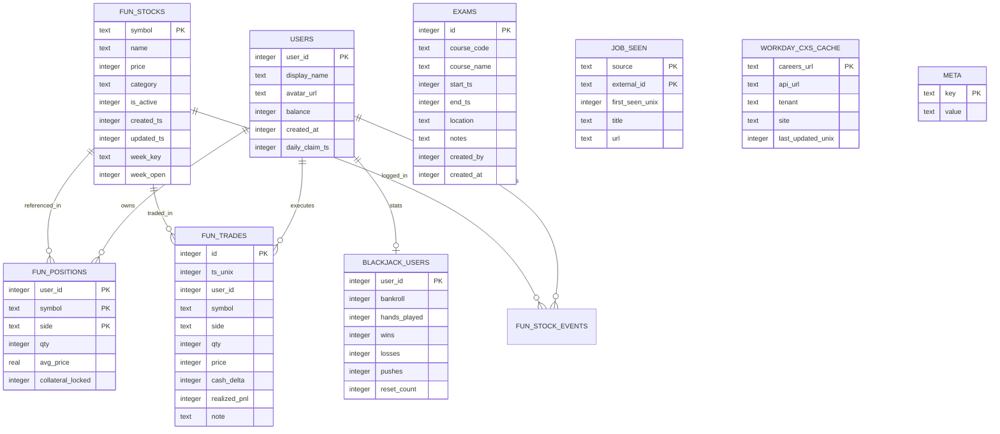
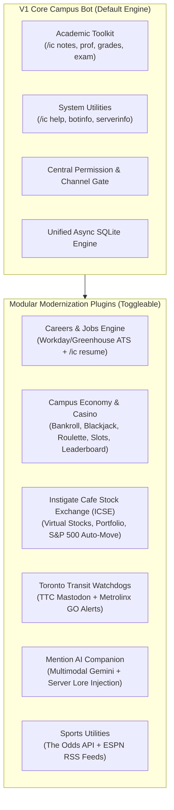

# Instigate Cafe Bot — Feature Disposition & Preservation Baseline
**Phase 0: Repository Audit and Zero-Change Baseline**  
**Audit Date:** November 3, 2026  
**Auditor:** Senior Engineering Infrastructure Modernization Agent  
**Operating Mode:** Audit/Design Only (Zero Code Removal / Zero Runtime Impact)

---

## 1. Executive Summary & Objective

This document establishes the official **Feature Disposition & Preservation Baseline** for the modernization of the Instigate Cafe Bot. The checked-out repository is treated as authoritative. 

The Instigate Cafe Bot currently contains **17 historical feature modules**, **8 background task modules**, **12 service integrations**, **3 table game engines**, **6 core infrastructure modules**, **5 manual test scripts**, and **4 maintenance tools**.

### Strict Safety & Baseline Preservation Rules
1. **Zero Code Removal in Phase 0:** No module is deleted or moved during this phase.
2. **`NO_DELETE_WITHOUT_PROOF` Rule:** Any module not showing immediate static inbound imports is evaluated for dynamic registration (decorators executing on import), CLI execution, manual tool usage, or test dependencies. Any unconfirmed module is marked `investigate`, strictly never `delete`.
3. **Zero Production Data Leakage:** Production database rows (`ic_stock.db`, `tmu_grades.db`) and `.env` credentials are not extracted, printed, or inspected. The schema is inventoried purely from DDL and migration source code.

---

## 2. Comprehensive Feature Disposition Table by Domain

The repository spans seven distinct functional domains plus developer tools and legacy candidate artifacts.

| Functional Domain | Modules / Files Included | Slash Command Paths | Background Loops / Callbacks | Core vs Optional Status | Disposition | Modernization Rationale & Strategy |
| :--- | :--- | :--- | :--- | :--- | :--- | :--- |
| **Core Academic** | `icbot/features/notes.py` `icbot/features/prof.py` `icbot/features/grades.py` `icbot/features/exams.py` | `/ic notes` `/ic prof` `/ic grades` `/ic exam (list, add, remove, clear)` | None (Request-driven) | **V1 Core** | **Keep & Refactor** | Foundational university student utilities. Decouple hardcoded SQLite DB in `grades.py`, extract RMP GraphQL client into service, add `/ic exams` alias. |
| **Optional Careers** | `icbot/features/jobs.py` `icbot/features/resume.py` `icbot/tasks/job_alerts.py` `icbot/tasks/jobs_workday_alerts.py` `icbot/services/jobs_ats_client.py` `icbot/services/jobs_workday_client.py` | `/ic jobs` `/ic resume` | `_jobs_loop()` `_workday_loop()` | **V1 Optional (Plugin)** | **Refactor to Plugin** | High value for university job seekers, but heavy external scraping dependency on Greenhouse, Lever, and Workday CXS. Should be toggleable via plugin. |
| **Optional AI Assistant** | `icbot/tasks/llm_assistant.py` `icbot/services/gemini_client.py` `icbot/features/admin.py` (LLM stop/start) `tools/lore.tmu_files.json` | `/ic admin llm_stop` `/ic admin llm_start` *(also powers `/ic resume`)* | Event-driven on `on_message` (bot mention) | **V1 Optional (Plugin)** | **Refactor to Plugin** | Rich conversational companion with server lore and image Q&A. Highly stateful memory cache; depends on Google Gemini API. Needs isolation behind interface. |
| **Optional Toronto Feeds** | `icbot/tasks/ttc_alerts.py` `icbot/tasks/go_alerts.py` `icbot/services/ttc_client.py` `icbot/services/go_client.py` | None (Broadcast alerts only) | `_ttc_loop()` `_go_loop()` | **V1 Optional (Plugin)** | **Refactor to Plugin** | Hyper-local to Toronto/Metrolinx transit riders. Does not add slash commands; purely autonomous background pollers posting to dedicated channels. |
| **Optional Economy & Casino** | `icbot/features/blackjack.py` `icbot/features/roulette.py` `icbot/features/slots.py` `icbot/features/profile.py` `icbot/features/lc_leaderboard.py` `icbot/games/*_engine.py` `icbot/services/user_service.py` | `/ic casino blackjack` `/ic casino roulette` `/ic casino slots` `/ic casino payouts` `/ic profile` `/ic dailyclaim` `/ic leaderboard` | Inactivity timeouts on Discord Views | **V1 Optional (Plugin)** | **Refactor & Keep** | Core community engagement driver. Needs transaction atomicity, unification of `BlackjackStore` into `UserStore`, and rename of `lc_leaderboard.py` to `networth_leaderboard.py`. |
| **Optional Market & Sports** | `icbot/features/invest.py` `icbot/features/report.py` `icbot/features/sports.py` `icbot/tasks/market_watch.py` `icbot/tasks/market_daily_report.py` `icbot/tasks/btc_watch.py` `icbot/services/fun_market*` `icbot/services/yahoo_quotes.py` `icbot/services/crypto_fng.py` `icbot/services/btc_esplora.py` `icbot/services/sports_client.py` | `/ic icse (9 commands)` `/ic admin (move, set, sync, weekroll)` `/ic report` `/ic sports (5 commands)` | `_market_loop()` `_daily_market_report_loop()` `_btc_watch_loop()` | **V1 Optional (Plugin)** | **Refactor to Plugin** | Virtual server stock exchange (ICSE) + real market watchers + sports odds. Yahoo Finance crumb/cookie scraper is fragile; should be encapsulated cleanly. |
| **Essential Diagnostics** | `icbot/features/info.py` `icbot/features/help.py` | `/ic serverinfo` `/ic botinfo` `/ic help` | View pagination timeout | **V1 Core** | **Keep & Refactor** | Essential bot management and user orientation commands. Fix `os.getenv("LLM_MODEL")` bypass in `info.py`; update `help.py` command catalog. |
| **Developer Tools** | `tools/lore_loader.py` `tools/purge_global_commands.py` `tools/scraper.py` | None (CLI standalone scripts) | None | **Dev Only** | **Investigate & Archive** | Maintenance scripts. `scraper.py` references missing `tmu_raw.html`. `purge_global_commands.py` carries high operational risk. Keep in `tools/` with safeguards. |
| **Candidate Dead / Orphan Code** | `icbot/utils.py:clamp_nonnegative` `.env.example:ALPHAVANTAGE_API_KEY` `tests/*.py` (unmocked manual test scripts) | None | None | **Dead / Test Only** | **Investigate** | `clamp_nonnegative` has 0 callers. `ALPHAVANTAGE_API_KEY` is completely unused. Old tests make live external HTTP calls without mocks. |

---

## 3. Preservation Grid: 17 Historical Features & Supporting Modules

Every module in `icbot/` has been traced for registration mechanisms, static/dynamic consumers, external dependencies, database access, privacy implications, and migration disposition.

### 3.1 Feature Modules (`icbot/features/`)
| Module Name | Registration Path | Inbound Consumers | External HTTP Calls | SQLite Table Ownership | Privacy Impact | Testability | Recommended Disposition | Migration Risk |
| :--- | :--- | :--- | :--- | :--- | :--- | :--- | :--- | :--- |
| **`admin.py`** | `from icbot.app import admin` Registered in `main.py:37` | Imported solely by `main.py` | None | `meta` (`llm_killed`) | Low | High (offline with mock DB) | **Keep (Core Admin)** | Low |
| **`blackjack.py`** | `from icbot.app import casino` Registered in `main.py:22` | Imported solely by `main.py` | None | `users`, `blackjack_users` | Medium (User ID, bankroll, gambling history) | High (engine is pure, mock DB) | **Refactor (Economy Plugin)** | Medium (Bypasses `UserStore`) |
| **`exams.py`** | `from icbot.app import exam` Registered in `main.py:32` | Imported solely by `main.py` | None | `exams` | Medium (Creator user ID, exam locations) | High (pure SQL, mock DB) | **Keep (Core Academic)** | Low (Need `/ic exams` alias) |
| **`grades.py`** | `from icbot.app import ic` Registered in `main.py:36` | Imported solely by `main.py` *(also called by `tests/test_tmu.py`)* | Scrapes `tmu.grades.zone` (GET HTML) | `course_cache` (in hardcoded `tmu_grades.db`) | Low (Public university academic records) | Medium (Requires HTML fixture, Matplotlib mock) | **Refactor (Core Academic)** | High (Separate DB, heavy Matplotlib at import) |
| **`help.py`** | `from icbot.app import ic` Registered in `main.py:38` | Imported solely by `main.py` | None | None | None | High (pure UI view) | **Keep (Core System)** | Low |
| **`info.py`** | `from icbot.app import ic` Registered in `main.py:28` | Imported solely by `main.py` | None | None | Low (Server guild metadata) | High (Mock Discord guild) | **Keep (Core System)** | Low (Has `os.getenv` bypass) |
| **`invest.py`** | `from icbot.app import icse, admin` Registered in `main.py:23` | Imported solely by `main.py` | None | `fun_stocks`, `fun_positions`, `fun_trades`, `fun_stock_events`, `fun_market_weeks`, `users`, `meta` | Medium (User IDs, trade notes, financial equity) | High (Mock `FunMarketStore`) | **Refactor (Market Plugin)** | High (Multi-table state mutations, short collateral) |
| **`jobs.py`** | `from icbot.app import ic` Registered in `main.py:31` | Imported solely by `main.py` | None (Reads DB populated by tasks) | `job_seen` | Low (Public job postings) | High (Mock `Database`) | **Refactor (Careers Plugin)** | Low |
| **`lc_leaderboard.py`** | `from icbot.app import ic` Registered in `main.py:24` | Imported solely by `main.py` | None | `users`, `fun_stocks`, `fun_positions` (via `FunMarketStore`) | Medium (User net worth rankings) | High (Mock snapshots) | **Refactor & Rename** | Low (Misleading filename, actually Net Worth) |
| **`notes.py`** | `from icbot.app import ic` Registered in `main.py:26` | Imported solely by `main.py` | Scrapes student GitHub Pages SPAs & Notion URLs | In-memory cache `_NOTES_CACHE` | Low (Public student notes) | Medium (Requires mocked HTML/JS payloads) | **Keep (Core Academic)** | Medium (Fragile bundle JS regex scraping) |
| **`prof.py`** | `from icbot.app import ic` Registered in `main.py:27` | Imported solely by `main.py` | RateMyProfessors GraphQL API (`graphql`) | None | Low (Public professor ratings) | Medium (Requires GraphQL JSON fixture) | **Refactor (Core Academic)** | Medium (Inlined client code, hardcoded Auth header) |
| **`profile.py`** | `from icbot.app import ic` Registered in `main.py:33` | Imported solely by `main.py` | None | `users`, `blackjack_users`, `fun_positions` | Medium (User IDs, balances, daily claim timestamps) | High (Mock DB) | **Refactor (Economy Plugin)** | Low |
| **`report.py`** | `from icbot.app import ic` Registered in `main.py:30` | Imported solely by `main.py` | Yahoo Finance Quote API, Alternative.me Fear & Greed API | `fun_stocks`, `meta` | Low | Medium (Requires quote fixtures) | **Refactor (Market Plugin)** | Low |
| **`resume.py`** | `from icbot.app import ic` Registered in `main.py:29` | Imported solely by `main.py` | Google Gemini API (`generateContent`) | None | **HIGH (User resumes, personal PII, work histories)** | Medium (Requires mocked Gemini REST responses) | **Refactor (Careers/AI Plugin)** | High (PII exposure, large PDF payloads, prompt injection) |
| **`roulette.py`** | `from icbot.app import casino` Registered in `main.py:34` | Imported solely by `main.py` | None | `users` (via `UserStore`) | Medium (User ID, gambling stakes) | High (Pure engine, mock DB) | **Refactor (Economy Plugin)** | Low |
| **`slots.py`** | `from icbot.app import casino` Registered in `main.py:35` | Imported solely by `main.py` | None | `users` (via `UserStore`) | Medium (User ID, gambling stakes) | High (Pure engine, mock DB) | **Refactor (Economy Plugin)** | Low |
| **`sports.py`** | `from icbot.app import sports` Registered in `main.py:25` | Imported solely by `main.py` | The Odds API v4 (`/events`), ESPN RSS feeds (XML) | In-memory cache `_RSS_CACHE` | Low | Medium (Requires XML & JSON fixtures) | **Refactor (Sports Plugin)** | Low |

### 3.2 Background Tasks (`icbot/tasks/`)
| Task Module Name | Spawning Entrypoint | Poller Function | Poll Cadence | SQLite Table Ownership | External Dependencies | Recommended Disposition |
| :--- | :--- | :--- | :--- | :--- | :--- | :--- |
| **`btc_watch.py`** | `main.py:509` (`_btc_watch_loop`) | `poll_and_post_btc_watch` | 300s (Default) | `meta` (`btc_last_tx:*`, `btc_last_alert_any`) | Blockstream Esplora API | **Optional (Crypto Plugin)** |
| **`go_alerts.py`** | `main.py:452` (`_go_loop`) | `poll_and_post_go_alerts` | 180s (Default) | `meta` (`go_last_servicealert_code`) | Metrolinx OpenData API | **Optional (Toronto Transit Plugin)** |
| **`job_alerts.py`** | `main.py:465` (`_jobs_loop`) | `poll_and_post_jobs` | 600s (Default) | `job_seen`, `meta` | Greenhouse Boards API, Lever API | **Optional (Careers Plugin)** |
| **`jobs_workday_alerts.py`** | `main.py:479` (`_workday_loop`) | `poll_and_post_workday_jobs` | 600s (Default) | `job_seen`, `workday_cxs_cache`, `meta` | Workday CXS Search APIs | **Optional (Careers Plugin)** |
| **`llm_assistant.py`** | `main.py:521` (`on_message`) | `maybe_handle_llm_mention` | Event-driven (3s cooldown) | Memory cache, reads `tools/lore.*.json` | Google Gemini API (Multimodal) | **Optional (AI Companion Plugin)** |
| **`market_daily_report.py`** | `main.py:502` (`_daily_market_report_loop`) | `post_daily_market_report` | Daily at 16:30 America/Toronto | `meta`, `fun_stocks`, `fun_stock_events` (auto-move) | Yahoo Finance, Alternative.me Fear & Greed | **Optional (Market Plugin)** |
| **`market_watch.py`** | `main.py:493` (`_market_loop`) | `poll_and_post_market_watch` | 60s (Default) | `meta` (`mw_vix_latched`, `mw_last_*_alert_ts`) | Yahoo Finance Quote API (`^VIX`, `SPY`, etc.) | **Optional (Market Plugin)** |
| **`ttc_alerts.py`** | `main.py:443` (`_ttc_loop`) | `poll_and_post_ttc` | 120s (Default) | `meta` (`ttc_account_id`, `ttc_last_status_id`) | Mastodon REST API | **Optional (Toronto Transit Plugin)** |

### 3.3 Core Supporting Services & Game Engines
| Service / Engine | File Path | Direct Inbound Callers | External Calls / Purpose | Table Access | Disposition |
| :--- | :--- | :--- | :--- | :--- | :--- |
| **`UserStore`** | `icbot/services/user_service.py` | `profile.py`, `roulette.py`, `slots.py` | Central profile & balance manager | `users` | **Keep (Core Economy)** |
| **`FunMarketStore`** | `icbot/services/fun_market.py` | `invest.py`, `lc_leaderboard.py`, `profile.py`, `market_daily_report.py` | Virtual stock trading, margin, portfolio calculations | `fun_stocks`, `fun_positions`, `fun_trades`, `fun_stock_events`, `fun_market_weeks`, `users`, `meta` | **Refactor (Market Plugin)** |
| **`fun_market_catalog`** | `icbot/services/fun_market_catalog.py`| `fun_market.py`, `invest.py` | Code-defined initial catalog of 10 server stocks | None | **Keep (Market Plugin)** |
| **`blackjack_engine`** | `icbot/games/blackjack_engine.py` | `features/blackjack.py` | Pure Python rules engine (deal, hit, stand, split, double) | None | **Keep (Pure Unit-Testable)** |
| **`roulette_engine`** | `icbot/games/roulette_engine.py` | `features/roulette.py` | Pure Python European/American roulette wheel physics | None | **Keep (Pure Unit-Testable)** |
| **`slots_engine`** | `icbot/games/slots_engine.py` | `features/slots.py` | Pure Python slot machine RNG & payout table | None | **Keep (Pure Unit-Testable)** |
| **`gemini_client`** | `icbot/services/gemini_client.py` | `features/resume.py`, `tasks/llm_assistant.py` | REST wrapper for Gemini text/image generation | None | **Keep (Central AI Client)** |
| **`yahoo_quotes`** | `icbot/services/yahoo_quotes.py` | `tasks/market_watch.py`, `tasks/market_daily_report.py` | Undocumented Yahoo Finance quote + crumb fetcher | None | **Refactor & Encapsulate** |
| **`crypto_fng`** | `icbot/services/crypto_fng.py` | `tasks/market_daily_report.py` | Alternative.me Fear & Greed index | None | **Keep (Market Client)** |
| **`btc_esplora`** | `icbot/services/btc_esplora.py` | `tasks/btc_watch.py` | Blockstream Esplora address transaction poller | None | **Keep (Crypto Client)** |
| **`jobs_ats_client`** | `icbot/services/jobs_ats_client.py`| `tasks/job_alerts.py` | Greenhouse Boards & Lever API scrapers | None | **Keep (Careers Client)** |
| **`jobs_workday_client`**| `icbot/services/jobs_workday_client.py`| `tasks/jobs_workday_alerts.py` | Workday CXS dynamic endpoint discovery and search | None | **Keep (Careers Client)** |
| **`sports_client`** | `icbot/services/sports_client.py` | `features/sports.py` | The Odds API v4 client | None | **Keep (Sports Client)** |
| **`ttc_client`** | `icbot/services/ttc_client.py` | `tasks/ttc_alerts.py` | Mastodon account status resolution and feed poller | None | **Keep (Transit Client)** |
| **`go_client`** | `icbot/services/go_client.py` | `tasks/go_alerts.py` | Metrolinx OpenData API client | None | **Keep (Transit Client)** |

---

## 4. Database Schema Inventory & Data Protection Risk Assessment

The bot currently maintains two distinct SQLite database files. The schema is inventoried below from code definitions in [`icbot/db.py`](file:///home/sukesan/dev/discord/campus-bot/icbot/db.py) and [`icbot/features/grades.py`](file:///home/sukesan/dev/discord/campus-bot/icbot/features/grades.py).

### 4.1 Database 1: `ic_stock.db` (Configured via `DB_PATH`)

#### Detailed Table Specifications & Data Protection Risks:
1. **`users` (`icbot/db.py:26`):**
   - *Columns:* `user_id` (PK, int), `display_name` (text), `avatar_url` (text), `balance` (int, default 1000), `created_at` (int), `daily_claim_ts` (int).
   - *Data Protection Risk:* **HIGH**. Stores Discord User IDs (snowflakes), usernames/nicknames, and CDN avatar image links.
2. **`blackjack_users` (`icbot/db.py:51`):**
   - *Columns:* `user_id` (PK, int), `bankroll` (int), `hands_played` (int), `wins` (int), `losses` (int), `pushes` (int), `reset_count` (int).
   - *Data Protection Risk:* **MEDIUM**. User IDs paired with gambling and session volume telemetry.
3. **`exams` (`icbot/db.py:110`):**
   - *Columns:* `id` (PK, int), `course_code` (text), `course_name` (text), `start_ts` (int), `end_ts` (int), `location` (text), `notes` (text), `created_by` (int), `created_at` (int). Index: `idx_exams_start_ts`.
   - *Data Protection Risk:* **MEDIUM**. Physical campus locations, specific exam times, and submitter Discord IDs.
4. **`fun_stocks` (`icbot/db.py:130`):**
   - *Columns:* `symbol` (PK, text), `name` (text), `price` (int), `category` (text), `is_active` (int), `created_ts` (int), `updated_ts` (int), `week_key` (text), `week_open` (int).
   - *Data Protection Risk:* **LOW**. Virtual stock names (some refer to student capstone projects).
5. **`fun_positions` (`icbot/db.py:179`):**
   - *Columns:* `user_id` (int), `symbol` (text), `side` (text), `qty` (int), `avg_price` (real), `collateral_locked` (int). PK: `(user_id, symbol, side)`. Index: `idx_fun_positions_user`.
   - *Data Protection Risk:* **MEDIUM**. Direct link between user IDs and open investment/shorting positions.
6. **`fun_trades` (`icbot/db.py:204`):**
   - *Columns:* `id` (PK, int), `ts_unix` (int), `user_id` (int), `symbol` (text), `side` (text), `qty` (int), `price` (int), `cash_delta` (int), `realized_pnl` (int), `note` (text). Indexes: `idx_fun_trades_user_ts`, `idx_fun_trades_ts`.
   - *Data Protection Risk:* **MEDIUM**. Complete trade logs and user notes.
7. **`fun_stock_events` (`icbot/db.py:159`):**
   - *Columns:* `id` (PK, int), `ts_unix` (int), `symbol` (text), `user_id` (int), `delta` (int), `new_value` (int), `reason` (text). Indexes: `idx_fun_stock_events_symbol_ts`, `idx_fun_stock_events_ts`.
   - *Data Protection Risk:* **LOW-MEDIUM**. Records admin user IDs who modified market stock prices with administrative reasons.
8. **`fun_market_weeks` (`icbot/db.py:227`):**
   - *Columns:* `week_key` (PK, text), `settled_at` (int), `settled_by` (int), `notes` (text).
   - *Data Protection Risk:* **LOW**.
9. **`stock_events` (`icbot/db.py:39`):**
   - *Columns:* `id` (PK, int), `ts_unix` (int), `user_id` (int), `delta` (int), `new_value` (int), `reason` (text).
   - *Data Protection Risk:* **LOW**. Historical legacy table for `/ic icse stock` ($IC price updates).
10. **`job_seen` (`icbot/db.py:77`):**
    - *Columns:* `source` (text), `external_id` (text), `first_seen_unix` (int), `title` (text), `url` (text). PK: `(source, external_id)`. Index: `idx_job_seen_first_seen`.
    - *Data Protection Risk:* **LOW**. Scraped public jobs.
11. **`workday_cxs_cache` (`icbot/db.py:97`):**
    - *Columns:* `careers_url` (PK, text), `api_url` (text), `tenant` (text), `site` (text), `last_updated_unix` (int).
    - *Data Protection Risk:* **LOW**. Internal technical endpoint discovery cache.
12. **`meta` (`icbot/db.py:16`):**
    - *Columns:* `key` (PK, text), `value` (text).
    - *Data Protection Risk:* **LOW-MEDIUM**. Stores operational flags: `llm_killed`, `ttc_last_status_id`, `go_last_servicealert_code`, `btc_last_tx:*`, `stock_value`.

### 4.2 Database 2: `tmu_grades.db` (Hardcoded in `icbot/features/grades.py:19`)
13. **`course_cache` (`icbot/features/grades.py:24`):**
    - *Columns:* `course_code` (PK, text), `title` (text), `parsed_data` (JSON text), `last_updated` (TIMESTAMP).
    - *Data Protection Risk:* **LOW**. Public grade distribution histograms scraped from `tmu.grades.zone`.

---

## 5. Legacy Behavioral Checklist & Parity Baseline

This checklist documents delicate legacy runtime behaviors that must be preserved identically after refactoring:

### 5.1 Slash Command Parity & Signature Mismatches
- [ ] **`/ic exam` vs `/ic exams` Mismatch:**
  - *Reality:* App command group registered as `/ic exam` ([`icbot/app.py:10`](file:///home/sukesan/dev/discord/campus-bot/icbot/app.py#L10)) with subcommands: `list`, `add`, `remove`, `clear`.
  - *Documentation:* `README.md:55` advertises `/ic exams`.
  - *Preservation Action:* Retain `/ic exam <subcommand>` and add a top-level alias `/ic exams` mapping to `/ic exam list` for backward compatibility.
- [ ] **`/ic dailyclaim` vs `/ic daily` Mismatch:**
  - *Reality:* Command is registered as `/ic dailyclaim` ([`icbot/features/profile.py:128`](file:///home/sukesan/dev/discord/campus-bot/icbot/features/profile.py#L128)).
  - *Internal Text:* [`icbot/features/profile.py:98`](file:///home/sukesan/dev/discord/campus-bot/icbot/features/profile.py#L98) instructs users: `"✅ Available now! Use /ic daily"`.
  - *Preservation Action:* Add `/ic daily` command alias pointing to `daily_cmd`.
- [ ] **Admin-Only Commands:**
  - Exactly 6 command routes require admin permissions:
    - `/ic admin llm_stop`
    - `/ic admin llm_start`
    - `/ic admin move`
    - `/ic admin set`
    - `/ic admin sync_catalog`
    - `/ic admin weekroll`
    - `/ic exam add`
    - `/ic exam remove`
    - `/ic exam clear`
  - *Behavioral Requirement:* Non-admin users must receive an ephemeral error: `"❌ You do not have permission to use this command."` or `"❌ Only administrators can ..."` without exposing stack traces.

### 5.2 Financial & Economy Engine Behavioral Invariants
- [ ] **Unified Starting Balance:** Every new user starts with `$1,000` (or `settings.bj_starting_bankroll`).
- [ ] **Daily Reward Settlement:** Exactly `$100` (or `settings.daily_claim_amount`). Strictly enforced 24-hour cooldown (`DAILY_COOLDOWN_SECONDS = 86400`). Attempting early claim returns remaining time in relative Discord format `<t:{ts}:R>`.
- [ ] **Casino Deduct-Before-Spin:**
  - `blackjack`: Deducts bet upfront; if split, requires deducting another equal bet amount.
  - `roulette`: Deducts bet upfront. If won, returns payout + original stake.
  - `slots`: Deducts bet upfront. Push returns original bet (net $0).
- [ ] **Short Collateral Invariant:**
  - Shorting requires locking `1.5x` (`SHORT_COLLATERAL_RATIO = 1.5`) the current share price in cash collateral.
  - When covering shorts, collateral is unlocked, and realized P&L is settled: `(borrow_price - cover_price) * qty`.

### 5.3 Stateful UI Views & Interaction Buttons
- [ ] **Blackjack Inactivity Forfeit:** If the player takes no action within 300 seconds (5 minutes), the hand automatically forfeits, deducting the bet to prevent infinite active hand locks.
- [ ] **Blackjack Terminal Expiration:** "Play Again" and "Double Bet" buttons expire after 15 minutes and disable themselves on timeout.
- [ ] **Leaderboard User Isolation:** Button clicks on `LeaderboardView` (`Prev`/`Next`) are strictly restricted to the user who invoked the command (`owner_id`). Other users receive ephemeral notice: `"❌ Only the command author can use these buttons."`.

### 5.4 Background Poller Timing & Deduping Cadence
- [ ] **TTC Poller:** Polls Mastodon every 120s; posts only `major` alerts (unless configured otherwise); checkpoints via `ttc_last_status_id`.
- [ ] **GO Poller:** Polls every 180s; advances `go_last_servicealert_code` checkpoint even on unposted messages to prevent alert loops.
- [ ] **Jobs Poller:** Scans Greenhouse and Lever boards every 600s; dedupes against `job_seen`.
- [ ] **Workday Poller:** Scans up to 30 Workday sites every 600s; caches dynamic API URLs in `workday_cxs_cache` with 7-day TTL.
- [ ] **Daily Market Summary:** Calculates exact sleep duration to target local time (16:30 America/Toronto). On execution, dedupes per local date string (`YYYY-MM-DD`).
- [ ] **Auto S&P 500 Move:** Immediately after posting the daily report, applies real S&P 500 % move to all active virtual fun stocks once per calendar day.

---

## 6. Recommended v1 Core vs. Optional Feature Split

### 6.1 Architectural Rationale & User Impact
1. **Core Package:**
   - **Includes:** Academic tools (`notes`, `prof`, `grades`, `exam`), central DB engine, permission gate, system diagnostics (`help`, `info`).
   - **Rationale:** High stability, zero external third-party scraping dependencies except rate-limited public academic sites, minimal memory footprint (no Matplotlib on startup if lazily loaded).
   - **User Impact:** Server members immediately gain clean, reliable academic course tools without bot spam or performance hiccups.
2. **Optional Modular Plugins:**
   - **Plugin: Careers Engine:** Toggleable via `JOBS_ENABLED=true`. Isolate Workday/Greenhouse/Lever scrapers.
   - **Plugin: Casino & Economy:** Toggleable via `ECONOMY_ENABLED=true`. Unify bankrolls under `UserStore`.
   - **Plugin: ICSE & Fun Market:** Toggleable via `ICSE_ENABLED=true`. Encapsulates virtual stock market trading.
   - **Plugin: Toronto Transit Alerts:** Toggleable via `TRANSIT_ALERTS_ENABLED=true`. Isolates background network pollers.
   - **Plugin: Mention AI Companion:** Toggleable via `LLM_ENABLED=true`. Encapsulates Gemini API calls and server lore.
   - **Plugin: Sports Utility:** Toggleable via `SPORTS_ENABLED=true`. Encapsulates Odds API quotas.

---

## 7. `NO_DELETE_WITHOUT_PROOF` Register

The following candidate modules or functions have sparse or zero static inbound references in `main.py`, but **MUST NOT BE DELETED** without verified proof of non-usage:

| Candidate Module / Symbol | Current Inbound References | Dynamic Execution / Runtime Role | Evidence & Verification Path | Final Disposition |
| :--- | :--- | :--- | :--- | :--- |
| **`icbot/utils.py:clamp_nonnegative`** | 0 static callers | Utility helper in `utils.py` | Line 6 in [`icbot/utils.py`](file:///home/sukesan/dev/discord/campus-bot/icbot/utils.py#L6). Unused by current commands, but zero side-effect. | **Investigate (Keep)** |
| **`tools/lore_loader.py`** | 0 inbound imports in `main.py` or `icbot/` | Standalone CLI script / devtool for validating lore JSON files | Referenced in `README.md:184`. Loads and parses `lore.tmu_files.json`. | **Investigate (Keep as Dev Tool)** |
| **`tools/purge_global_commands.py`**| 0 inbound imports | Standalone Discord maintenance script | High operational risk, but intentional utility for clearing rogue global slash commands. | **Investigate (Keep with Confirmation)** |
| **`tools/scraper.py`** | 0 inbound imports | Historical one-off parser | References missing `tmu_raw.html`. Was used to build `grades.py` soup parsing logic. | **Investigate (Archive candidate)** |
| **`tests/test_rmp.py`** | 0 inbound imports | Manual live test script | Queries live RateMyProfessors GraphQL endpoint without mocks. | **Investigate (Quarantine/Mock)** |
| **`tests/test_tmu.py`** | 0 inbound imports | Manual live test script | Queries `tmu.grades.zone` and writes to `tmu_grades.db`. | **Investigate (Quarantine/Mock)** |
| **`tests/test_yf.py`** | 0 inbound imports | Manual live test script | Queries live Yahoo Finance quote endpoint. | **Investigate (Quarantine/Mock)** |
| **`tests/test_notes.py`** | 0 inbound imports | Manual live test script | Queries live GitHub Pages JS bundle. | **Investigate (Quarantine/Mock)** |
| **`tests/test_kh_notes.py`** | 0 inbound imports | Manual live test script | Queries live Krish Patel notes site. | **Investigate (Quarantine/Mock)** |
| **`icbot/features/admin.py`** | Imported in `main.py:37` with `# noqa: F401` | Decorators dynamically attach to `icbot.app.admin` | Mutates app command tree at import time. | **DO NOT DELETE (Active Feature)** |
| **`icbot/features/lc_leaderboard.py`**| Imported in `main.py:24` with `# noqa: F401` | Decorators dynamically attach to `icbot.app.ic` | Active `/ic leaderboard` command. Misnamed historically (LeetCode -> Net Worth). | **DO NOT DELETE (Active Feature)** |
| **`assets/ic_logo.png`** | Referenced as static file path in `info.py:88` | Discord file attachment for `/ic botinfo` | Opened via `discord.File("assets/ic_logo.png")`. | **DO NOT DELETE (Active Asset)** |

