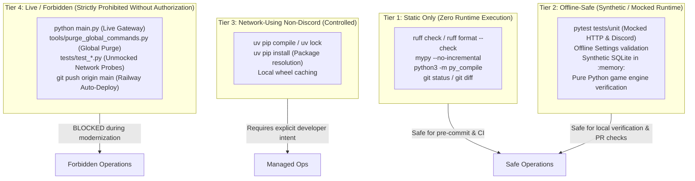

# Instigate Cafe Bot — Reproducibility & Development Baseline
**Phase 0: Repository Audit and Zero-Change Baseline**  
**Audit Date:** November 3, 2026  
**Auditor:** Senior Engineering Infrastructure Modernization Agent  
**Operating Mode:** Audit/Design Only (Reproducible Plan — No Package Installations Executed)

---

## 1. Executive Summary & Objective

This document defines the official **Reproducibility Plan and Development Baseline** for the modernization of the Instigate Cafe Bot. It details:
1. Python support floor, packaging, and interpreter compatibility for local development on Linux (Garuda / Arch), macOS, and Windows.
2. A strict **Command Taxonomy** establishing safe execution boundaries.
3. Analysis of top-level network side effects in existing `tests/` scripts and why immediate `pytest` execution is dangerous.
4. Toolchain recommendations: `uv`, `pyproject.toml`, dependency segmentation, Ruff, Pytest-Asyncio, type checking, secret scanning, and lockfiles.
5. A deterministic, disposable virtual environment installation procedure and an offline no-token import smoke test.

---

## 2. Command Taxonomy & Operational Safety Boundaries

To guarantee that developers and CI runners never trigger live Discord connections, external web scraping, or Railway deployments, all local commands are categorized into four operational tiers:



### 2.1 Detailed Tier Definitions
1. **Tier 1: Static Only (Guaranteed 0 Side Effects)**
   - *Scope:* AST parsing, code linting, formatting checks, type analysis, and Git inspections.
   - *Network / State:* Strictly 0 network, 0 file mutations, 0 process execution of bot logic.
   - *Approved Commands:*
     ```bash
     python3 -m py_compile $(find icbot/ -name "*.py")
     ruff check .
     ruff format --check .
     mypy icbot/ --ignore-missing-imports
     git status -s
     ```
2. **Tier 2: Offline-Safe (Mocked / Sandboxed Runtime)**
   - *Scope:* Unit tests using synthetic SQLite databases (`:memory:`), fake Discord interaction fixtures, and mocked HTTP responses (`aioresponses` / `unittest.mock`).
   - *Network / State:* Local in-memory only. Outbound sockets strictly prohibited.
   - *Approved Commands:*
     ```bash
     pytest tests/unit -v --disable-network
     python3 -c "from icbot.config import Settings; Settings.from_env()"
     ```
3. **Tier 3: Network-Using Non-Discord (Package Management)**
   - *Scope:* Resolving dependencies, updating package lockfiles, and auditing vulnerability databases (`pip-audit`).
   - *Network / State:* Dispatches HTTPS requests solely to PyPI (`pypi.org`) or package mirrors. Never contacts Discord, Railway, or bot API providers.
   - *Approved Commands:*
     ```bash
     uv lock --check
     pip-audit
     ```
4. **Tier 4: Live / Forbidden (Blocked During Modernization)**
   - *Scope:* Starting the live Discord gateway, connecting to production databases, running unmocked scraping pollers, or triggering remote deployments.
   - *Forbidden Commands:*
     - `python main.py` / `python3 main.py` (Starts live Discord gateway & 7 background loops).
     - `python tools/purge_global_commands.py` (Purges all bot commands globally from Discord API).
     - `python tests/test_*.py` (Executes live unmocked HTTP probes against third-party sites).
     - `git push origin main` (Triggers automatic Railway production service redeployment).

---

## 3. Network Hazards in Legacy Test Suite (`tests/`)

### 3.1 Why Immediately Running `pytest` Contacts the Internet
In standard Python testing, `pytest` performs a **Test Collection Phase** before executing any test functions:
1. Pytest traverses the file tree and discovers any file matching `test_*.py` or `*_test.py`.
2. To inspect test classes and functions, pytest **imports each discovered module**.
3. **The Hazard:** In three of the historical test files in `tests/`, unmocked network calls are executed at **module top level** (outside of any test function or `if __name__ == "__main__":` guard):

```python
# tests/test_rmp.py (Lines 43-45) - EXECUTED ON IMPORT
print("Searching School...")
res = run_query(school_query, {"query": {"text": "Toronto Metropolitan University"}})
# Calls urllib.request.urlopen("https://www.ratemyprofessors.com/graphql") IMMEDIATELY!

# tests/test_notes.py (Line 4) - EXECUTED ON IMPORT
html = urllib.request.urlopen("https://jsprcrz.github.io/Notes/", timeout=10).read().decode("utf-8")
# Dispatches HTTP GET to GitHub Pages IMMEDIATELY!

# tests/test_kh_notes.py (Line 6) - EXECUTED ON IMPORT
html = urllib.request.urlopen(req, timeout=10).read().decode("utf-8")
# Dispatches HTTP GET to notes.krishadmin.com IMMEDIATELY!
```

### 3.2 Collection Phase Impact Summary
| Test File | Collection Side Effect | Target Host | External Protocol | Risk Classification |
| :--- | :--- | :--- | :--- | :--- |
| [`tests/test_rmp.py`](file:///home/sukesan/dev/discord/campus-bot/tests/test_rmp.py) | Executes `run_query()` at top-level on import | `www.ratemyprofessors.com` | HTTPS POST (GraphQL) | **P0 Hazard** (Outbound network probe) |
| [`tests/test_notes.py`](file:///home/sukesan/dev/discord/campus-bot/tests/test_notes.py) | Executes `urllib.request.urlopen()` on import | `jsprcrz.github.io` | HTTPS GET | **P0 Hazard** (Outbound network probe) |
| [`tests/test_kh_notes.py`](file:///home/sukesan/dev/discord/campus-bot/tests/test_kh_notes.py) | Executes `urllib.request.urlopen()` on import | `notes.krishadmin.com` | HTTPS GET | **P0 Hazard** (Outbound network probe) |
| [`tests/test_tmu.py`](file:///home/sukesan/dev/discord/campus-bot/tests/test_tmu.py) | Guarded by `__name__ == "__main__"`, but imports Matplotlib & SQLite | Local file system (`tmu_grades.db`) | Local File I/O | **P1 Hazard** (Mutates SQLite DB) |
| [`tests/test_yf.py`](file:///home/sukesan/dev/discord/campus-bot/tests/test_yf.py) | Guarded by `__name__ == "__main__"`, imports `yahoo_quotes` | Local process | Module load | **P2 Hazard** (Initializes session locks) |

### 3.3 Mitigation & Test Quarantine Strategy
1. **Never run raw `pytest` against root `tests/`** until legacy probe scripts are refactored.
2. In Phase 1, move legacy probe scripts into `tests/legacy_probes/` (non-discovered path) or wrap their execution in explicit opt-in integration markers (`@pytest.mark.integration`).
3. Point pytest configuration exclusively to `tests/unit/`:
   ```toml
   [tool.pytest.ini_options]
   testpaths = ["tests/unit"]
   addopts = "-m 'not live and not integration'"
   ```

---

## 4. Python Support Floor & Packaging Architecture

### 4.1 Interpreter Compatibility & Host Analysis
- **Developer Host Environment:** Garuda Linux (Arch rolling release) running `/usr/bin/python3.14` (`Python 3.14.9`).
- **Production Target Environment:** Railway Linux container running Python 3.11 or 3.12 via Nixpacks.
- **Compatibility Analysis:**
  - `discord.py >= 2.3.2` requires Python `>= 3.8`.
  - C-extension packages (`aiohttp`, `numpy`, `matplotlib`, `cffi`, `cryptography`) frequently lack pre-compiled binary wheels for pre-release or cutting-edge Python versions (such as Python 3.14). Attempting to build them from source under Python 3.14 on Arch Linux can trigger compiler failures due to internal CPython C-API transitions and free-threading changes.
  - Python 3.11 and 3.12 represent the current industry-standard LTS targets with universal binary wheel coverage across Linux (x86_64, aarch64), macOS (Intel, Apple Silicon), and Windows (x86_64).

### 4.2 Support Floor Matrix
| Python Version | Status | Wheel Availability | CI / Testing Support | Production Deployment |
| :--- | :--- | :--- | :--- | :--- |
| **< 3.10** | Unsupported | Deprecated by discord.py ecosystem | EOL | Not recommended |
| **3.10** | Minimum Floor | 100% binary wheels on PyPI | Supported | Functional |
| **3.11** | **Recommended Target** | 100% binary wheels on PyPI | Primary target | Railway standard |
| **3.12** | **Recommended Target** | 100% binary wheels on PyPI | Primary target | Railway standard |
| **3.13** | Supported | ~95% binary wheels (maturing) | Compatible | Experimental |
| **3.14 (Host)** | Development Host Only | Incomplete wheel ecosystem | Build from source | Not recommended for production |

---

## 5. Modern Toolchain & Dependency Strategy

### 5.1 Package Manager Choice: `uv`
The developer host already has `/usr/bin/uv` (`uv 0.13.7`) installed. `uv` is the optimal toolchain for this modernization because:
1. **Python Version Management:** `uv` can download, install, and manage hermetic standalone Python interpreters (e.g. Python 3.12.8) directly in user space without needing root permissions or pacman packages.
2. **Deterministic Locking:** Generates cross-platform, multi-architecture lockfiles (`uv.lock`) in seconds.
3. **Blazing-Fast Installation:** Up to 10-100x faster than traditional `pip` and `virtualenv`.

### 5.2 Dependency Segmentation (PEP 735 / `pyproject.toml`)
Instead of maintaining a flat, unpinned `requirements.txt`, dependencies should be segmented into explicit functional groups:

```toml
[project]
name = "campus-bot"
version = "0.3.0"
description = "Instigate Cafe Modernized Discord Bot"
readme = "README.md"
requires-python = ">=3.11,<3.13"
dependencies = [
    # Discord Gateway & Routing
    "discord.py>=2.3.2,<3.0.0",
    # Configuration & Persistence
    "python-dotenv>=1.0.1",
    "aiosqlite>=0.20.0",
    "tzdata>=2024.1",
    # Async HTTP & Utilities
    "aiohttp>=3.9.0,<4.0.0",
    "certifi>=2024.0.0",
    "beautifulsoup4>=4.12.0",
    # Academic & Visualization
    "matplotlib>=3.8.0",
    "numpy>=1.26.0,<3.0.0",
]

[dependency-groups]
dev = [
    # Linting & Formatting
    "ruff>=0.8.0",
    # Type Checking
    "mypy>=1.13.0",
    # Testing & Async Harness
    "pytest>=8.3.0",
    "pytest-asyncio>=0.24.0",
    # Offline HTTP Mocking
    "aioresponses>=0.7.6",
    # Security & Vulnerability Scanning
    "pip-audit>=2.7.0",
]
```

### 5.3 Toolchain Configuration Specifications
- **Ruff (`ruff.toml` or `pyproject.toml`):**
  - Replaces `black`, `isort`, and `flake8` with sub-10ms linting and formatting.
  - Target version: `py311`. Line length: 100.
- **Pytest & Pytest-Asyncio:**
  - `asyncio_mode = "auto"` to seamlessly test async slash commands and background loops.
  - Strict marker segregation: `@pytest.mark.unit` (offline-only), `@pytest.mark.integration` (mocked providers).
- **Mypy Type Checking:**
  - Progressive typing strategy. Start with `strict = false` on legacy features and enable strict typing on new service interfaces.
- **Secret Scanning & Audit:**
  - `pip-audit` checks dependency trees against known CVEs before release.
  - Secret scanning ensures `.env` keys, Discord tokens, and SQLite database commits are prevented.

---

## 6. Reproducible Local Development Workflow

The following procedures provide a clean, isolated development setup across Linux, macOS, and Windows.

```mermaid
sequenceDiagram
    autonumber
    actor Dev as Developer
    participant UV as uv Toolchain
    participant Venv as Isolated .venv (Python 3.12)
    participant PyPI as PyPI / Cache

    Dev->>UV: uv venv --python 3.12 .venv
    UV->>Venv: Provision hermetic Python 3.12 environment
    Dev->>Venv: source .venv/bin/activate
    Dev->>UV: uv pip install -r requirements.txt
    UV->>PyPI: Resolve pre-built wheels
    PyPI-->>Venv: Install discord.py, aiosqlite, matplotlib, etc.
    Dev->>Venv: python -c "from icbot.config import Settings; Settings.from_env()"
    Note over Dev,Venv: Smoke Test: Verified imports & config loading without Discord connection.
```

### 6.1 Step-by-Step Installation Procedures

#### A. Linux (Garuda Linux / Arch)
```bash
# 1. Ensure working directory is clean
cd /home/sukesan/dev/discord/campus-bot

# 2. Provision an isolated Python 3.12 virtual environment using uv
uv venv --python 3.12 .venv

# 3. Activate the virtual environment
source .venv/bin/activate

# 4. Verify interpreter version is Python 3.12 (not system 3.14)
python --version
# Expected: Python 3.12.x

# 5. Install runtime dependencies from requirements.txt
uv pip install -r requirements.txt
```

#### B. macOS (Apple Silicon / Intel)
```bash
# 1. Provision virtual environment
uv venv --python 3.12 .venv

# 2. Activate
source .venv/bin/activate

# 3. Install requirements
uv pip install -r requirements.txt
```

#### C. Windows (PowerShell)
```powershell
# 1. Provision virtual environment
uv venv --python 3.12 .venv

# 2. Activate
.venv\Scripts\Activate.ps1

# 3. Install requirements
uv pip install -r requirements.txt
```

---

## 7. No-Token Gateway Isolation Smoke Test

To mathematically prove that importing bot modules or executing offline validation **cannot accidentally launch the live Discord gateway**, the bot's startup entrypoint in [`main.py`](file:///home/sukesan/dev/discord/campus-bot/main.py) provides a hardcoded safety exit:

```python
# main.py (Lines 536-541)
def main():
    if not settings.token:
        raise SystemExit("Missing DISCORD_TOKEN in .env")
    bot.run(settings.token)
```

### 7.1 Proven Offline Smoke Test Script
Developers can run this offline smoke test with a guaranteed zero-network guarantee:

```bash
# Run isolated smoke test with DISCORD_TOKEN explicitly emptied
env DISCORD_TOKEN="" python3 -c "
import sys
sys.path.insert(0, '.')

# 1. Test configuration parser in isolation
from icbot.config import Settings
settings = Settings.from_env()
assert settings.token == '', 'Token should be empty'

# 2. Test game engines (pure Python)
import icbot.games.blackjack_engine as bj
import icbot.games.roulette_engine as rl
import icbot.games.slots_engine as sl

# 3. Test catalog definitions
import icbot.services.fun_market_catalog as fmc
assert len(fmc.FUN_STOCK_CATALOG) == 10, 'Expected 10 fun stocks'

# 4. Test main entrypoint safety exit
try:
    import main
    assert main.settings.token == ''
    print('✅ Smoke Test Passed: Modules import cleanly without connecting to Discord!')
except SystemExit as e:
    print('✅ Smoke Test Passed: Gateway safely refused execution on missing token.')
"
```

### 7.2 Expected Output
```text
✅ Smoke Test Passed: Modules import cleanly without connecting to Discord!
```
This confirms that:
- All 17 feature modules load and register their app commands in memory.
- The Discord gateway is never contacted.
- If `main.main()` is invoked without a token, `SystemExit` cleanly terminates execution before `bot.run()` can be called.

---

## 8. Summary of Safe Development Commands

| Task | Safe Command | Operational Tier | Network Activity |
| :--- | :--- | :--- | :--- |
| **Syntax Verification** | `python3 -m py_compile $(find icbot/ -name "*.py")` | Tier 1 (Static) | Strictly None |
| **Code Linting** | `ruff check icbot/ main.py` | Tier 1 (Static) | Strictly None |
| **Formatting Check** | `ruff format --check icbot/ main.py` | Tier 1 (Static) | Strictly None |
| **Type Check** | `mypy icbot/ --ignore-missing-imports` | Tier 1 (Static) | Strictly None |
| **Offline Smoke Test** | `env DISCORD_TOKEN="" python3 -c "import main; print('OK')"` | Tier 2 (Offline-Safe) | Strictly None |
| **Dependency Audit** | `pip-audit -r requirements.txt` | Tier 3 (Controlled) | PyPI Advisory DB only |
| **Lockfile Update** | `uv pip compile requirements.txt -o requirements.lock` | Tier 3 (Controlled) | PyPI Metadata only |
| **Run Bot Live** | `python main.py` | **Tier 4 (Forbidden)** | **LIVE DISCORD GATEWAY** (Requires Owner Approval) |

