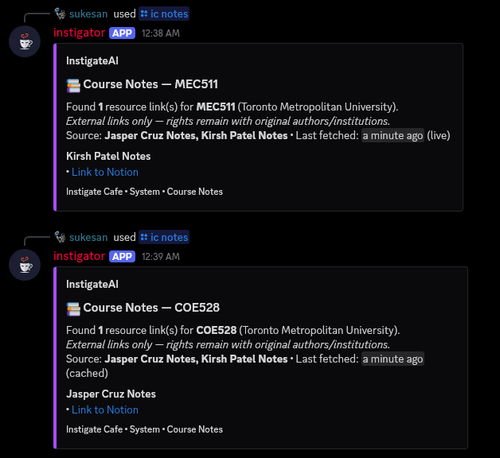

# Instigate Cafe Bot — Screenshot Gallery

Verified, metadata-stripped Discord UI captures from the v1.0 release using the default `instigate_cafe` theme (`#A64DFF`). For capture, cropping, and redaction standards, see [Screenshots Capture & Redaction Guide](screenshots-guide.md).

---

## Core Experience

<table>
  <tr>
    <td width="50%" align="center" valign="top">
       
      <b>Onboarding Walkthrough</b> — <code>/ic getting-started</code> interactive 4-step guide
    </td>
    <td width="50%" align="center" valign="top">
       
      <b>Dynamic Help Directory</b> — <code>/ic help</code> paginated command index
    </td>
  </tr>
  <tr>
    <td width="50%" align="center" valign="top">
       
      <b>Academic Course Notes</b> — <code>/ic notes</code> study links with live and cached provenance
    </td>
    <td width="50%" align="center" valign="top">
       
      <b>Career Job Board</b> — <code>/ic jobs</code> paginated Greenhouse, Lever, and Workday listings
    </td>
  </tr>
</table>

---

## Economy, Casino & Sports

<table>
  <tr>
    <td width="50%" align="center" valign="top">
       
      <b>Virtual Stock Exchange (ICSE)</b> — <code>/ic icse market</code> synthetic securities
    </td>
    <td width="50%" align="center" valign="top">
       
      <b>Interactive Blackjack</b> — <code>/ic casino blackjack</code> button-driven card play
    </td>
  </tr>
  <tr>
    <td width="50%" align="center" valign="top">
       
      <b>Sports Updates</b> — <code>/ic sports boxing</code> upcoming schedule and RSS headlines
    </td>
    <td width="50%" align="center" valign="top">
      
<i>Additional optional captures (<code>/ic exam list</code>, redacted <code>/ic status</code>, and <code>/ic resume</code> consent notice) will be added here once recaptured without Discord snowflake IDs, private channel names, or real student resumes.</i>

    </td>
  </tr>
</table>

---

[Back to README](../README.md) · [Documentation Index](README.md) · [Screenshots Capture & Redaction Guide](screenshots-guide.md)
