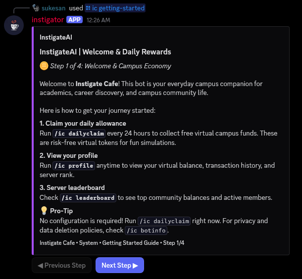
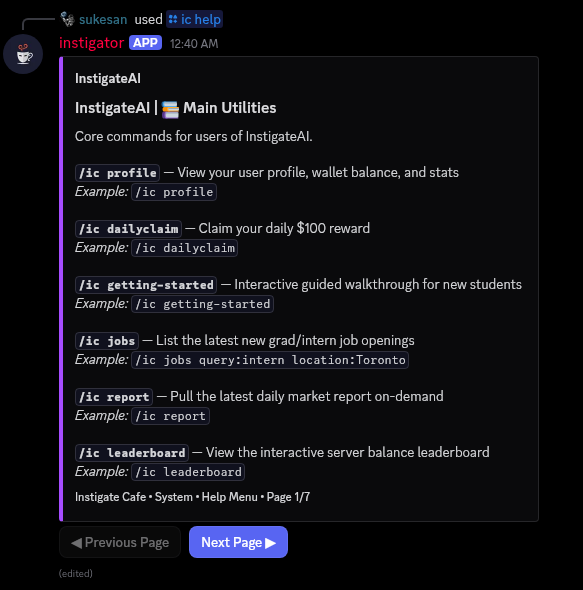
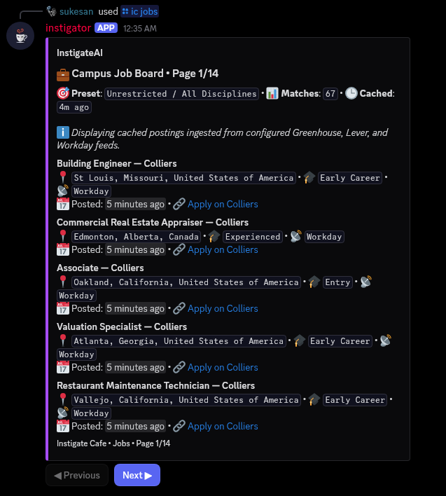
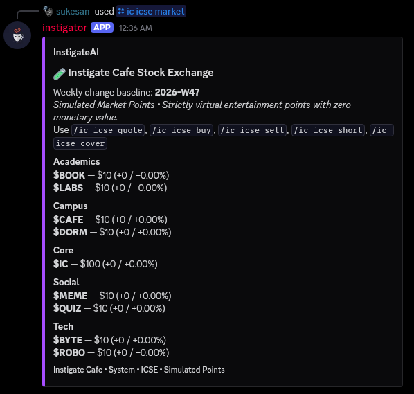
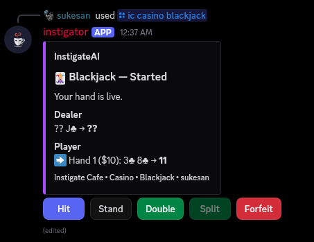
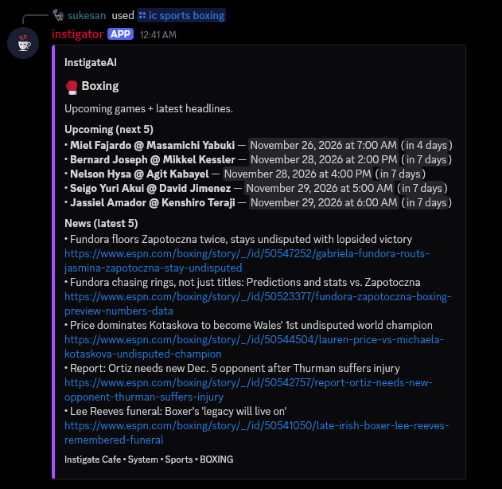

# Instigate Cafe Bot — Screenshot Gallery

Real Discord UI screenshots captured using the default `instigate_cafe` theme (`#A64DFF`).

---

## Core Features

<table>
  <tr>
    <td width="50%" align="center" valign="top">
       
      <b>Onboarding Walkthrough</b> — <code>/ic getting-started</code> interactive 4-step guide
    </td>
    <td width="50%" align="center" valign="top">
       
      <b>Dynamic Help Directory</b> — <code>/ic help</code> paginated command index
    </td>
  </tr>
  <tr>
    <td width="50%" align="center" valign="top">
       
      <b>Academic Course Notes</b> — <code>/ic notes</code> study links with live and cached provenance
    </td>
    <td width="50%" align="center" valign="top">
       
      <b>Career Job Board</b> — <code>/ic jobs</code> paginated Greenhouse, Lever, and Workday listings
    </td>
  </tr>
</table>

---

## Simulated Economy, Casino & Sports

<table>
  <tr>
    <td width="50%" align="center" valign="top">
       
      <b>Simulated Stock Exchange (ICSE)</b> — <code>/ic icse market</code> virtual community points
    </td>
    <td width="50%" align="center" valign="top">
       
      <b>Interactive Blackjack</b> — <code>/ic casino blackjack</code> button-driven simulated card play
    </td>
  </tr>
  <tr>
    <td width="50%" align="center" valign="top">
       
      <b>Sports Updates</b> — <code>/ic sports boxing</code> upcoming schedule and RSS headlines
    </td>
    <td width="50%" align="center" valign="top">
      
<i>All economy balances, casino bets, and ICSE stocks shown above use purely virtual server points with no real-money value.</i>

    </td>
  </tr>
</table>

---

[Back to README](../README.md) · [Documentation Index](README.md) · [Features & Command Guide](features.md)
