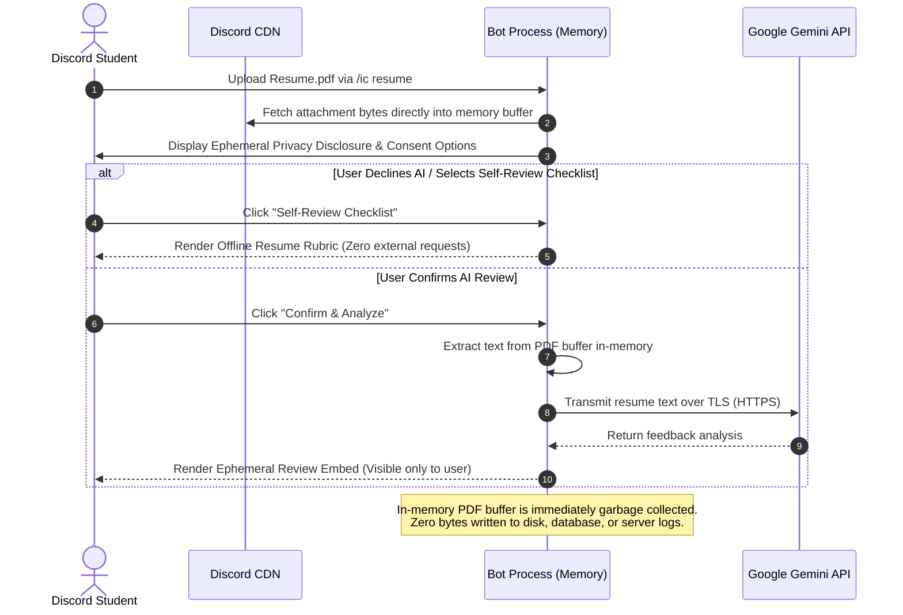

# Instigate Cafe Bot — Privacy Model, Data Flows & Deletion Policy

**Document Version:** 2.0.0 (Phase 12 Privacy Specification)  
**Reference Specification:** [`docs/privacy/data-map.md`](file:///home/sukesan/dev/discord/campus-bot/docs/privacy/data-map.md)  
**Storage Architecture:** Local SQLite 3 (`campus.db`) with Write-Ahead Logging (WAL)  
**Scope Notice:** This document describes technical privacy controls, data flows, and erasure procedures implemented in code. It does not constitute formal legal counsel or an automated compliance certification.

---

## 1. Core Principles & Data Minimization

The Instigate Cafe Bot operates on strict **data minimization** principles:
- **No Message Eavesdropping:** The bot does **not** record, log, or persist arbitrary channel messages or private chat history.
- **No PII Collection:** The bot does not request or store real names, email addresses, student ID numbers, passwords, phone numbers, or financial account details.
- **Local Sovereignty:** Self-hosted deployments retain all database state on the host's own disk volume. Upstream maintainers have zero access to private server databases.

---

## 2. Complete Data Classification & Storage Matrix

| Data Category | Specific Fields Stored | Storage Location | Retention Window | Deletion Mechanism |
|---|---|---|---|---|
| **User Economy Profile** | Discord Snowflake User ID, Server ID, virtual cash balance, daily claim timestamp | SQLite `users` table | Indefinite (active server membership) | Atomically deleted on Right-to-be-Forgotten request |
| **Transaction Ledger** | Transaction ID, User ID (or tombstone), delta amount, reason, timestamp | SQLite `transactions` table | Indefinite (audit trail) | User ID replaced with anonymous tombstone on deletion |
| **Fun-Stock Portfolios** | User ID, Guild ID, stock symbol, shares, cost basis | SQLite `portfolio` table | Until position is sold/covered | Deleted on user data purge |
| **Exam Schedules** | Course code, course name, exam date, start time, location, guild ID | SQLite `exams` table | Managed by guild admins | Removed via `/ic exam remove` or `/ic exam clear` |
| **Job Alert Preferences** | User ID, career preset, location keywords, remote flag | SQLite `job_preferences` table | Until updated or purged | Deleted on user data purge |
| **Resume Reviews** | PDF resume text, discipline, target role | **In-Memory Only** | **Ephemeral (0 seconds)** | **Never stored on disk or in SQLite** |
| **Community Lore** | Nicknames, inside jokes, public server lore | Static JSON (`lore.json`) | Managed by guild operator | Edited or removed in operator's lore file |

---

## 3. Ephemeral AI Resume Review Processing

The `/ic resume` feature provides confidential automated resume feedback powered by Google's Gemini API:



### Privacy Guarantees:
1. **Zero Disk Storage:** Uploaded PDF attachments are processed entirely in transient RAM buffers. They are never written to disk, SQLite, or container layers.
2. **Confidentiality:** Analysis responses are sent as ephemeral Discord messages visible exclusively to the uploading student.
3. **Offline Fallback:** Students can decline AI submission and receive an offline resume rubric without transmitting data to any external endpoint.

---

## 4. Third-Party Data Processors

| Third Party | Purpose | Data Transmitted | Privacy Safeguards |
|---|---|---|---|
| **Discord (Discord Inc.)** | Message delivery, slash commands, UI components | User interactions, command options, ephemeral responses | Discord Developer Terms of Service and Privacy Policy |
| **Google Gemini API (Google LLC)** | Generative assistant replies & resume feedback | User prompt text, mentioned message context, in-memory resume text | API key auth over TLS; hourly rate limits; prompt sanitization |
| **RateMyProfessors (Chewse Inc.)** | Professor lookup | Professor names and course codes only | Zero user IDs or Discord metadata transmitted |
| **Metrolinx / TTC Mastodon** | Transit alert aggregation | None (bot only pulls public feeds) | Zero user data transmitted |
| **Greenhouse / Lever / Workday** | Career board scraping | None (bot only pulls public postings) | Zero user data transmitted |

---

## 5. User Data Deletion & Right-to-be-Forgotten

Community members have the right to purge all stored personal data from the bot's database:

### Technical Deletion Mechanism:
The bot implements the Right-to-be-Forgotten through [`UserStore.delete_user_data()`](file:///home/sukesan/dev/discord/campus-bot/icbot/storage/user.py):
1. **User Profile Purged:** Deletes the user's row from the `users` table.
2. **Job Preferences Purged:** Deletes saved search alerts from `job_preferences`.
3. **Open Portfolios Closed:** Cleans up fun-stock holdings from `portfolio`.
4. **Ledger Anonymization:** Transaction history in `transactions` is anonymized using tombstones (`user_id = 0` / `"ANONYMIZED"`). This guarantees that historical currency circulation remains mathematically balanced without retaining any link to the deleted Discord identity.

### How to Request Deletion:
- Members can contact their Discord server administrator to trigger a data purge.
- In self-hosted installations, operators can purge a user record directly using the SQLite CLI:
  ```bash
  python3 -c "
  import asyncio
  from icbot.db import Database
  from icbot.storage.user import UserStore
  async def purge():
      db = Database('data/campus.db')
      await db.init()
      store = UserStore(db)
      counts = await store.delete_user_data(USER_ID, anonymize_ledger=True)
      print('Purged rows:', counts)
      await db.close()
  asyncio.run(purge())
  "
  ```

