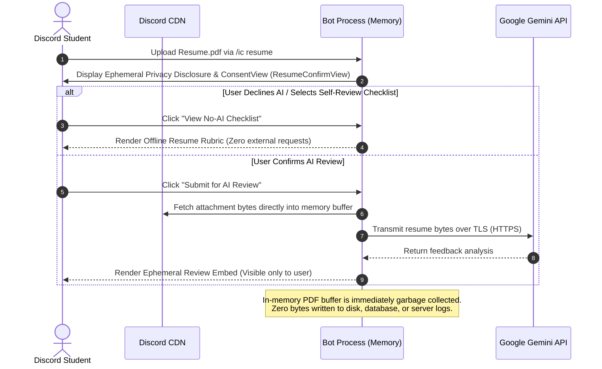
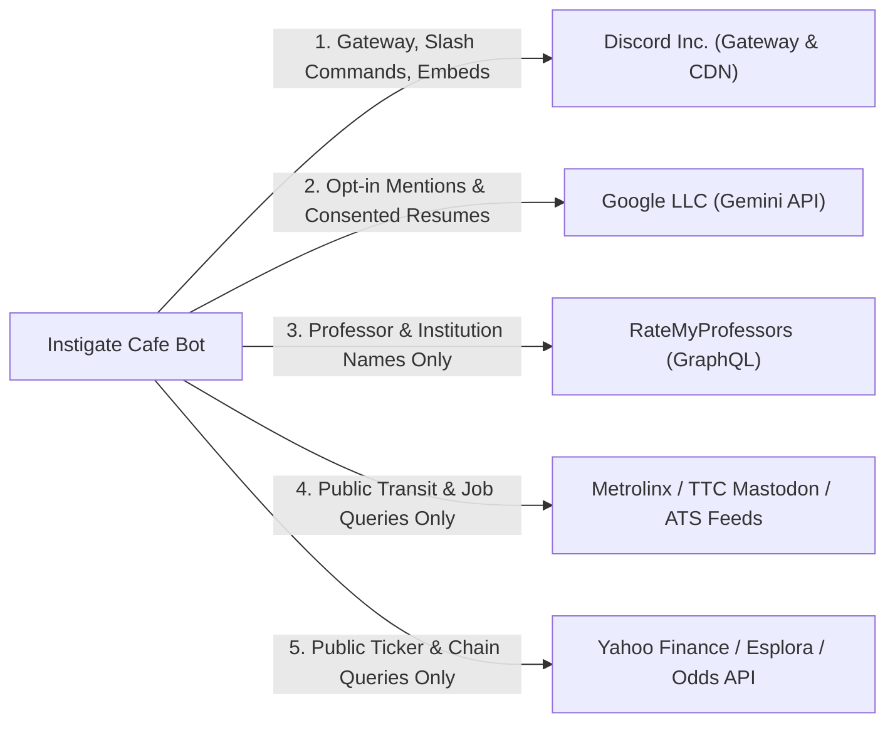
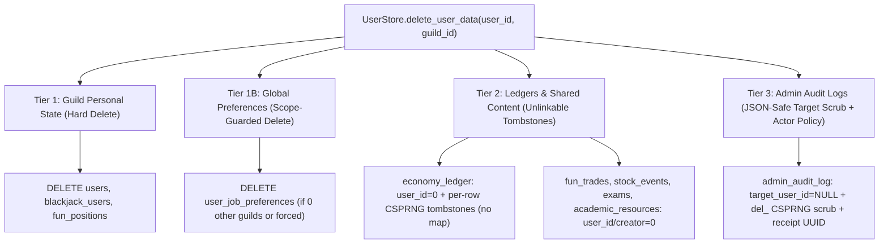

# Instigate Cafe Bot — Privacy Model, Data Map & Deletion Policy

**Release:** `v1.0.0`  
**Primary Implementation:** [`icbot/services/user_service.py`](../icbot/services/user_service.py)  
**Storage Architecture:** Local SQLite 3 (`DB_PATH`, container default `/data/campus.db`) with Write-Ahead Logging (WAL)  
**Scope Notice:** This document describes the verified technical privacy controls, data flows, retention boundaries, and erasure/anonymization procedures implemented in code. It does not constitute formal legal counsel or an automated regulatory certification.

---

## 1. Core Principles & Data Minimization

The Instigate Cafe Bot operates on **data minimization** principles:
- **No Persistent Message Storage & No Automatic Channel-History Collection by Default:** The bot does **not** record, log, or persist arbitrary channel messages or private chat history to local disk or SQLite. By default (`LLM_CHANNEL_HISTORY_ENABLED=false`), `@mention` invocations process only the mentioning message (and any directly replied-to message). Only if the server operator explicitly enables both `LLM_ENABLED=true` and `LLM_CHANNEL_HISTORY_ENABLED=true` does an `@mention` read recent surrounding channel messages (bounded by `LLM_MAX_MESSAGES`) into transient memory for the duration of that single Google Gemini API request.
- **No Real-World Identity or Payment Collection:** The bot does not request or store real names (beyond public Discord `display_name`), email addresses, student ID numbers, passwords, phone numbers, or real financial account details.
- **Local Plaintext SQLite & Host Data Sovereignty:** Self-hosted deployments store all persistent state in a local plaintext SQLite 3 database on the host's own disk volume (`DB_PATH`, container default `/data/campus.db`). Application-level encryption is not performed; encryption at rest depends on the host operator's disk/volume configuration. Upstream maintainers have zero network access to self-hosted databases.
- **Distinction Between Local Application Storage and Platform/Third-Party Retention:** Data marked as *"not stored by this application"* means the bot process never writes it to local disk, SQLite, or application logs. However, slash-command attachments and ephemeral reply payloads transit **Discord's infrastructure** under Discord's Privacy Policy, and opt-in AI requests transmit prompt or document bytes to **Google Gemini API** under the operator's Google Cloud / Google AI Studio data retention terms.

---

## 2. Authoritative SQLite Data Classification & Storage Matrix

Every table in [`icbot/db.py`](../icbot/db.py) has been audited for user-addressable identifiers:

| SQLite Table | Scope | User-Identifiable Fields | Retention Window | `UserStore.delete_user_data()` Behavior |
|---|---|---|---|---|
| `users` | Guild (`guild_id, user_id`) | `user_id`, `display_name`, `avatar_url`, `balance`, `created_at`, `daily_claim_ts` | Active guild membership | **Hard-Deleted** (`DELETE FROM users WHERE guild_id=? AND user_id=?`) |
| `blackjack_users` | Guild (`guild_id, user_id`) | `user_id`, `bankroll`, `hands_played`, `wins`, `losses`, `pushes`, `reset_count` | Active guild membership | **Hard-Deleted** (`DELETE FROM blackjack_users WHERE guild_id=? AND user_id=?`) |
| `fun_positions` | Guild (`guild_id, user_id, symbol, side`) | `user_id`, `symbol`, `side`, `qty`, `avg_price`, `collateral_locked` | Until position is closed or user deleted | **Hard-Deleted** (`DELETE FROM fun_positions WHERE guild_id=? AND user_id=?`) |
| `user_job_preferences` | **Global Cross-Guild** (`user_id`) | `user_id`, `preset`, `disciplines`, `career_levels`, `locations`, `keywords_allow`, `keywords_deny`, `remote_only` | Until cleared via `/ic job_preferences clear:True` or user purge | **Scope-Guarded Hard-Delete:** Deleted automatically if the user has no remaining profiles in other guilds (`users`), or when `delete_global_preferences=True` is passed. Preserved if the user remains active in another guild and `delete_global_preferences=False`. |
| `economy_ledger` | Guild (`guild_id, id`) | `user_id`, plus `uid` embedded in auto-generated `transaction_id` / `reference_id`, plus `balance_after` / `amount` / `created_at` | Indefinite (aggregate supply audit trail) | **Unlinkable Tombstones** (`anonymize_ledger=True`): Row `amount`, `balance_after`, and `created_at` are preserved for guild supply accounting; `user_id` is set to `0` (`ANONYMIZED_USER_ID`); any `transaction_id` containing `user_id` is replaced with an unpredictable per-row CSPRNG tombstone (`tombstone:<32-alpha>`, no retained reidentification map) while remapping in-batch `reference_id` links atomically; opaque caller keys without `user_id` stay unique under `user_id=0` so late replays fail closed (`IdempotencyConflict`). Residual linkability from timestamps, amounts, and balance chains remains (see Section 5.2). |
| `fun_trades` | Guild (`guild_id, id`) | `user_id`, `note`, plus `ts_unix` / `cash_delta` | Indefinite (market volume & PnL tape) | **Tombstoned** (`anonymize_ledger=True`): `user_id` set to `0` and `note` set to `'[ANONYMIZED_USER]'` (or hard-deleted when `anonymize_ledger=False`). Residual timestamp/amount correlation remains. |
| `fun_stock_events` / `stock_events` | Guild (`guild_id, id`) | `user_id`, `reason` | Indefinite (stock price change history) | **Tombstoned**: `user_id` set to `0` and `reason` set to `'[ANONYMIZED_USER]'`. |
| `fun_market_weeks` | Guild (`guild_id, week_key`) | `settled_by` (admin snowflake), optional `notes` | Indefinite (weekly settlement log) | **Tombstoned**: `settled_by` set to `NULL` and exact-boundary `user_id` tokens in `notes` replaced with unpredictable CSPRNG tokens (`del_<24-alpha>`). |
| `exams` | Guild (`guild_id, id`) | `created_by` (creator snowflake); shared free-text `course_name` / `notes` / `organizer` | Until removed via `/ic exam remove` or `/ic exam clear` | **Creator Tombstoned**: `created_by` set to `0` so shared guild exam timetables stay intact without creator attribution. Shared free-text fields are not rewritten. |
| `academic_resources` | Guild (`guild_id, id`) | `added_by` (contributor snowflake); shared `title` / `url` / `source_attribution` | Until removed via catalog admin | **Contributor Tombstoned**: `added_by` set to `0` so shared study links stay intact without contributor attribution. Shared link metadata is not rewritten. |
| `admin_audit_log` | Guild (`guild_id, id`) | `target_user_id`, `admin_user_id`, `details_json` | Indefinite (security & admin audit trail) | **Split Target vs. Actor Policy:** Where the user is `target_user_id`, `target_user_id` is set to `NULL` and `details_json` is JSON-safely scrubbed of exact-boundary `user_id` values using unpredictable CSPRNG tokens (`del_<24-alpha>`). Where the user was a privileged admin (`admin_user_id`), the actor ID is retained by default (`retain_admin_actor_audit=True`) for security accountability, or zeroed (with `details_json` scrubbed) if `retain_admin_actor_audit=False`. |
| `guild_settings_audit` | Guild (`guild_id, audit_id`) | `actor_id` (admin snowflake) | Indefinite (server config audit trail) | **Operator Policy Choice:** Retained by default (`retain_admin_actor_audit=True`) for server configuration accountability, or set to `0` when `retain_admin_actor_audit=False`. |
| `guild_job_subscriptions`, `job_seen`, `job_alert_outbox`, `alert_delivery_dedupes`, `workday_cxs_cache`, `grades_course_cache`, `guild_settings`, `guild_stock_catalog`, `fun_stocks`, `academic_courses`, `meta`, `schema_migrations` | Guild or Global System State | **None** (guild IDs, channel IDs, role IDs, and public course/job metadata only) | Managed by `Database.prune_stale_data()` or guild admins | Untouched by user deletion (contains zero user-level identifiers). |
| **Resume Reviews (`/ic resume`)** | **In-Memory Only** | PDF resume bytes/text, discipline, target role | **Ephemeral (0 seconds on disk)** | **Never written to disk, SQLite, or logs**; garbage-collected immediately after response. |

---

## 3. Ephemeral AI Resume Review Processing

The `/ic resume` feature provides confidential automated resume feedback powered by Google's Gemini API:



### Privacy Safeguards:
1. **Mandatory Pre-Transmission Consent (`ResumeConfirmView`):** Before reading or forwarding any resume bytes to Google Gemini, the bot presents an ephemeral consent barrier allowing the user to choose **"Submit for AI Review"**, **"View No-AI Checklist"**, or **"Cancel"** (unless the user explicitly passes `confirm:True` on `/ic resume`).
2. **Zero Disk Storage by This Application:** Uploaded PDF/image attachments are processed entirely in transient RAM buffers by the bot process. They are never written to local disk, SQLite, or container filesystem layers.
3. **Platform & Third-Party Retention Boundary:** Because users upload resume attachments through Discord slash commands and receive ephemeral embeds (or an ephemeral `.md` attachment if the review exceeds 3,900 characters), attachment bytes and responses transit Discord's CDN/API under Discord's retention policy. When AI review is confirmed, document bytes are transmitted over HTTPS to Google Gemini under the operator's Google Cloud / Gemini API terms.
4. **Ephemeral Delivery:** Analysis responses are delivered as ephemeral Discord messages visible only to the uploading student.

---

## 4. Third-Party Data Processors & Data-Flow Map



| Third Party | Purpose | Data Transmitted | Privacy Safeguards & Terms |
|---|---|---|---|
| **Discord (Discord Inc.)** | Message delivery, slash commands, UI components | User interactions, command options, ephemeral responses | [Discord Developer Terms of Service](https://discord.com/developers/docs/policies-and-agreements/developer-terms-of-service) & [Discord Privacy Policy](https://discord.com/privacy) |
| **Google Gemini API (Google LLC)** | Generative assistant replies & opt-in resume feedback | Mention prompt text, optional recent channel history (`LLM_CHANNEL_HISTORY_ENABLED=true` only), in-memory resume bytes after explicit user consent | TLS encryption; rate limits & token budgets; log redaction; [Gemini API Terms](https://ai.google.dev/terms) |
| **RateMyProfessors (Chewse Inc.)** | Professor lookup (`/ic prof`) | Professor names and institution names only | Zero user IDs or Discord metadata transmitted |
| **Metrolinx / TTC Mastodon** | Transit alert aggregation | None (public feeds only) | Zero user data transmitted |
| **Greenhouse / Lever / Workday** | Career board ingestion | None (public job listings only) | Zero user data transmitted |
| **Yahoo Finance / Esplora / Odds API** | Market quotes, BTC UTXOs, sports schedules | Public tickers, addresses, and sport keys only | Zero user PII or Discord IDs transmitted |

### 4.1 Operator Disablement & Log Redaction Controls
| Control | Environment Variable / Command | Effect |
| :--- | :--- | :--- |
| **Disable All AI Processing** | `LLM_ENABLED=false` *(default)*, `DISABLED_FEATURES=ai`, or `/ic admin llm_stop` | Deny-first master disable halting all `@mention` Q&A and `/ic resume` Gemini calls (without reading attachments or channel history); setting `GEMINI_API_KEY` alone never enables AI traffic. |
| **Disable Channel Context Window** | `LLM_CHANNEL_HISTORY_ENABLED=false` *(default)* | `@mention` processes only the invoking message (and direct reply), never surrounding channel history. |
| **Restrict Command Channels** | `USER_COMMAND_CHANNEL_ID` / `LLM_ALLOWED_CHANNEL_IDS` | Scopes command and AI access to approved channels only. |
| **Disable Background Pollers** | `MARKET_WATCH_ENABLED=false`, `BTC_WATCH_ENABLED=false`, `JOBS_POLL_SECONDS=0` | Stops autonomous outbound polling and checkpoint storage. |
| **Log Redaction Invariant** | `RedactingLogFilter` ([`icbot/logging.py`](../icbot/logging.py)) | Never logs raw resume bytes, channel message bodies, credentials, host paths, or bound SQL parameters; deletion audit receipts record an opaque random UUID without re-logging the deleted `user_id`. |

### 4.2 Data Controller Boundary: Self-Hosted vs. Hosted Public Instance
- **Self-Hosted Operator (Recommended):** Controls the Discord Application, optional API keys, host filesystem (`DB_PATH`), backups, and logs. The **self-hosting operator is the sole Data Controller** for their community.
- **Maintainer-Hosted Shared Instance:** Central operator controls shared infrastructure and acts as Data Controller for invited guilds, handling cross-guild deletion requests and API billing.

---

## 5. Deterministic Data Export & Right-to-be-Forgotten Erasure / Tombstone Contract



### 5.1 Deterministic Batched Export (`UserStore.export_user_data()`)
[`UserStore.export_user_data()`](../icbot/services/user_service.py) exports all user-addressable records for `(guild_id, user_id)` in a machine-readable JSON dictionary (`format_version: 2`):
- **Covered Tables:** `profile` (`users`), `blackjack` (`blackjack_users`), `positions` (`fun_positions`), `trades` (`fun_trades`), `ledger` (`economy_ledger`), `exams_created` (`exams`), `academic_resources_added` (`academic_resources`), and `job_preferences` (`user_job_preferences`, explicitly tagged with `"scope": "global_user"`).
- **No Hidden `LIMIT 100` Truncation:** Queries execute in deterministic pages (`batch_size=250` by default) up to a configurable memory-safety ceiling (`max_rows_per_table=5000`, or `None` for unbounded).
- **Honest Truncation Reporting:** If any table exceeds `max_rows_per_table`, the export sets `"truncated": True`, populates `pagination.total_counts` vs. exported counts, and appends an explicit human-readable warning in `"warnings"`.
- **Post-Deletion Export Behavior:** After `delete_user_data(user_id, guild_id=gid)` completes, `export_user_data(user_id, guild_id=gid)` returns `profile: None`, `blackjack: None`, empty lists for all guild-scoped tables, and `job_preferences: None` once no guild profiles remain.

### 5.2 Atomic Deletion & Unlinkable Tombstones (`UserStore.delete_user_data()`)
[`UserStore.delete_user_data()`](../icbot/services/user_service.py) executes inside a single `BEGIN IMMEDIATE` write transaction (`db.write_transaction()`). This design uses **unlinkable per-row CSPRNG tombstones (with no retained reidentification map)** rather than deterministic hashing/pseudonymization, and explicitly avoids claiming total anonymization:

1. **Guild Profile & Game State Hard-Deleted:** Removes rows for `(guild_id, user_id)` from `users`, `blackjack_users`, and `fun_positions`.
2. **Cross-Guild Job Preferences Guard:** Checks whether `user_id` still has active profiles in any other guild (`SELECT COUNT(1) FROM users WHERE user_id=? AND guild_id!=?`). `user_job_preferences` is deleted only when no other guild profiles remain or when `delete_global_preferences=True` is explicitly passed.
3. **Ledger Balancing, Uniqueness & Post-Deletion Idempotency Contract:**
   - **Historical Ledger Balancing (Preserved):** All `economy_ledger` rows for `(guild_id, user_id)` keep their exact `amount`, `balance_after`, `category`, and `created_at` values while `user_id` is set to `0` (`ANONYMIZED_USER_ID`), so aggregate guild token supply (`COUNT` and `SUM(amount)`) remains invariant.
   - **Unlinkable Per-Row CSPRNG Tombstones (No Retained Reidentification Map):** Every `transaction_id` containing the deleted `user_id` (all auto-generated ledger and game-event IDs such as `credit:...`, `buy:...`, `bj_bet:...`, `game:...`) is replaced with a fresh, independent 128-bit CSPRNG token (`tombstone:<32-alpha>`, lowercase letters only). An ephemeral in-memory map remaps matching in-batch `reference_id` values (`a.reference_id = b.transaction_id`) within the same transaction and is immediately discarded on commit — no reidentification map is persisted anywhere. Because unrelated rows receive independent random tokens, they cannot be recomputed from a Discord Snowflake or grouped by a shared user pseudonym.
   - **Transaction Uniqueness & Same-Operation Idempotency After Deletion:** `UNIQUE(transaction_id)` is preserved. Same-operation replay for a deleted user's `user_id`-embedded keys is intentionally retired on erasure (and abandoned blackjack escrow rows no longer match `bj_bet:%`, preventing recovery refunds into `user_id = 0`). Caller-provided opaque `transaction_id` keys that contain no `user_id` remain unique under `user_id = 0` so any late post-deletion retry fails closed with `IdempotencyConflict` instead of resurrecting the erased account.
4. **Zero Re-Exposure in Deletion Audit Receipt:** When recording the `user_data_delete` event in `admin_audit_log`, `target_user_id` is stored as `NULL` and `details_json` records only an opaque random `erasure_receipt` UUID and row count — never re-inserting the deleted `user_id`. Target audit `details_json` entries are scrubbed JSON-safely using exact numeric boundary matching and unpredictable `del_<24-alpha>` tokens so longer adjacent IDs and JSON syntax are preserved.
5. **Survival Surfaces & Residual Linkability (Honest Disclosure):**
   Even with unpredictable CSPRNG tombstones and zero retained mapping tables, tombstoned records are **not** claimed to provide absolute/total anonymization:
   - **Timestamps, Amounts & Balance-History Chains:** `economy_ledger` retains exact `created_at`, `amount`, and sequential `balance_after` values, and `fun_trades` retains `ts_unix`, `symbol`, `side`, `qty`, `price`, `cash_delta`, and `realized_pnl`. An observer who knows a user's balance trajectory or an exact trade timestamp/amount can still correlate tombstoned rows (`user_id = 0`).
   - **Privileged Admin Audit Trails (`retain_admin_actor_audit=True` default):** If the deleted user was a server administrator who mutated server settings (`guild_settings_audit.actor_id`) or stock prices (`admin_audit_log.admin_user_id`), those actor IDs are retained by default for non-repudiation. Operators can pass `retain_admin_actor_audit=False` to zero actor IDs and scrub `details_json` as well.
   - **Shared Free-Text Community Content:** `exams` (`course_name`, `notes`, `organizer`) and `academic_resources` (`title`, `url`, `source_attribution`) retain shared text when `created_by` / `added_by` is set to `0`; any personal info manually typed into shared fields requires manual admin removal.
   - **Cross-Guild Job Preferences:** `user_job_preferences` survives single-guild deletion if the user still has a profile in another guild on the same bot instance and `delete_global_preferences=False`.
   - **Pre-Deletion Exports & Point-in-Time Backups:** External JSON files generated earlier by `export_user_data()` and SQLite backups created via `tools/backup_db.py` retain pre-deletion state until rotated or deleted by the host operator; restoring a pre-erasure backup reintroduces erased rows.
   - **Historical Git Blobs:** Application-level `delete_user_data()` mutates only the live SQLite database and cannot remove data from historical Git commits or blobs; repository history cleanup requires a separate operator-approved Git history remediation.
   - **Discord & External AI Providers:** Messages/embeds/interaction logs on Discord and consented AI requests sent to Google Gemini are governed by those providers' retention policies.

### 5.3 Forward-Only Upgrade for Legacy `anon_<sha256>` Tombstones (Operator-Controlled)
Databases that ran `delete_user_data()` under earlier versions may contain already-tombstoned rows (`user_id = 0` in `economy_ledger` or `target_user_id IS NULL` in `admin_audit_log`) bearing predictable legacy `anon_<12-alpha>` SHA-256 pseudonyms. Upgrading those rows is **never run automatically** during startup or schema migrations; operators can run [`UserStore.upgrade_legacy_erasure_tombstones()`](../icbot/services/user_service.py) explicitly as a forward-only, backup-gated migration:

1. **Dry-run preview (default, read-only):** `await store.upgrade_legacy_erasure_tombstones(dry_run=True)` reports exact legacy row counts without writing to SQLite.
2. **Verified backup + explicit owner approval:** `await store.upgrade_legacy_erasure_tombstones(dry_run=False, confirmed=True, backup_path='/data/backups/pre_tombstone_upgrade.db')` writes and verifies an online SQLite backup before atomically replacing legacy `anon_<12-alpha>` tokens on `user_id = 0` rows with unpredictable per-row CSPRNG tombstones, preserving `reference_id -> transaction_id` links and active user records untouched.

### 5.4 Reproducible Operator Maintenance Workflow (`tools/privacy_ops.py`)
A public user-facing `/ic privacy delete` slash command is intentionally **not** registered in the command tree until multi-guild vs. single-guild scope confirmation UX, unsettled casino escrow lockout checks, and admin audit retention policies are finalized. Until then, self-hosted operators should inspect, export, and erase member records via [`tools/privacy_ops.py`](../tools/privacy_ops.py), which reuses `UserStore` and [`tools/backup_db.py`](../tools/backup_db.py) directly with `--dry-run` enabled by default and never prints PII or export JSON to terminal output.

Before running any command, replace the target values for your deployment:
- `<YOUR_DB_PATH>`: Local self-hosted path (for example `./data/campus.db` for Docker/systemd) **or** your mounted Railway persistent volume database path (`/data/campus.db`, accessed inside a maintenance shell on the Railway service/volume). Never point `--db-path` at `:memory:` or repository `tests/` fixtures, and never copy a production database into a staging environment.
- `<YOUR_GUILD_SNOWFLAKE>`: Target Discord Server (Guild) ID (`1..9223372036854775807`).
- `<YOUR_USER_SNOWFLAKE>`: Target Discord User ID (`1..9223372036854775807`).

```bash
# 1. Read-only dry-run preview (default --dry-run: zero SQLite writes, counts only, no PII printed)
uv run python tools/privacy_ops.py \
  --db-path ./data/campus.db \
  --guild-id 123456789012345678 \
  --user-id 987654321098765432 \
  --action delete

# 2. Portable JSON export (writes chmod 0600 file; never dumps JSON to stdout/logs)
uv run python tools/privacy_ops.py \
  --db-path ./data/campus.db \
  --guild-id 123456789012345678 \
  --user-id 987654321098765432 \
  --action export \
  --no-dry-run \
  --output ./exports/user_export.json

# 3. Real erasure (requires --no-dry-run, verified online SQLite backup, and interactive TTY phrase)
uv run python tools/privacy_ops.py \
  --db-path ./data/campus.db \
  --guild-id 123456789012345678 \
  --user-id 987654321098765432 \
  --action delete \
  --no-dry-run \
  --backup-path ./backups/pre_delete_backup.db
```

On **Railway deployments**, `DB_PATH` lives on the mounted persistent volume (`/data/campus.db`, separate from local `./data/campus.db`). Run the exact commands above inside an isolated maintenance shell with `--db-path /data/campus.db` (without starting a second bot replica). To roll back an accidental deletion, stop the bot process first and restore the verified pre-deletion snapshot via `tools/backup_db.py`:

```bash
uv run python tools/backup_db.py --restore ./backups/pre_delete_backup.db --dest ./data/campus.db
```

#### Retention & Responsibility Boundary
- **What this repository provides:** Atomic single-guild erasure and unlinkable CSPRNG ledger tombstones (`UserStore.delete_user_data()`), scope-guarded global preference cleanup, batched JSON export (`UserStore.export_user_data()`), online hot backups (`tools/backup_db.py`), and pre-flight guarded dry-run/execution tooling (`tools/privacy_ops.py`).
- **What remains the self-hosted operator's responsibility (Data Controller):** Setting host disk encryption, rotating and purging expired SQLite backups (`tools/backup_db.py`) and exported JSON files per your community's retention policy, reviewing shared free-text `exams` / `academic_resources` entries if needed, and honoring external Discord / Google Gemini data-controller obligations. Upstream repository maintainers have no access to self-hosted databases or backups.


