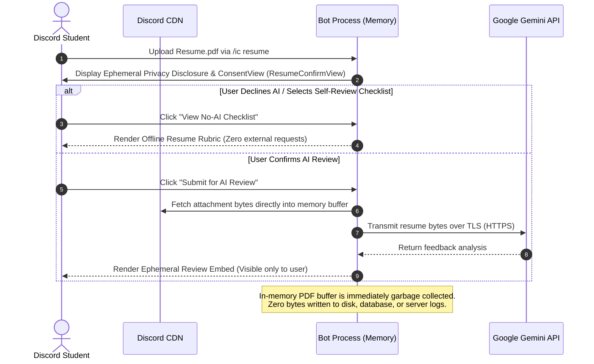
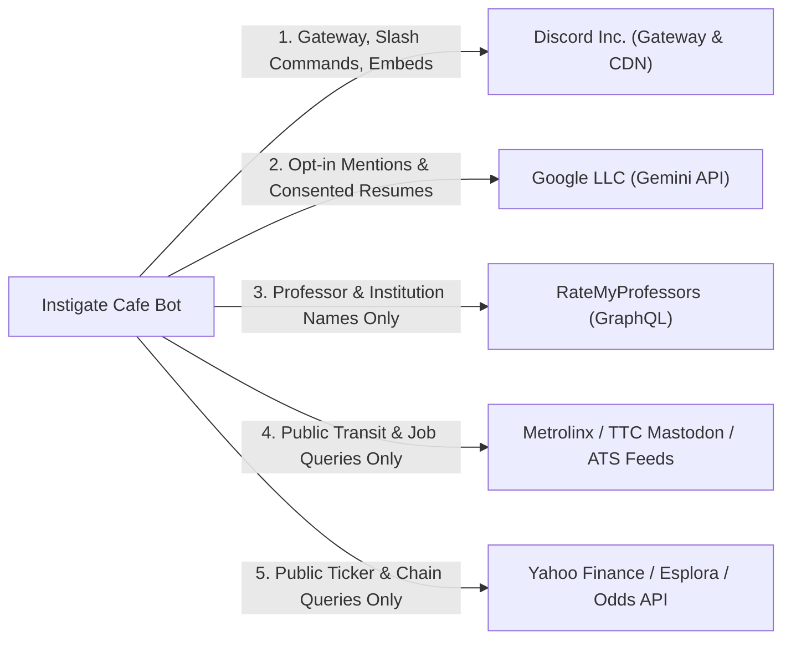
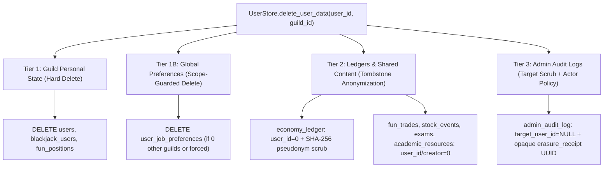

# Instigate Cafe Bot — Privacy Model, Data Map & Deletion Policy

**Release:** `v1.0.0-rc1`  
**Primary Implementation:** [`icbot/services/user_service.py`](../icbot/services/user_service.py)  
**Storage Architecture:** Local SQLite 3 (`DB_PATH`, container default `/data/campus.db`) with Write-Ahead Logging (WAL)  
**Scope Notice:** This document describes the verified technical privacy controls, data flows, retention boundaries, and erasure/anonymization procedures implemented in code. It does not constitute formal legal counsel or an automated regulatory certification.

---

## 1. Core Principles & Data Minimization

The Instigate Cafe Bot operates on **data minimization** principles:
- **No Persistent Message Storage & No Automatic Channel-History Collection by Default:** The bot does **not** record, log, or persist arbitrary channel messages or private chat history to local disk or SQLite. By default (`LLM_CHANNEL_HISTORY_ENABLED=false`), `@mention` invocations process only the mentioning message (and any directly replied-to message). Only if the server operator explicitly enables both `LLM_ENABLED=true` and `LLM_CHANNEL_HISTORY_ENABLED=true` does an `@mention` read recent surrounding channel messages (bounded by `LLM_MAX_MESSAGES`) into transient memory for the duration of that single Google Gemini API request.
- **No Real-World Identity or Payment Collection:** The bot does not request or store real names (beyond public Discord `display_name`), email addresses, student ID numbers, passwords, phone numbers, or real financial account details.
- **Local Plaintext SQLite & Host Data Sovereignty:** Self-hosted deployments store all persistent state in a local plaintext SQLite 3 database on the host's own disk volume (`DB_PATH`, container default `/data/campus.db`). Application-level encryption is not performed; encryption at rest depends on the host operator's disk/volume configuration. Upstream maintainers have zero network access to self-hosted databases.
- **Distinction Between Local Application Storage and Platform/Third-Party Retention:** Data marked as *"not stored by this application"* means the bot process never writes it to local disk, SQLite, or application logs. However, slash-command attachments and ephemeral reply payloads transit **Discord's infrastructure** under Discord's Privacy Policy, and opt-in AI requests transmit prompt or document bytes to **Google Gemini API** under the operator's Google Cloud / Google AI Studio data retention terms.

---

## 2. Authoritative SQLite Data Classification & Storage Matrix

Every table in [`icbot/db.py`](../icbot/db.py) has been audited for user-addressable identifiers:

| SQLite Table | Scope | User-Identifiable Fields | Retention Window | `UserStore.delete_user_data()` Behavior |
|---|---|---|---|---|
| `users` | Guild (`guild_id, user_id`) | `user_id`, `display_name`, `avatar_url`, `balance`, `created_at`, `daily_claim_ts` | Active guild membership | **Hard-Deleted** (`DELETE FROM users WHERE guild_id=? AND user_id=?`) |
| `blackjack_users` | Guild (`guild_id, user_id`) | `user_id`, `bankroll`, `hands_played`, `wins`, `losses`, `pushes`, `reset_count` | Active guild membership | **Hard-Deleted** (`DELETE FROM blackjack_users WHERE guild_id=? AND user_id=?`) |
| `fun_positions` | Guild (`guild_id, user_id, symbol, side`) | `user_id`, `symbol`, `side`, `qty`, `avg_price`, `collateral_locked` | Until position is closed or user deleted | **Hard-Deleted** (`DELETE FROM fun_positions WHERE guild_id=? AND user_id=?`) |
| `user_job_preferences` | **Global Cross-Guild** (`user_id`) | `user_id`, `preset`, `disciplines`, `career_levels`, `locations`, `keywords_allow`, `keywords_deny`, `remote_only` | Until cleared via `/ic job_preferences clear:True` or user purge | **Scope-Guarded Hard-Delete:** Deleted automatically if the user has no remaining profiles in other guilds (`users`), or when `delete_global_preferences=True` is passed. Preserved if the user remains active in another guild and `delete_global_preferences=False`. |
| `economy_ledger` | Guild (`guild_id, id`) | `user_id`, plus `uid` substring embedded in `transaction_id` / `reference_id` | Indefinite (immutable financial supply audit trail) | **Tombstone-Anonymized** (`anonymize_ledger=True`): Row amounts and timestamps are preserved for supply accounting; `user_id` is set to `0` (`ANONYMIZED_USER_ID`), and embedded `user_id` tokens in `transaction_id` and `reference_id` are replaced with an irreversible SHA-256 pseudonym (`anon_<hash>`). |
| `fun_trades` | Guild (`guild_id, id`) | `user_id`, `note` | Indefinite (market volume & PnL tape) | **Tombstone-Anonymized** (`anonymize_ledger=True`): `user_id` set to `0` and `note` set to `'[ANONYMIZED_USER]'` (or hard-deleted when `anonymize_ledger=False`). |
| `fun_stock_events` / `stock_events` | Guild (`guild_id, id`) | `user_id`, `reason` | Indefinite (stock price change history) | **Tombstone-Anonymized**: `user_id` set to `0` and `reason` set to `'[ANONYMIZED_USER]'`. |
| `fun_market_weeks` | Guild (`guild_id, week_key`) | `settled_by` (admin snowflake) | Indefinite (weekly settlement log) | **Tombstone-Anonymized**: `settled_by` set to `NULL` where `settled_by = user_id`. |
| `exams` | Guild (`guild_id, id`) | `created_by` (creator snowflake) | Until removed via `/ic exam remove` or `/ic exam clear` | **Tombstone-Anonymized**: `created_by` set to `0` so shared guild exam timetables stay intact without linking to the creator. |
| `academic_resources` | Guild (`guild_id, id`) | `added_by` (contributor snowflake) | Until removed via catalog admin | **Tombstone-Anonymized**: `added_by` set to `0` so shared study links stay intact without contributor attribution. |
| `admin_audit_log` | Guild (`guild_id, id`) | `target_user_id`, `admin_user_id`, `details_json` | Indefinite (security & admin audit trail) | **Split Target vs. Actor Policy:** Where the user is `target_user_id`, `target_user_id` is set to `NULL` and `details_json` is scrubbed of `user_id`. Where the user was a privileged admin (`admin_user_id`), the actor ID is retained by default (`retain_admin_actor_audit=True`) for security accountability, or zeroed if `retain_admin_actor_audit=False`. |
| `guild_settings_audit` | Guild (`guild_id, audit_id`) | `actor_id` (admin snowflake) | Indefinite (server config audit trail) | **Operator Policy Choice:** Retained by default (`retain_admin_actor_audit=True`) for server configuration accountability, or set to `0` when `retain_admin_actor_audit=False`. |
| `guild_job_subscriptions`, `job_seen`, `job_alert_outbox`, `alert_delivery_dedupes`, `workday_cxs_cache`, `grades_course_cache`, `guild_settings`, `guild_stock_catalog`, `fun_stocks`, `academic_courses`, `meta`, `schema_migrations` | Guild or Global System State | **None** (guild IDs, channel IDs, role IDs, and public course/job metadata only) | Managed by `Database.prune_stale_data()` or guild admins | Untouched by user deletion (contains zero user-level identifiers). |
| **Resume Reviews (`/ic resume`)** | **In-Memory Only** | PDF resume bytes/text, discipline, target role | **Ephemeral (0 seconds on disk)** | **Never written to disk, SQLite, or logs**; garbage-collected immediately after response. |

---

## 3. Ephemeral AI Resume Review Processing

The `/ic resume` feature provides confidential automated resume feedback powered by Google's Gemini API:



### Privacy Safeguards:
1. **Mandatory Pre-Transmission Consent (`ResumeConfirmView`):** Before reading or forwarding any resume bytes to Google Gemini, the bot presents an ephemeral consent barrier allowing the user to choose **"Submit for AI Review"**, **"View No-AI Checklist"**, or **"Cancel"** (unless the user explicitly passes `confirm:True` on `/ic resume`).
2. **Zero Disk Storage by This Application:** Uploaded PDF/image attachments are processed entirely in transient RAM buffers by the bot process. They are never written to local disk, SQLite, or container filesystem layers.
3. **Platform & Third-Party Retention Boundary:** Because users upload resume attachments through Discord slash commands and receive ephemeral embeds (or an ephemeral `.md` attachment if the review exceeds 3,900 characters), attachment bytes and responses transit Discord's CDN/API under Discord's retention policy. When AI review is confirmed, document bytes are transmitted over HTTPS to Google Gemini under the operator's Google Cloud / Gemini API terms.
4. **Ephemeral Delivery:** Analysis responses are delivered as ephemeral Discord messages visible only to the uploading student.

---

## 4. Third-Party Data Processors & Data-Flow Map



| Third Party | Purpose | Data Transmitted | Privacy Safeguards & Terms |
|---|---|---|---|
| **Discord (Discord Inc.)** | Message delivery, slash commands, UI components | User interactions, command options, ephemeral responses | [Discord Developer Terms of Service](https://discord.com/developers/docs/policies-and-agreements/developer-terms-of-service) & [Discord Privacy Policy](https://discord.com/privacy) |
| **Google Gemini API (Google LLC)** | Generative assistant replies & opt-in resume feedback | Mention prompt text, optional recent channel history (`LLM_CHANNEL_HISTORY_ENABLED=true` only), in-memory resume bytes after explicit user consent | TLS encryption; rate limits & token budgets; log redaction; [Gemini API Terms](https://ai.google.dev/terms) |
| **RateMyProfessors (Chewse Inc.)** | Professor lookup (`/ic prof`) | Professor names and institution names only | Zero user IDs or Discord metadata transmitted |
| **Metrolinx / TTC Mastodon** | Transit alert aggregation | None (public feeds only) | Zero user data transmitted |
| **Greenhouse / Lever / Workday** | Career board ingestion | None (public job listings only) | Zero user data transmitted |
| **Yahoo Finance / Esplora / Odds API** | Market quotes, BTC UTXOs, sports schedules | Public tickers, addresses, and sport keys only | Zero user PII or Discord IDs transmitted |

### 4.1 Operator Disablement & Log Redaction Controls
| Control | Environment Variable / Command | Effect |
| :--- | :--- | :--- |
| **Disable All AI Processing** | `LLM_ENABLED=false` or `/ic admin llm_stop` | Halts `@mention` Q&A and `/ic resume` AI calls immediately; zero content leaves to Google Gemini. |
| **Disable Channel Context Window** | `LLM_CHANNEL_HISTORY_ENABLED=false` *(default)* | `@mention` processes only the invoking message (and direct reply), never surrounding channel history. |
| **Restrict Command Channels** | `USER_COMMAND_CHANNEL_ID` / `LLM_ALLOWED_CHANNEL_IDS` | Scopes command and AI access to approved channels only. |
| **Disable Background Pollers** | `MARKET_WATCH_ENABLED=false`, `BTC_WATCH_ENABLED=false`, `JOBS_POLL_SECONDS=0` | Stops autonomous outbound polling and checkpoint storage. |
| **Log Redaction Invariant** | `RedactingLogFilter` ([`icbot/logging.py`](../icbot/logging.py)) | Never logs raw resume bytes, channel message bodies, credentials, host paths, or bound SQL parameters; deletion audit receipts record an opaque random UUID without re-logging the deleted `user_id`. |

### 4.2 Data Controller Boundary: Self-Hosted vs. Hosted Public Instance
- **Self-Hosted Operator (Recommended):** Controls the Discord Application, optional API keys, host filesystem (`DB_PATH`), backups, and logs. The **self-hosting operator is the sole Data Controller** for their community.
- **Maintainer-Hosted Shared Instance:** Central operator controls shared infrastructure and acts as Data Controller for invited guilds, handling cross-guild deletion requests and API billing.

---

## 5. Deterministic Data Export & Right-to-be-Forgotten Erasure / Anonymization Contract



### 5.1 Deterministic Batched Export (`UserStore.export_user_data()`)
[`UserStore.export_user_data()`](../icbot/services/user_service.py) exports all user-addressable records for `(guild_id, user_id)` in a machine-readable JSON dictionary (`format_version: 2`):
- **Covered Tables:** `profile` (`users`), `blackjack` (`blackjack_users`), `positions` (`fun_positions`), `trades` (`fun_trades`), `ledger` (`economy_ledger`), `exams_created` (`exams`), `academic_resources_added` (`academic_resources`), and `job_preferences` (`user_job_preferences`, explicitly tagged with `"scope": "global_user"`).
- **No Hidden `LIMIT 100` Truncation:** Queries execute in deterministic pages (`batch_size=250` by default) up to a configurable memory-safety ceiling (`max_rows_per_table=5000`, or `None` for unbounded).
- **Honest Truncation Reporting:** If any table exceeds `max_rows_per_table`, the export sets `"truncated": True`, populates `pagination.total_counts` vs. exported counts, and appends an explicit human-readable warning in `"warnings"`.

### 5.2 Atomic Deletion & De-Identification (`UserStore.delete_user_data()`)
[`UserStore.delete_user_data()`](../icbot/services/user_service.py) executes inside a single `BEGIN IMMEDIATE` write transaction (`db.write_transaction()`):
1. **Guild Profile & Game State Hard-Deleted:** Removes rows for `(guild_id, user_id)` from `users`, `blackjack_users`, and `fun_positions`.
2. **Cross-Guild Job Preferences Guard:** Checks whether `user_id` still has active profiles in any other guild (`SELECT COUNT(1) FROM users WHERE user_id=? AND guild_id!=?`). `user_job_preferences` is deleted only when no other guild profiles remain or when `delete_global_preferences=True` is explicitly passed.
3. **Ledger Supply & Accounting Integrity:** All `economy_ledger` rows for `(guild_id, user_id)` keep their exact `amount`, `balance_after`, `category`, and `created_at` values while `user_id` is set to `0` and any `user_id` embedded inside `transaction_id` (e.g. `claim:gid:uid:...`, `buy:gid:uid:...`) or `reference_id` is scrubbed to an irreversible hash token (`anon_<sha256_prefix>:<row_id>`). Aggregate guild token flows and referral links between bet reservations and settlements remain 100% intact.
4. **Zero Re-Exposure in Deletion Audit Receipt:** When recording the `user_data_delete` event in `admin_audit_log`, `target_user_id` is stored as `NULL` and `details_json` records only an opaque random `erasure_receipt` UUID and row count — never re-inserting the deleted `user_id`.
5. **What Remains Potentially Identifiable (Honest Disclosure):**
   - **Privileged Admin Audit Trails (`retain_admin_actor_audit=True` default):** If the deleted user was a server administrator who mutated server settings (`guild_settings_audit.actor_id`) or stock prices (`admin_audit_log.admin_user_id`), those actor IDs are retained by default so malicious admin actions cannot be repudiated. Operators can pass `retain_admin_actor_audit=False` to zero out admin actor IDs as well.
   - **Temporal/Amount Correlation:** Because `economy_ledger` and `fun_trades` retain exact timestamps (`created_at`, `ts_unix`) and amounts for accounting integrity, an observer who already knows the exact timestamp and amount of a historical trade could correlate an anonymized row (`user_id = 0`).
   - **Historical Database Backups:** Point-in-time SQLite backups created via `tools/backup_db.py` retain pre-deletion state until those backup snapshots expire or are rotated by the host operator.

### 5.3 Why No Self-Service Deletion Slash Command Is Exposed Yet
A public user-facing `/ic privacy delete` slash command is intentionally **not** registered in the command tree until multi-guild vs. single-guild scope confirmation UX, unsettled casino escrow lockout checks, and admin audit retention policies are finalized. Until then, data export and erasure are executed by the server operator via `UserStore`:

```bash
python3 -c "
import asyncio
from icbot.db import Database
from icbot.services.user_service import UserStore

async def purge_member(guild_id: int, user_id: int) -> None:
    db = Database('/data/campus.db')
    await db.init()
    try:
        store = UserStore(db, guild_id=guild_id)
        counts = await store.delete_user_data(
            user_id,
            guild_id=guild_id,
            anonymize_ledger=True,
            delete_global_preferences=False,
            retain_admin_actor_audit=True,
        )
        print('Erasure & anonymization summary:', counts)
    finally:
        await db.close()

asyncio.run(purge_member(GUILD_ID, USER_ID))
"
```


