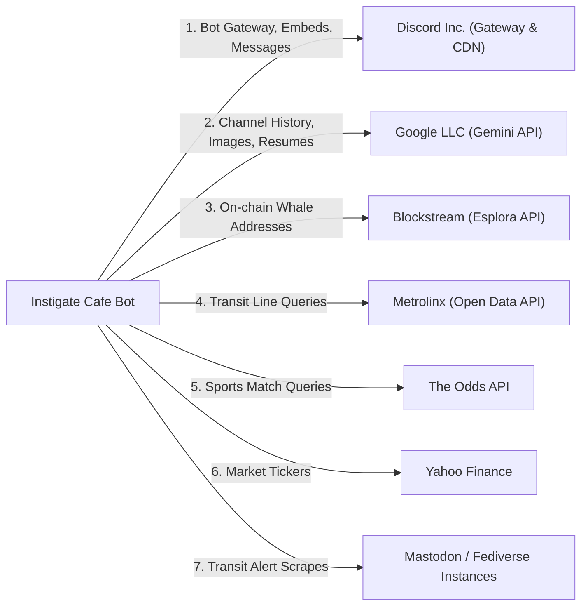

# Instigate Cafe Bot — Privacy Architecture, Data-Flow Inventory & Deletion Model

**Phase 1: Privacy, Secrets, and Publication Safety**  
**Document Status:** Technical Privacy Architecture & Data Map (Not a Legal Certification)  
**Author:** Senior Engineering Infrastructure Modernization Agent  
**Last Updated:** November 5, 2026  

---

## 1. Executive Summary & Purpose

This document provides a comprehensive, evidence-based data-flow inventory and privacy-by-default architecture for the **Instigate Cafe Bot**. It details:
1. Every class of user, community, and system data processed or stored by the bot.
2. The exact storage locations, persistence lifecycles, and external third-party recipients (e.g., Google Gemini, Discord CDN, transit APIs).
3. Configurable retention windows and guild-owner disablement controls for every subsystem.
4. Non-destructive export and deletion protocols that preserve the referential integrity of economic ledgers and audit trails through tombstone anonymization.
5. The jurisdictional and operational boundary separating **self-hosted instance operators** from **shared instance maintainers**.
6. A testable specification for future privacy commands (`/ic privacy export`, `/ic privacy delete`).

> [!IMPORTANT]
> **Legal Notice:** This document is an engineering data map and technical specification. It describes system behavior, data destinations, and technical deletion mechanisms. It does not constitute formal legal counsel or an official GDPR/CCPA compliance certification.

---

## 2. Complete Data-Flow Inventory

The bot processes seven distinct categories of data across its commands, background loops, and external integrations:

```mermaid
flowchart TD
    subgraph Discord["Discord Platform"]
        U["User Interaction / Message / Attachment"]
        CH["Channel Message History (up to 25 msgs)"]
    end

    subgraph BotCore["Instigate Cafe Bot Core"]
        US["UserStore (icbot/services/user_service.py)"]
        FM["FunMarket (icbot/services/fun_market_store.py)"]
        EX["ExamStore (icbot/features/exams.py)"]
        LLM["LLM Assistant (icbot/tasks/llm_assistant.py)"]
        RES["Resume Reviewer (icbot/features/resume.py)"]
        JOB["Job Poller (icbot/tasks/job_alerts.py)"]
    end

    subgraph Storage["Local SQLite Persistence (DB_PATH)"]
        T_USERS["users / blackjack_users"]
        T_TRADES["fun_trades / fun_positions"]
        T_EXAMS["exams"]
        T_JOBS["job_seen / workday_cxs_cache"]
    end

    subgraph External["External Third-Party APIs"]
        GEMINI["Google Gemini API (Alphabet LLC)"]
        BLOCKSTREAM["Blockstream Esplora API"]
        METROLINX["Metrolinx Open Data API"]
        MASTODON["TTC Mastodon Feed"]
        ODDS["The Odds API"]
        YFINANCE["Yahoo Finance (Scraper/API)"]
    end

    U -->|/ic profile, casino, daily| US -->|Persist PII & Balance| T_USERS
    U -->|/ic icse buy/sell| FM -->|Persist Trade Ledger| T_TRADES
    U -->|/ic exam add| EX -->|Persist Exam & Creator ID| T_EXAMS
    U -->|Bot Mention + Image| LLM
    CH -->|Recent 24 msgs| LLM
    LLM -->|HTTPS POST: Prompt + Image + History| GEMINI
    U -->|/ic resume (PDF/Image)| RES -->|HTTPS POST: Full Resume Bytes| GEMINI
    JOB -->|Scrape Postings| T_JOBS
```

---

### 2.1 Detailed Field-Level Data Matrix

| Data Flow / Field | Source | Processing Purpose | Field Classification | Storage Destination | External Forwarding | Retention Window | Deletion & Management Owner |
| :--- | :--- | :--- | :--- | :--- | :--- | :--- | :--- |
| **Discord User Snowflake ID** (`user_id`) | Discord interaction / message | Account identification, economy tracking, rate limiting | **PII (Indirect Identifier)** | SQLite: `users`, `blackjack_users`, `fun_positions`, `fun_trades`, `exams`, `stock_events` | Never forwarded externally; sent to Discord API in command responses | Indefinite (persists until user deletion request) | User (self-service request) / Bot Operator |
| **Display Name** (`display_name`) | Discord interaction / message author | User profile embeds, leaderboard display | **PII (Personal Name / Handle)** | SQLite: `users.display_name`; ephemeral RAM in `llm_assistant.py` | Forwarded to **Google Gemini API** when user appears in recent channel history | Updated on every interaction; persists until profile deletion or rename | User (via Discord profile change or deletion) |
| **Avatar URL** (`avatar_url`) | Discord interaction / message author | Profile embed thumbnail rendering | **PII (Image URL)** | SQLite: `users.avatar_url` | Rendered by Discord client | Overwritten on next user interaction; purged on profile deletion | User / Bot Operator |
| **Virtual Balances & Bankroll** | Game results, `/ic daily`, trading | Virtual community economy & casino simulation | **Financial / Economic Data (Virtual)** | SQLite: `users.balance`, `blackjack_users.bankroll` | Never forwarded externally | Indefinite | User / Bot Operator (admin reset via `/ic admin set`) |
| **Virtual Trade Ledger** (`fun_trades`) | `/ic icse buy`, `/ic icse sell` | Historical record of transactions, PnL tracking | **Transactional Audit Record** | SQLite: `fun_trades` (`user_id`, `symbol`, `qty`, `price`, `cash_delta`, `realized_pnl`) | Never forwarded externally | Indefinite (required for market accounting) | Bot Operator (anonymized on user deletion) |
| **Channel Message Context** | Discord text channel history | Providing conversational memory for `@Instigator` Q&A | **User Communication Content (Text + Embeds)** | **Ephemeral RAM only** (never saved to SQLite or local disk) | **Forwarded to Google Gemini API** (`generativelanguage.googleapis.com`) | Duration of single HTTP request (<60s) in bot memory; subject to Google API data terms | Channel Admin (can disable LLM or restrict bot access to private channels) |
| **Image Attachments (Q&A)** | Attached image in mention or reply | Multimodal Q&A (math, logic puzzles, diagram review) | **User Content (Image Bytes)** | **Ephemeral RAM only** (buffered up to 2MB in memory) | **Forwarded to Google Gemini API** as raw inline base64/bytes | Duration of single request; discarded immediately upon reply completion | User (chooses what to upload) |
| **Uploaded Resumes** | `/ic resume` file parameter | Automated ATS screening and engineering resume critique | **Sensitive PII** (Names, contact info, education, career history) | **Ephemeral RAM only** (buffered up to 5MB in memory; never saved to disk) | **Forwarded to Google Gemini API** as inline PDF/image bytes | Duration of ATS + review calls (<120s); discarded immediately after | User (chooses what to upload) |
| **Exam Schedule Entries** | `/ic exam add` (Admin/User) | Community exam timetable and countdowns | **Public Academic Schedule** | SQLite: `exams` (`course_code`, `course_name`, `start_ts`, `location`, `notes`, `created_by`) | Never forwarded externally | Kept until deleted via `/ic exam remove` or `/ic exam clear` | Server Admin / Course Lead |
| **Scraped Job Postings** | Greenhouse, Lever, Workday | Deduplicating job notifications | **Public Commercial Metadata** | SQLite: `job_seen` (`source`, `external_id`, `title`, `url`, `first_seen_unix`) | Forwarded to configured Discord announcements channel | Indefinite deduplication cache | Bot Operator |
| **Professor Ratings Cache** | RateMyProfessors API | Fast caching for `/ic prof` queries | **Public Academic Metadata** | Ephemeral RAM cache in `icbot/services/rmp_client.py` | Never forwarded; queried from RMP GraphQL | Process runtime memory cache | Bot Operator |
| **Grade Distribution Cache** | `tmu.grades.zone` | Fast caching for `/ic grades` queries | **Institutional Academic Data** | SQLite: `course_cache` in `tmu_grades.db` | Never forwarded externally | Kept until manual cache flush | Bot Operator |

---

## 3. Third-Party Disclosures & Provider Boundaries

When the bot is running with all features enabled, data leaves the host environment to the following third-party services:



### 3.1 Google LLC (Gemini API)
- **Data Forwarded:**
  - Up to 25 recent channel messages (including author display names and message bodies).
  - Attached images (PNG, JPG, WebP up to 2MB).
  - Uploaded resume documents (PDF, PNG, JPG up to 5MB).
  - Configured community lore snippets (`tools/lore.*.json`).
- **Data Protection Controls:**
  - Encrypted in transit via TLS 1.3.
  - Zero local disk caching: payload is read into a temporary memory buffer and released immediately upon response delivery.
  - Users can bypass Gemini analysis entirely by using slash commands that do not invoke LLM features.
- **Provider Terms:** Governed by the [Google AI Studio / Gemini API Terms of Service](https://ai.google.dev/terms). Operators should note that standard API tier data logging and retention policies apply at Google's boundary.

### 3.2 Discord Inc.
- **Data Forwarded:** Slash command interaction responses, public embed broadcasts, user display name/avatar fetches.
- **Provider Terms:** Governed by the [Discord Developer Terms of Service](https://discord.com/developers/docs/policies-and-agreements/developer-terms-of-service) and [Discord Privacy Policy](https://discord.com/privacy).

### 3.3 Metrolinx, Blockstream, The Odds API, Yahoo Finance
- **Data Forwarded:** System-level API queries only (transit line codes, Bitcoin public addresses, sport keys, stock ticker symbols). **Zero user PII, messages, or Discord IDs are ever transmitted to these services.**

---

## 4. Operator Disablement & Configuration Controls

Server owners and bot operators have granular environment-variable controls to disable or restrict any data collection:

| Subsystem | Environment Variable / Command | Effect When Disabled |
| :--- | :--- | :--- |
| **LLM Channel History & Vision** | `LLM_ENABLED=false`<br>or `/ic admin llm_stop` | Disables all Gemini processing. Mentions are ignored. Zero message history or images are transmitted to Google. |
| **Resume Reviewer** | `GEMINI_API_KEY=""`<br>or `/ic admin llm_stop` | `/ic resume` returns an immediate administrative pause error. No documents are uploaded or inspected. |
| **Memory Buffer Size** | `LLM_MAX_MESSAGES=5`<br>`LLM_MAX_CHARS=2000` | Restricts conversation context window to fewer messages and characters. |
| **Image Size Budget** | `LLM_MAX_IMAGE_BYTES=1000000` | Lowers maximum accepted image payload size (e.g. to 1MB). |
| **Channel Scoping** | `USER_COMMAND_CHANNEL_ID=<channel_id>` | Restricts slash command execution to designated channels, keeping public chat free of command processing. |
| **Market / BTC Watchers** | `MARKET_WATCH_ENABLED=false`<br>`BTC_WATCH_ENABLED=false` | Halts autonomous polling loops. No background outbound requests to Yahoo Finance or Blockstream. |
| **Job Scrapers** | `JOBS_POLL_SECONDS=0`<br>`GREENHOUSE_BOARDS=""` | Halts Greenhouse, Lever, and Workday scrapers. No job checkpoints recorded in `job_seen`. |

---

## 5. User Rights: Export, Anonymization & Deletion Model

To satisfy privacy-by-default standards and support user deletion requests (such as GDPR "Right to Erasure" / CCPA deletion), the bot implements a dual **Deletion & Anonymization Model**:

### 5.1 The Ledger Integrity Dilemma
Hard-deleting foreign keys from financial/market ledgers causes database corruption and breaks economic accounting:
- If a user row is removed with `CASCADE DELETE`, historical trades in `fun_trades` disappear, invalidating historical market volume, stock price tracking, and weekly market settlement audits (`fun_market_weeks`).
- If a user row is removed with `RESTRICT`, the deletion fails, violating the user's right to erasure.

### 5.2 Two-Tier Deletion & De-Identification Architecture (`UserStore.delete_user_data`)

```mermaid
flowchart TD
    Req["Operator / Admin Triggers UserStore.delete_user_data(user_id, guild_id)"] --> Tier1["Tier 1: Guild-Scoped Personal State (Hard Delete)"]
    Req --> Tier1G["Tier 1B: Cross-Guild Global Preferences (Scope-Guarded Delete)"]
    Req --> Tier2["Tier 2: Ledgers & Shared Community Content (Tombstone Anonymization)"]
    Req --> Tier3["Tier 3: Security & Admin Audit Logs (Target Scrub + Actor Policy)"]

    Tier1 --> D1["DELETE FROM users WHERE guild_id = :gid AND user_id = :uid"]
    Tier1 --> D2["DELETE FROM blackjack_users WHERE guild_id = :gid AND user_id = :uid"]
    Tier1 --> D3["DELETE FROM fun_positions WHERE guild_id = :gid AND user_id = :uid"]

    Tier1G --> DG["DELETE FROM user_job_preferences WHERE user_id = :uid (only if 0 other guild profiles remain or delete_global_preferences=True)"]

    Tier2 --> A1["UPDATE economy_ledger SET user_id = 0, transaction_id = anon_hash, reference_id = anon_hash WHERE guild_id = :gid AND user_id = :uid"]
    Tier2 --> A2["UPDATE fun_trades SET user_id = 0, note = '[ANONYMIZED_USER]' WHERE guild_id = :gid AND user_id = :uid"]
    Tier2 --> A3["UPDATE fun_stock_events / stock_events SET user_id = 0, reason = '[ANONYMIZED_USER]' WHERE guild_id = :gid AND user_id = :uid"]
    Tier2 --> A4["UPDATE exams SET created_by = 0 WHERE guild_id = :gid AND created_by = :uid"]
    Tier2 --> A5["UPDATE academic_resources SET added_by = 0 WHERE guild_id = :gid AND added_by = :uid"]
    Tier2 --> A6["UPDATE fun_market_weeks SET settled_by = NULL WHERE guild_id = :gid AND settled_by = :uid"]

    Tier3 --> S1["UPDATE admin_audit_log SET target_user_id = NULL, details_json = scrubbed WHERE guild_id = :gid AND target_user_id = :uid"]
    Tier3 --> S2["Optional (retain_admin_actor_audit=False): zero admin_user_id & guild_settings_audit.actor_id"]
    Tier3 --> S3["INSERT admin_audit_log (action='user_data_delete', target_user_id=NULL, erasure_receipt=UUID)"]
```



#### Tier 1: Hard Deletion (Personal Profile, Game State & Scope-Guarded Global Preferences)
1. `users`: Deletes `(guild_id, user_id)` row (`display_name`, `avatar_url`, `balance`, `created_at`, `daily_claim_ts`).
2. `blackjack_users`: Deletes `(guild_id, user_id)` bankroll, win/loss/push counts, and reset counters.
3. `fun_positions`: Deletes all open long/short positions for `(guild_id, user_id)`.
4. `user_job_preferences` (Cross-Guild Global Key): Because `user_job_preferences` is keyed globally by `user_id` (`PRIMARY KEY (user_id)`), deleting a user in Guild A checks whether the user still has a profile in Guild B (`SELECT COUNT(1) FROM users WHERE user_id=? AND guild_id!=?`). It deletes `user_job_preferences` automatically only when zero other guild profiles remain, or when `delete_global_preferences=True` is explicitly confirmed.

#### Tier 2: Tombstone Anonymization (Financial Ledgers & Shared Community Content)
To preserve aggregate token supply and shared academic schedules without retaining the deleted user's snowflake ID:
1. `economy_ledger`: Preserves all rows and amounts while setting `user_id = 0` (`ANONYMIZED_USER_ID`) and scrubbing the user's snowflake substring out of `transaction_id` (e.g. `claim:gid:uid:...` &rarr; `claim:gid:anon_<sha256_12>:...:<row_id>`) and `reference_id`, preserving internal reservation-to-settlement referral links.
2. `fun_trades`: Sets `user_id = 0` and `note = '[ANONYMIZED_USER]'` when `anonymize_ledger=True` (or hard-deletes rows when `anonymize_ledger=False`).
3. `fun_stock_events` and `stock_events`: Sets `user_id = 0` and `reason = '[ANONYMIZED_USER]'`.
4. `fun_market_weeks`: Sets `settled_by = NULL` where `settled_by = user_id`.
5. `exams`: Sets `created_by = 0` where `created_by = user_id` in that guild, preserving shared course exam calendars while removing creator identity.
6. `academic_resources`: Sets `added_by = 0` where `added_by = user_id` in that guild, preserving shared study guide links while removing contributor identity.

#### Tier 3: Security & Administrative Audit Logs (Honest Retention & De-Identification Policy)
1. **Target De-Identification:** Any `admin_audit_log` row where `target_user_id = user_id` has `target_user_id` set to `NULL` and `details_json` scrubbed of the user's snowflake.
2. **Deletion Receipt Without Re-Exposure:** The `user_data_delete` audit event is inserted with `admin_user_id = 0`, `target_user_id = NULL`, and an opaque random `erasure_receipt` UUID in `details_json` — never re-recording the deleted `user_id`.
3. **Privileged Admin Actor Retention (`retain_admin_actor_audit=True` default):** When a server administrator performs privileged actions (`admin_audit_log.admin_user_id` or `guild_settings_audit.actor_id`), those actor IDs are retained by default for security and abuse accountability. If an operator wishes to de-identify an outgoing administrator's actor records as well, passing `retain_admin_actor_audit=False` zeroes `admin_user_id` and `guild_settings_audit.actor_id` for that guild.
4. **Residual Identifiability Notice:** Anonymized ledger and trade rows retain timestamps and integer amounts to keep financial audit totals invariant; someone possessing external knowledge of an exact transaction timestamp and amount could correlate an anonymized row. Historical database backup files (`tools/backup_db.py`) also retain pre-deletion snapshots until rotated.

---

## 6. Self-Hosted vs. Shared Instance Responsibilities

The software is open source under the MIT License. Responsibilities for privacy, data retention, and infrastructure differ fundamentally between deployment models:

| Responsibility Domain | Self-Hosted Operator (Deploying Own Bot Token) | Maintainer-Hosted Shared Instance (Running Official Bot) |
| :--- | :--- | :--- |
| **Discord Bot Token & Application** | Operator creates and controls Discord Bot Application in developer portal. | Maintainer controls Discord Application credentials. |
| **API Keys (Gemini, Metrolinx, Odds)** | Operator provides their own API keys; direct contract with Google/Metrolinx. | Maintainer provides API keys; maintainer account billed for API consumption. |
| **Database Ownership & Storage** | Operator owns host filesystem, SQLite database (`ic_stock.db`), and backup storage. | Maintainer controls database server, host volumes, and backups. |
| **Data Controller Status** | **Operator is the sole Data Controller** for their Discord guild members. | **Maintainer is the Data Controller** for guilds inviting the shared bot instance. |
| **Deletion Request Fulfillment** | Operator must execute deletion commands or SQLite scripts on their local DB. | Maintainer is responsible for processing deletion requests across shared DB. |
| **Log Inspection & Redaction** | Operator controls console logging and container log shipping (e.g. Railway, Docker). | Maintainer enforces log redaction policies on production logging streams. |

---

## 7. Log Redaction Rules & Operator Audit Trails

To ensure logs do not inadvertently capture sensitive data or undermine deletions:
1. **Resume File Bytes:** Must **never** be logged to stdout, stderr, or logfiles. Only file size and MIME type may be logged at `DEBUG` level:
   ```python
   # Compliant logging pattern:
   log.info("Resume review requested: mime=%s, size=%d bytes", mime, len(file_bytes))
   ```
2. **Channel Message Bodies:** Messages fetched during channel history collection must **never** be logged at `INFO` or `WARN` level.
3. **Database Deletion Audit Trail:** When a deletion is processed, the audit log must record a cryptographic hash or timestamp without recording deleted usernames or message texts:
   ```python
   # Compliant audit trace:
   log.info("Privacy deletion completed: subject_hash=%s, timestamp=%d", hmac_sha256(user_id), now)
   ```

---

## 8. Programmatic Privacy APIs & Future Self-Service Command Prerequisites

Data export and deletion are currently exposed programmatically via [`UserStore.export_user_data()`](file:///home/sukesan/dev/discord/campus-bot/icbot/services/user_service.py) and [`UserStore.delete_user_data()`](file:///home/sukesan/dev/discord/campus-bot/icbot/services/user_service.py) and tested in [`tests/unit/test_privacy_model.py`](file:///home/sukesan/dev/discord/campus-bot/tests/unit/test_privacy_model.py).

A user-facing slash command (`/ic privacy export`, `/ic privacy delete`) is intentionally **not** exposed in the live Discord command tree until the following security and UX prerequisites are completed:
1. **Scope Confirmation UX:** Explicit user choice between single-guild erasure (`guild_id=interaction.guild_id`) vs. cross-guild global preference erasure (`delete_global_preferences=True`).
2. **Active Escrow / Live Hand Lockout:** Verification that the user cannot trigger self-deletion mid-hand while an unsettled Blackjack or Casino wager reservation is open in `CasinoService._active_wagers` or `SessionManager`.
3. **Re-Authentication & Cooldown Gate:** Anti-abuse confirmation modal preventing accidental click-through or rapid create/claim/delete cycling to farm starting bankrolls (`bj_starting_bankroll`).

